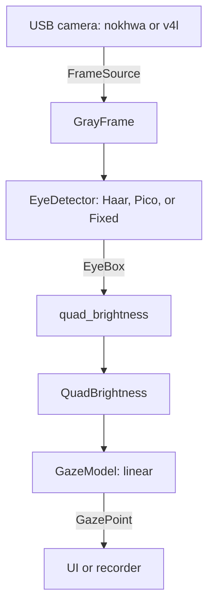

# CV crate survey for `yet-rs`

- **Status:** research only — no code written.
- **Date:** 2026-10-25.
- **Scope:** camera capture and control, frame representation, grayscale conversion, eye detection, and the feature-extraction boundary. UI/graphics, table I/O, and regression are out of scope except for short notes.
- **Method:** crates.io search API, then downloaded the `.crate` archives and read the source. Descriptions on crates.io are unreliable for this domain; every claim below about an API or a missing feature was checked against the published source or docs.

---

## 0. Bottom line

| Concern | Recommendation | Version | Why |
|---|---|---|---|
| Camera, cross-platform | **`nokhwa`**, default features **off** | 0.10.11 | Mature, cross-platform, pure-Rust bindings. Its default `decoding` feature pulls the C library `mozjpeg` — disable it. |
| Camera, Linux-only | **`v4l`** | 0.14.0 | Lean, mature, direct V4L2, full camera controls. No macOS/Windows. |
| Frame decode | **`image`** with only the `jpeg` feature | 0.25.10 | Pure Rust; JPEG via `zune-jpeg`. Keep it at the adapter/UI edge, not in the core. |
| Eye detection | **in-house Haar cascade** (`roxmltree` + own integral image) | — | No crates.io crate loads OpenCV's `haarcascade_*.xml`. See §4. |
| Eye-detection fallback | **`FixedRegionDetector`** | — | The prototype only detects in the "Detect" state; if the eye is fixed relative to the camera, a configured ROI is sufficient. |
| Alternative detector | `pico-detect` | 0.7.0 | Genuine pure-Rust PICO cascade, but needs a PICO-format model, not the existing XML. |
| Not recommended | `opencv`, `rustface`, `mediapipe`, `scirs2-vision`, `opencv-no-c-*`, `shiguredo_video_device`, `webcam` | — | C/C++ or ONNX dependency, immature, or does not actually provide the missing loader. |

**Key insight:** the CV surface of the prototype is tiny. The camera delivers a frame, a detector optionally finds one eye, four quadrant means are computed, and a 4→2 linear model decodes gaze. There is no reason to bring OpenCV, a DNN runtime, or a large CV framework into the port.

Illustrative dependency set (not created yet):

```toml
# Linux adapter
nokhwa = { version = "0.10.11", default-features = false, features = ["input-v4l"] }
# or, for all three desktop platforms: features = ["input-native"]

image = { version = "0.25.10", default-features = false, features = ["jpeg"] }
roxmltree = "0.21.2" # only if/when the Haar detector is built
```

Do **not** enable `nokhwa`'s `decoding` feature unless a C dependency is acceptable; see §2.2.

---

## 1. What the Python prototype actually needs

All CV-relevant logic is in `yet_zero/src/yet_zero/lib.py` (`class YETI`).

| Prototype step | OpenCV call | Rust plan |
|---|---|---|
| Open USB camera, read FPS/size | `cv.VideoCapture(usb)`, `CAP_PROP_FPS`, `CAP_PROP_FRAME_WIDTH/HEIGHT` | `nokhwa` (or `v4l` on Linux) |
| Read one frame | `device.read()` | `FrameSource::next_frame()` |
| Reject blank frame | `np.sum(frame) == 0` | Cheap in-house check (sampled sum / checksum) |
| Eye detection | `CascadeClassifier(haarcascade_eye.xml)` + `detectMultiScale(scaleFactor=1.1, minNeighbors=5, minSize=(50,50))` | In-house Haar cascade (§4), `pico-detect`, or fixed region |
| Crop eye | NumPy slicing | In-house |
| BGR → gray | `cv.cvtColor(..., BGR2GRAY)` | In-house luma; for YUYV, take the Y plane directly |
| Four quadrant means | `np.mean` over four slices | In-house (integral image or direct loops) |
| 4→2 linear regression | `sklearn.linear_model.LinearRegression` | `nalgebra`/`linfa` (out of scope) |
| UI-only blur / RGB / rotate | `cv.blur`, `cvtColor`, `np.rot90`, `pygame.transform` | UI crate (`imageproc`, `image`) |

The only non-trivial CV item is the Haar classifier. Everything else is arithmetic on a grayscale buffer.

One deliberate change from the prototype: `yet_zero` detects on the BGR frame and converts to gray only after cropping. Luma is a per-pixel transform, so converting once at the frame source and running both detection and feature extraction on `GrayFrame` is equivalent and cheaper. It also gives the traits a single frame type.

### 1.1 Measured model facts

From `yet_zero/src/yet_zero/haarcascade_eye.xml` (353,619 bytes):

- `opencv_storage` → `cascade` with `featureType = HAAR`, window **20×20**, `stageNum = 24`.
- **24 stages**, **1,066 weak classifiers**, all single stumps. Stage sizes range from 6 to 93 weak classifiers.
- Each stump: `internalNodes` contains four numbers `(left, right, featureIdx, threshold)`; `leafValues` contains two numbers. Stump thresholds range from -0.389 to 0.431.
- **1,066 features**, each with **two or three** rectangles in `<rects>` (899 features have 2, 167 have 3), each rectangle written as `(x y w h weight)`.
- **No tilted features** (`<tilted>` occurs zero times).
- License: Intel License Agreement (redistribution allowed with notice). Keep the header if the XML is bundled.

### 1.2 A porting hazard in the feature order

The Python code names the quadrants inconsistently with its own slicing:

```python
b_NW = eye_frame[0:h/2, 0:w/2]      # top-left     -> NW, correct
b_NE = eye_frame[h/2:h, 0:w/2]      # bottom-left  -> actually SW
b_SW = eye_frame[0:h/2, w/2:w]      # top-right    -> actually NE
b_SE = eye_frame[h/2:h, w/2:w]      # bottom-right -> SE, correct
```

For a linear model the order is arbitrary as long as it is consistent, so this is harmless *inside* the prototype. It becomes a bug when mapping old calibration CSVs into a Rust struct with named fields. Define `QuadBrightness { nw, ne, sw, se }` with correct semantics and retrain (calibration is cheap). If old CSVs must be read, document that their column order is `(nw, sw, ne, se)`.

---

## 2. Camera capture and control

### 2.1 Candidates

| Crate | Latest | Platforms | Implementation | API / controls | Maintenance | Verdict |
|---|---|---|---|---|---|---|
| **`nokhwa`** | 0.10.11 | Linux, macOS, Windows | `v4l` on Linux, AVFoundation/Media Foundation bindings; no C build step (with `decoding` off) | `Camera`, `CameraFormat`, `frame()` / `frame_raw()`, `CallbackCamera`, `KnownCameraControl` | Since 2021, 632k downloads, 817★; repo moved to `l1npengfih/nokhwa`, last push 2026-05 | **Recommended** |
| **`v4l`** | 0.14.0 | Linux | Safe V4L2 bindings (`v4l2-sys-mit`, no libv4l by default) | `Device`, `Format`, `Stream`, `Frame`; full V4L2 controls | 8.1M downloads, last push 2024-10; stable, not actively developed | **Linux-only fallback** |
| `cameras` | 0.3.2 | Linux, macOS, Windows | `v4l`, `objc2`, `windows`; `zune-jpeg` for MJPEG — pure Rust, no build script | Data-oriented free functions; explicit formats; `controls` feature | Created 2026-04, 3.1k downloads, 11★, last push 2026-05 | Watch / spike, do not bet v1 |
| `shiguredo_video_device` | 2026.3.0 | Linux, macOS, Windows | Bundled **C/Objective-C** (`video_v4l2.c`, `video_avf.m`, Media Foundation), `build.rs` + `cc` + `bindgen` | `device` / `capture` modules | Shiguredo, 10.7k downloads, active | Reject: not pure Rust |
| `linuxvideo` | 0.3.5 | Linux | V4L2 | Thin wrapper | 52k downloads, last release 2025-07 | Redundant; `v4l` is better |
| `camera_capture` | 0.5.0 | Linux, Windows | Linux + Windows backends | — | Last release 2017 | Reject: stale |
| `rscam` | 0.5.5 | Linux | V4L2 | — | Last release 2019 | Reject: stale |
| `opencv` | 0.101.1 | all | FFI to OpenCV C++ | — | Very active | Reject: violates principle 1 |
| `webcam` | 0.0.0 | — | Stub | — | 2021, 1.7k downloads | Reject: empty stub |
| `opencv-no-c` / `-videoio` | 0.1.0 | — | Pure-Rust OpenCV port | `VideoCapture` for **AVI/Y4M/image sequences only** | Published 2026-10-20 | Reject for camera: no live-device backend |

Also present but not relevant: `puppyeyes` and `tobii` are eye-tracking *hardware* crates, not general USB camera capture; `shiguredo_v4l2`, `styx-v4l2`, `bevy_v4l2` are niche V4L2 wrappers.

### 2.2 Recommendation: `nokhwa`, with default features off

`nokhwa` is the only mature cross-platform option that does not require a C/C++ toolchain when configured correctly.

**The `decoding` trap.** `nokhwa`'s default feature is `decoding`, which enables `nokhwa-core/mjpeg`, which depends on **`mozjpeg`** — a C library built with `cc`. That contradicts principle 1. Disable default features:

```toml
nokhwa = { version = "0.10.11", default-features = false, features = ["input-v4l"] }
```

Use `input-v4l`, `input-avfoundation`, or `input-msmf` per target, or `input-native` for all three. `output-threaded` (which enables `CallbackCamera`) is optional; a plain capture thread is often simpler.

**How to get frames without `decoding`:**

- `Camera::frame_raw()` returns the backend buffer unchanged (`Cow<[u8]>`), bypassing all decoders.
- `Camera::frame()` returns a `Buffer` with `.buffer()`, `.resolution()`, `.source_frame_format()`, and `.capture_timestamp()`.
- `RequestedFormat::with_formats(RequestedFormatType::Closest(...), &[FrameFormat::YUYV, FrameFormat::MJPEG, FrameFormat::GRAY])` avoids having to name a decoder type at all.
- Decode MJPEG yourself with `image`'s `jpeg` feature (which uses pure-Rust `zune-jpeg`), or avoid JPEG entirely by requesting YUYV/GRAY.

**Why YUYV is attractive here.** The tracker only needs luminance. YUYV 4:2:2 stores a Y byte for every pixel; the luma plane is every other byte. There is no color conversion and no JPEG decode. At 640×480@30 this is ~18 MB/s, comfortably within USB 2.0; at 1280×720@30 it is ~55 MB/s and may require MJPEG. Given the prototype's `minSize=(50,50)` and the nature of the features, 640×480 is likely sufficient. If the camera exposes `GRAY` (common for IR eye cameras), request that and the adapter becomes a memcpy.

**Exposure and gain are part of CV correctness.** The four quadrant means are absolute brightness values. Auto-exposure will drift during a calibration run and the linear model will see a moving target. Lock `KnownCameraControl::Exposure`, `Gain`, and `Focus` (autofocus off) before calibration, and expose a manual override in the UI. `nokhwa` supports these controls; `v4l` exposes them directly.

**Threading.** Keep capture on a dedicated OS thread. A bounded channel of capacity 1 with "replace the stale frame" semantics is the right shape at 30 fps; the tracker should always process the newest frame, not a backlog. `crossbeam-channel` is the pragmatic choice; `std::sync::mpsc` is enough if only one consumer exists. Do not make the CV core async: a camera is a blocking 30 fps source, and an async runtime adds dependencies without improving latency. `nokhwa::CallbackCamera` is available if a callback style is preferred, but a `FrameSource` implementation over `Camera` keeps the adapter boundary explicit.

**Linux-only alternative.** If v1 targets Linux only, use `v4l` directly. It is leaner than `nokhwa`, gives direct access to `Frame` bytes and all V4L2 controls, and has 8.1M downloads. It has no macOS/Windows support, which is the only reason it is not the primary recommendation.

**Watch list: `cameras` 0.3.2.** It is the cleanest design of the bunch — plain data types, explicit format negotiation, no trait objects, `zune-jpeg` for MJPEG, controls behind a feature — and it is pure Rust end to end. It was created in April 2026 and has ~3k downloads. That is not enough maturity for a foundation, but it is worth a one-day spike against the actual camera; if it works, it is a better long-term fit than `nokhwa`.

**Rejected on principle.** `shiguredo_video_device` is cross-platform and well maintained, but it is a bundled C/Objective-C library behind a Rust API. `opencv` and `nokhwa`'s `input-opencv` feature both require an OpenCV installation. Neither fits principle 1.

---

## 3. Frame representation and image processing

### 3.1 `image` 0.25.10

MIT/Apache-2.0, MSRV 1.88, 225M downloads. Provides `GrayImage`/`Luma<u8>`, `RgbImage`, `DynamicImage`, and decoding. Its JPEG path uses pure-Rust `zune-jpeg` 0.5.5. Keep the feature set minimal:

```toml
image = { version = "0.25.10", default-features = false, features = ["jpeg"] }
```

For the core tracker, however, do not use `image` types in the trait signatures. Define an owned `GrayFrame { width, height, data }` in the core and convert at the adapter boundary. That keeps the tracking logic independent of any image crate and makes tests trivial.

### 3.2 `imageproc` 0.27.0 — useful, but not in the core

MIT, MSRV 1.87, edition 2024, active (last push 2026-10-01). It provides:

- `integral_image`, `integral_squared_image`, `sum_image_pixels`, `variance`
- filters (Gaussian, box, median), drawing, geometric transforms
- `stats`: min/max, histogram, percentile, RMSE, PSNR
- `haar`: **Haar-like feature enumeration and evaluation only**

What it does **not** provide:

- No object detector, no cascade model, no XML loader, no `detectMultiScale` equivalent.
- `imageproc::stats` has **no mean** function. Quadrant means are in-house regardless.
- Its `haar` module supports five untilted feature types and is a low-level evaluator, not a classifier.

`imageproc` is also heavier than it looks: `nalgebra`, `rand`, `rand_distr`, `itertools`, and `num` are non-optional, and the default features add `rayon`, `fft`, and text rendering. For this project:

- Implement the summed-area table and quadrant means in-house (~30 lines). `summed-area-table` 2.0.0 exists, but its last release was 2017 and recent downloads are effectively zero; the table is trivial to test and keeps the core dependency-free.
- Use `imageproc` only in the UI crate if blur/resize/drawing are needed, where its weight is already paid for by the graphics stack.

### 3.3 Grayscale

`image::DynamicImage::to_luma8()` uses the standard luma weights. For YUYV input, skip it: the Y plane is already luma and is cheaper and more faithful to the sensor. For MJPEG, decode to RGB then convert, or use `zune-jpeg` directly if the extra dependency is justified.

---

## 4. Eye detection: the Haar cascade gap

### 4.1 Search evidence

Queries against the crates.io API on 2026-10-25:

| Query | Total hits | Relevant hits |
|---|---:|---|
| `haarcascade` | **0** | — |
| `haar cascade` | 8 | `oximedia-cv`, `scirs2-vision` (neither is a loader) |
| `cascade classifier` | 172 | `rustface` (C++ FFI), `pico-detect`, `opencv-no-c-objdetect` |
| `viola jones` | 1 | `scirs2-vision` (skeleton) |
| `opencv cascade` | 5 | `opencv-no-c-objdetect`, `rustface`, `warden-vision`, `scirs2-vision` |
| `eye cascade` | 31 | `pico-detect` (plus noise) |

Name variants (`haar-detector`, `viola-jones`, `cascade-xml`, `opencv-xml`, `haar-classifier`, `cascade-model`, `face-cascade`) return zero hits, apart from `scirs2-vision` for `viola-jones`.

**There is no crates.io crate that loads OpenCV's `haarcascade_*.xml`.** This is the one genuine gap in the Rust ecosystem for this port.

### 4.2 What the near-misses actually provide

| Crate | What it has | Why it is not a drop-in |
|---|---|---|
| `imageproc` 0.27.0 | Integral images, Haar-like feature evaluation | No cascade model, no stages/leaves, no scan, no XML |
| `scirs2-vision` 0.6.5 | `face_detection::viola_jones`, multiscale + NMS | Source comment: *"This is an algorithmic skeleton"*; only `AdaBoostClassifier::default_24x24()` with synthetic stages; no XML loader; heavy deps (`scirs2-core`, `scirs2-linalg`, `statrs`) |
| `oximedia-cv` 0.2.1 | `HaarCascade` with multiscale scan and grouping | Its own doc comment calls it *"a skeleton implementation"*; `stages` is private with no loader or public insertion, `HaarCascade::new()` yields an empty cascade, and the normalization divides by `std_dev` rather than OpenCV's `1/sqrt(A*Q - S^2)` (off by a factor of window area). First published 2026-03, current version 2026-08 |
| `opencv-no-c-objdetect` 0.1.0 | Public `CascadeClassifier`, `detect_multi_scale`, `group_rectangles` | Explicitly *"The XML loader is not here"*; `passes()` compares raw rect sums to thresholds and has **no variance normalization**, so it cannot run the real XML as-is. Published 2026-10-20, 15 downloads |
| `pico-detect` 0.7.0 | Real pure-Rust PICO detector, multiscale, IoU clustering, pupil localizer | Needs PICO-format binary models, not OpenCV XML; an eye model would have to be trained from data, as there is no direct conversion from a Haar cascade |
| `rustface` 0.1.7 | SeetaFace face detection | C++ FFI; last release 2021 |
| `opencv` 0.101.1 | Everything | C++ OpenCV installation required |
| `mediapipe` 0.1.0 | Face/eye landmarks | C API; heavyweight for four brightness features |

Even `opencv-no-c-core`'s `FileStorage` deliberately supports only YAML and JSON; its source comments that OpenCV's XML dialect is "a third parser" and leaves it out. The XML loader is missing even in the newest pure-Rust OpenCV port.

### 4.3 What OpenCV does, so the port can match it

The existing XML is the **old HAAR format**: 24 BOOST stages, 1,066 stumps, rectangles with weights. To reproduce `detectMultiScale` faithfully (verified against OpenCV 4.x `cascadedetect.cpp` / `.hpp`):

1. **Integral images** for both the image and its square.
2. **Per-window variance normalization.** For a window with area `A`, sum `S`, squared sum `Q`:
   `nf = A*Q - S*S`. If `nf > 0`, `varianceNormFactor = 1/sqrt(nf)`; otherwise reject the window. Also reject if `A * varianceNormFactor < 0.1` (low contrast).
3. **Feature value** = weighted rectangle sum × `varianceNormFactor`. This is essential: the XML thresholds are between -0.39 and 0.43, while raw rectangle sums are in the thousands. An evaluator that omits this step will never fire.
4. **Stump**: `feature_value < threshold ? leafValues[0] : leafValues[1]`. Sum the leaves; reject the stage if the sum is below `stageThreshold - 1e-5`. Note: OpenCV ignores the raw `left`/`right` indices for single-stump trees (they are `0` and `-1` here); do not follow them as node offsets.
5. **Scale scan**: `scale *= 1.1`, window `round(20*scale)`, stop when it exceeds the image. OpenCV uses a step of 2 at the smallest scale and 1 otherwise.
6. **Grouping**: OpenCV's `groupRectangles(minNeighbors=5, eps=0.2)`, not plain IoU NMS. Reproducing the exact grouping is optional; the Python code only needs one final box.
7. **`minSize=(50,50)`** filters scales where the window is smaller than 50×50, i.e. scale < 2.5.

### 4.4 Options

| Option | Reuses the XML | Pure Rust | Effort | Verdict |
|---|---|---|---|---|
| In-house loader + evaluator + scan | Yes, verbatim | Yes | ~400–600 LOC, ~1.5–2.5 days | **Recommended** |
| `pico-detect` | No (needs PICO model) | Yes | Low integration; an eye model must be trained | Viable alternative if retraining is acceptable |
| `opencv-no-c-objdetect` | No loader; no normalization | Yes | Low, but would need a fork/PR | Reference only |
| `scirs2-vision` | No | Yes | — | Reject: skeleton |
| `oximedia-cv` | No loader; skeleton | Yes | — | Reject as-is |
| `opencv` (verbatim XML); `rustface` / `mediapipe` (own models) | Only `opencv` | No | Low | Reject on principle 1 |

**Recommended implementation plan:**

1. Parse the XML with `roxmltree` 0.21.2 (MIT/Apache-2.0, 91M downloads, read-only tree, no C). Build owned `Cascade { stages: Vec<Stage> }` with `Stump { feature: usize, threshold: f32, left: f32, right: f32 }` and `Feature { rects: Vec<Rect> }`. Do not keep the XML document alive.
2. Build a summed-area table and a squared-sum table in-house. Use `u64`/`f64` accumulators; `u32` can overflow on larger windows.
3. Implement the evaluation above, including normalization and the low-contrast rejection.
4. Implement the scale scan and grouping. Start with "collect candidates, cluster by center/size, pick the group with the most votes"; exact OpenCV parity is not required.
5. Validate against OpenCV on recorded frames: compare boxes and the count of detections. This is where the effort is, not in the XML parser.
6. Keep the Intel license header with the XML.

### 4.5 A scope-reducing insight

In the prototype, detection is only used in the **"Detect" state**: `init_eye_detection()` is called, then `detect_eye()` sets `eye_frame_coords`, and the calibration/recording states only reuse that box. `detectMultiScale` is not run during recording.

If the camera is head-mounted or endoscope-mounted, the eye is approximately fixed relative to the camera. That makes a `FixedRegionDetector` — a box configured once, or set manually — sufficient for the actual tracking run. Haar is then only needed for initial acquisition or re-acquisition. This has two consequences:

- The first port can ship without the Haar detector at all, using a configured ROI; this removes the riskiest dependency.
- The prototype's `len(Eyes) == 1` requirement is brittle: it fails when the cascade finds both eyes or a false positive. A Rust port should choose the best detection (highest score or nearest previous box) and expose the score, rather than requiring exactly one.

**Recommendation:** implement `FixedRegionDetector` first. Add `HaarCascadeDetector` behind the same trait later, when the fixed-ROI assumption fails on real recordings. If the assumption holds, the in-house Haar work can be deferred indefinitely.

---

## 5. Proposed trait boundary

The goal is that the tracking logic has no camera, image, or graphics dependency. The camera adapter and the Haar implementation depend on the core, never the other way round.



### 5.1 Data types (core, no dependencies)

```rust
pub struct GrayFrame {
    pub width: u32,
    pub height: u32,
    pub data: Vec<u8>, // row-major, no padding
}

#[derive(Clone, Copy, Debug, PartialEq, Eq)]
pub struct EyeBox {
    pub x: u32,
    pub y: u32,
    pub width: u32,
    pub height: u32,
}

#[derive(Clone, Copy, Debug, PartialEq)]
pub struct EyeDetection {
    pub bbox: EyeBox,
    pub score: f32,
}

#[derive(Clone, Copy, Debug, PartialEq)]
pub struct QuadBrightness {
    pub nw: f32,
    pub ne: f32,
    pub sw: f32,
    pub se: f32,
}

pub struct CalibrationSample {
    pub features: QuadBrightness,
    pub target: [f32; 2],
}
```

`GrayFrame` owns its buffer in the first version. If profiling shows that the camera-to-tracker copy matters, replace `Vec<u8>` with a pooled buffer or a borrow; do not optimize this before measuring. `nokhwa` already gives an owned `Buffer`, so one copy is unavoidable unless the adapter is allowed to borrow.

### 5.2 Traits

```rust
pub trait FrameSource: Send {
    type Error: std::error::Error + Send + Sync + 'static;

    /// Blocking read of the next frame. `Ok(None)` means "no frame this time"
    /// (dropped frame, timeout), not a failure.
    fn next_frame(&mut self) -> Result<Option<GrayFrame>, Self::Error>;

    fn resolution(&self) -> (u32, u32);
    fn fps(&self) -> Option<f32> {
        None
    }
}

pub trait EyeDetector {
    type Error: std::error::Error + Send + Sync + 'static;

    /// All candidate eyes, best first or with a score.
    fn detect_all(&self, frame: &GrayFrame) -> Result<Vec<EyeDetection>, Self::Error>;

    /// Convenience: the single best candidate, if any.
    fn detect(&self, frame: &GrayFrame) -> Result<Option<EyeDetection>, Self::Error> {
        Ok(self
            .detect_all(frame)?
            .into_iter()
            .max_by(|a, b| a.score.total_cmp(&b.score)))
    }
}

pub trait GazeModel {
    type Error: std::error::Error + Send + Sync + 'static;

    fn fit(&mut self, samples: &[CalibrationSample]) -> Result<(), Self::Error>;
    fn predict(&self, features: QuadBrightness) -> Result<[f32; 2], Self::Error>;
    fn is_fitted(&self) -> bool;
}

/// Optional extension implemented by camera adapters that support it.
pub trait CameraControls {
    type Error: std::error::Error + Send + Sync + 'static;

    fn set_exposure(&mut self, mode: ExposureMode) -> Result<(), Self::Error>;
    fn set_gain(&mut self, gain: f32) -> Result<(), Self::Error>;
    fn set_autofocus(&mut self, enabled: bool) -> Result<(), Self::Error>;
}
```

Design notes:

- **`detect_all` + provided `detect`** removes the `len == 1` brittleness without forcing every detector to implement selection.
- **`EyeDetector::detect*` takes `&self`.** Detectors are stateless and can be shared or run in parallel. A detector that wants to cache the previous box (tracking) can wrap another detector and use interior mutability; that policy does not belong in the Haar evaluator.
- **`FrameSource` is blocking, and implementations must be `Send`.** Run the source on its own thread. `nokhwa::Camera` carries an `unsafe impl Send` (but is not `Sync`), so the adapter can be moved into the capture thread; verify this for whichever backend is chosen. Do not share the camera between threads.
- **`GazeModel` is the only stateful trait.** `fit` consumes calibration samples; `predict` is pure. A `LinearGazeModel` can hold the 2×4 coefficient matrix and the intercepts.
- **Errors:** use `thiserror` in library crates and a small `CoreError` enum at the boundary. Do not use `anyhow` in a library API. `None` means "no eye in this frame"; `Err` means "the camera or decoder failed". Keep those distinct.
- **UI preview:** do not route color frames through the core. The camera adapter can publish a separate, lower-rate RGB preview to the UI, or the UI can own its own capture handle. The core only ever sees `GrayFrame`.
- **Feature extraction:** `quad_brightness(&GrayFrame, EyeBox) -> QuadBrightness` can be a free function. A trait is only justified when a second feature scheme (e.g. pupil center, or a weighted grid) actually exists. Adding `FeatureExtractor` now would force `GazeModel` to be generic over features for no current benefit. This is a deliberate "trait later" decision, not an oversight.

### 5.3 Suggested crate/module split

```text
yet-core       no camera/image deps: GrayFrame, EyeBox, QuadBrightness,
               FrameSource, EyeDetector, GazeModel, quad_brightness
yet-vision     roxmltree + in-house integral image; implements EyeDetector
yet-camera     nokhwa (or v4l) adapter; implements FrameSource + CameraControls
yet-ml         LinearGazeModel; implements GazeModel
yet-present    UI (see UI_analysis.md)
```

This is the strict separation requested in principle 2, and it uses the same crate names as the existing `UI_analysis.md` (`yet-core`, `yet-camera`, `yet-ml`, `yet-present`). The core can be tested with synthetic `GrayFrame`s and a scripted `FrameSource`; no camera or XML is needed.

---

## 6. Adjacent crates (out of scope, for the next analysis)

- **Regression:** `nalgebra` 0.35.0 (97M downloads) for a 4→2 least-squares fit. Center the features like scikit-learn does, and solve with SVD or QR rather than normal equations: the four quadrant means are highly collinear, and normal equations lose precision. `linfa` 0.8.1 is only worth it if more models are planned.
- **Tables:** `csv` 1.4.0 + `serde` for calibration and recording data. `polars` 0.55.2 only if in-Rust analysis is a goal; it is heavy for a write-only recorder.
- **Timing:** use `Buffer::capture_timestamp()` from `nokhwa` instead of `time()` at processing time; it survives scheduling jitter and makes the recorded data more defensible.
- **Alternative features:** `pico-detect`'s `Localizer` (pupil centroid) could replace the four quadrant means, but that changes the YET method. Evaluate it only if the brightness features prove too exposure-sensitive.

---

## 7. Consolidated rejections

| Crate / approach | Reason |
|---|---|
| `opencv` 0.101.1, `nokhwa/input-opencv` | Requires an OpenCV C++ installation; violates principle 1 |
| `rustface` 0.1.7 | C++ SeetaFace FFI; stale |
| `mediapipe` 0.1.0 | C API; excessive for four brightness features |
| `rusty_scrfd` 2.0.1 | ONNX/OpenCV dependency |
| `rust-faces` 1.0.0 | ONNX Runtime (BlazeFace/MTCNN); not a Haar loader |
| `scirs2-vision` 0.6.5 | Viola-Jones is explicitly a skeleton; no XML loader; heavy |
| `oximedia-cv` 0.2.1 | HaarCascade is a self-described skeleton; no loader; private stages; new |
| `opencv-no-c-*` 0.1.0 | Five days old; no XML loader; no variance normalization; videoio has no live camera |
| `shiguredo_video_device` 2026.3.0 | Bundled C/Objective-C |
| `webcam` 0.0.0 | Empty stub |
| `camera_capture`, `rscam` | Stale (2017/2019) |
| `linuxvideo` | Redundant with `v4l` |
| `tobii`, `puppyeyes` | Hardware-specific eye trackers, not USB camera capture |
| `trackforge`, `visioncortex` | Tracking/semantic CV frameworks; wrong abstraction level |
| `cv` 0.6.0 / `rust-cv` 0.1.0 | Stale (2020/2023); feature-based CV, no cascade or loader |
| `summed-area-table` 2.0.0 | Last release 2017; ~20 LOC to implement and test in-house |

---

## 8. Risks and open questions

1. **`nokhwa` is pre-1.0.** The API is stable in practice but there is no 0.11 yet. Pin `0.10.11` and isolate it behind `FrameSource`.
2. **`nokhwa` repository moved** to `l1npengfih/nokhwa`; crates.io metadata still points at `l1npengtul/nokhwa`. Check issue activity before relying on long-term maintenance.
3. **`cameras` is very new.** It is the cleanest pure-Rust design but has ~3k downloads and a single maintainer. Spike it, do not make it the foundation yet.
4. **Pixel-format negotiation and row stride.** A camera may expose only MJPEG, only YUYV, or both. Test the actual device. YUYV at 720p may exceed USB 2.0 bandwidth; MJPEG costs decode CPU and adds a dependency option. V4L2 may also pad rows (`bytesperline`), and `nokhwa`'s `Buffer` exposes only width/height. Derive `stride = data.len() / height` and read luma at `row*stride + 2*x`, or use `v4l`, whose `Format::stride` exposes it directly.
5. **Auto-exposure drift.** The linear model sees absolute brightness. Lock exposure/gain/focus, or normalize the quadrants by their mean before fitting. The latter is a cheap robustness win but changes the model; decide deliberately.
6. **Haar parity.** Matching OpenCV requires variance normalization, the `-1e-5` stage epsilon, and sensible grouping. Without these the detector silently returns nothing. Validate on recorded frames, not just on the XML parse.
7. **Low-contrast rejection.** OpenCV rejects windows with `area * varianceNormFactor < 0.1`. This matters for dark or defocused frames; do not omit it.
8. **Licensing.** The XML is Intel IAC, not Apache/MIT. Keep the notice if the file is redistributed. `pico-detect` models may carry their own licenses.
9. **MSRV.** `image` 0.25.10 requires Rust 1.88; `imageproc` 0.27 requires 1.87. `nokhwa` does not declare an MSRV. Check the target toolchain.
10. **Thread safety.** `nokhwa::Camera` has an explicit `unsafe impl Send` but is not `Sync`. Keep it on the capture thread and assert `Send` at compile time in the adapter; do not rely on the unsafe impl as proof that every backend is safe to move.

---

## 9. Questions for you

1. **Target platforms for v1:** Linux only, or macOS/Windows too? Linux-only makes `v4l` the leaner choice; cross-platform points to `nokhwa`.
2. **How strict is "pure Rust"?** Is "no OpenCV/C++ toolchain, but OS APIs via FFI" acceptable (yes for `nokhwa`/`v4l`), or must there be no C at all (rules out `nokhwa`'s default `decoding`, `shiguredo`, and `mozjpeg`)?
3. **Must the existing `haarcascade_eye.xml` be reused verbatim**, or is retraining/converting to a PICO model acceptable? The answer decides between in-house Haar and `pico-detect`.
4. **Is eye detection needed continuously**, or only for initial acquisition? If the eye is fixed relative to the camera, `FixedRegionDetector` removes the largest piece of work.
5. **What camera/resolution/FPS** is the target? Does it expose YUYV/GRAY, or only MJPEG?
6. **Do you need exposure/gain control in-app?** If yes, lock them during calibration; if no, the model must tolerate drift.
7. **Is `linfa`/`nalgebra` already decided** for the regression, or should that be part of the next analysis?
8. **One crate with modules, or separate `yet-core` / `yet-vision` / `yet-camera` / `yet-ml` crates?** The trait boundary works either way; separate crates enforce the dependency direction at compile time.

### Suggested spike (about one day)

1. Open the actual camera with `nokhwa` (default features off); list its formats and pick YUYV at 640×480@30 if available. Measure the real frame rate and confirm the adapter can be moved into the capture thread.
2. Capture a handful of frames to disk and compare a fixed-ROI `quad_brightness` against the Python implementation on the same frames. This validates the feature order and the luma conversion before anything else is built.
3. Only if the fixed ROI is insufficient, start the Haar loader against the recorded frames. This ordering keeps the riskiest work optional.

---

## Appendix A — Search log

Queries run against `https://crates.io/api/v1/crates?q=...` on 2026-10-25:

`webcam capture`, `v4l2`, `haar`, `haar cascade`, `haarcascade`, `haar-cascade`, `haar_cascade`, `haar-detector`, `haar-classifier`, `cascade classifier`, `cascade-xml`, `cascade-model`, `face-cascade`, `viola jones`, `viola-jones`, `viola_jones`, `opencv cascade`, `opencv-xml`, `opencv_storage`, `detectmultiscale`, `eye cascade`, `eye tracking`, `eye tracker`, `gaze estimation`, `eye detection`, `pupil detection`, `computer vision`, `image processing`, `video capture`, `face detection`, `object detection`, `camera calibration`, `integral image`.

Notes:

- crates.io search is fuzzy. `haar` returns wavelet/transform crates; `cascade classifier` returns AI-agent noise; `eye tracking` returns proxy dashboards and Tobii hardware bindings. The relevant hits were verified by downloading the crate and reading the module.
- `haarcascade` returns **zero** results. This is the strongest single piece of evidence for the gap in §4.
- The search API indexes names and descriptions, not source code. The claim in §4 is therefore based on inspecting every plausible candidate (`imageproc`, `scirs2-vision`, `oximedia-cv`, `opencv-no-c-objdetect`, `pico-detect`, `rustface`, `rust-faces`, `opencv`), not on the search counts alone.
- The search API's `total` is the number of matching crates, not the number of relevant ones.

## Appendix B — Versions verified

| Crate | Version | Verified via |
|---|---:|---|
| `nokhwa` | 0.10.11 | crates.io API + downloaded `Cargo.toml` / `src` |
| `nokhwa-core` | 0.1.9 | downloaded source (`pixel_format.rs`, `types.rs`, `buffer.rs`) |
| `v4l` | 0.14.0 | crates.io API + `Cargo.toml` |
| `cameras` | 0.3.2 | downloaded source (`README.md`, `Cargo.toml`, `controls.rs`) |
| `shiguredo_video_device` | 2026.3.0 | downloaded source (C/Obj-C file list, `Cargo.toml`) |
| `image` | 0.25.10 | crates.io API + `Cargo.toml` |
| `imageproc` | 0.27.0 | downloaded source (`haar.rs`, `stats.rs`, `integral_image.rs`, `Cargo.toml`) |
| `scirs2-vision` | 0.6.5 | downloaded source (`viola_jones.rs`) |
| `oximedia-cv` | 0.2.1 | downloaded source (`detect/face.rs`, `detect/mod.rs`) |
| `opencv-no-c-objdetect` | 0.1.0 | downloaded source (`lib.rs`); published 2026-10-20 |
| `opencv-no-c-videoio` | 0.1.0 | downloaded source (`Cargo.toml`); AVI/Y4M only |
| `pico-detect` | 0.7.0 | downloaded source (`README.md`, `Cargo.toml`) |
| `roxmltree` | 0.21.2 | crates.io API |
| `nalgebra` / `linfa` / `csv` / `polars` | 0.35.0 / 0.8.1 / 1.4.0 / 0.55.2 | crates.io API |

No runtime benchmarks were run. Latency and CPU figures in this document are bandwidth/CPU estimates, not measurements; a spike against the actual camera is the next step.
