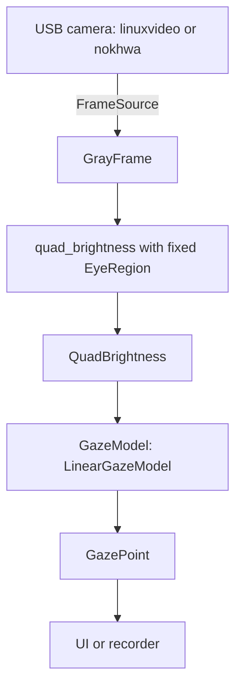

# CV crate analysis and requirements for `yet-rs`

- **Status:** analysis only — no Rust code written.
- **Date:** 2026-10-25.
- **Scope:** camera capture, frame representation, feature extraction, and the gaze-model boundary. UI/graphics, table I/O, and the stimulus presentation are out of scope except where they constrain the CV design.
- **Method:** crates.io search API, then downloaded the `.crate` archives and read the source, including build scripts. Descriptions alone are not sufficient in this domain.

---

## 0. Requirements (owner decisions)

These are the decisions that drive every recommendation below. They supersede the open questions in the previous version of this document.

### Platform and build

- **R1. All three desktop OSes are v1 targets.** Linux, macOS, and Windows must work from one codebase.
- **R2. Users build from source by default.** No third-party C/C++ libraries, system packages, or heavy build dependencies. No OpenCV. Camera access is inherently OS-level FFI, so "no FFI" is interpreted as **no C/C++ toolchain and no C library**; OS bindings (`libc`, `windows`, `objc`) and OS frameworks (V4L2, AVFoundation/CoreMedia, Media Foundation) are unavoidable and allowed. A C fallback, if ever needed, must be optional and off by default.
- **R3. Implementations must be swappable behind traits.** Camera and model implementations must not leak into the tracker. The `cameras` crate is not adopted for now.
- **R4. The camera is a simple, low-resolution USB 2.0 device.** Bandwidth is not a constraint. Support both uncompressed YUYV/GRAY and MJPEG; MJPEG decoding must remain pure Rust.
- **R5. No in-app exposure or gain control is required.**

### Tracking method

- **R6. Eye detection is removed.** No Haar cascade, no XML parser, no detector crate. The eye region is a fixed, configurable ROI.
- **R7. Drift is handled by frequent, quick recalibration**, not by global brightness normalization. The model must be cheap to refit repeatedly, and the illumination profile must be preserved.
- **R8. The blurred stimulus preview is part of the method.** It keeps the screen-induced illumination distribution without revealing the stimulus. The presentation module owns the blur; the tracker consumes the resulting eye frames.
- **R9. The feature vector is the four quadrant means (`QuadBrightness`).** No additional contrast normalization or low-contrast rejection is required.
- **R10. Use a 4→2 linear regression now**, behind an exported `GazeModel` trait so it can be replaced.

### Architecture

- **R11. One crate with modules.** Modules interoperate through traits. The trait boundaries must keep a later split into separate crates mechanical.
- **R12. Eye-tracking logic stays independent of UI/graphics.** No UI types in the tracker modules.
- **R13. Keep the MSRV in mind.** `image` 0.25.10 requires Rust 1.88, so that is the current floor. `nalgebra` 0.34 keeps the floor at 1.88; `nalgebra` 0.35 raises it to 1.89.
- **R14 (derived from the efficiency requirement).** Capture runs on a worker thread; the tracker consumes the latest frame; no unbounded frame queue.

> **FFI nuance.** There is no pure-Rust camera API: a webcam is a kernel/OS device, so every camera crate uses FFI. The achievable constraint is "no C/C++ library and no build-time C compiler". Both recommended backends meet that; see §3.1.

---

## 1. Conclusions

| Concern | Decision |
|---|---|
| Camera, Linux | **`linuxvideo` 0.3.5** — direct V4L2 ioctls via `libc`, **no `build.rs`**, no libv4l, no bindgen |
| Camera, macOS/Windows | **`nokhwa` 0.10.11** with `default-features = false`; `input-avfoundation` on macOS, `input-msmf` on Windows |
| Camera, explicitly not used | `v4l` and `nokhwa`'s `input-v4l`/`input-native` on Linux: both pull in `v4l2-sys-mit`, which runs **bindgen** and requires libclang; `cameras` inherits the same on Linux and is too new |
| Frame decode | **`image` 0.25.10** with `jpeg` + `png`; pure Rust via `zune-jpeg` |
| Eye detection | **Removed.** Fixed `EyeRegion`; no Haar, no XML, no `roxmltree`, no detector trait |
| Features | `QuadBrightness` from four direct quadrant sums; no integral image needed at this ROI size |
| Gaze model | **`nalgebra` 0.34** behind an exported `GazeModel` trait |
| Architecture | One crate, modules, `FrameSource` + `GazeModel` as the seams |
| Removed from consideration | `roxmltree`, `imageproc`, `pico-detect`, `opencv`, `rustface`, `mediapipe`, `scirs2-vision`, `oximedia-cv`, `opencv-no-c-*` |

Illustrative dependency set:

```toml
[target.'cfg(target_os = "linux")'.dependencies]
linuxvideo = "0.3.5"

[target.'cfg(target_os = "macos")'.dependencies]
nokhwa = { version = "0.10.11", default-features = false, features = ["input-avfoundation"] }

[target.'cfg(target_os = "windows")'.dependencies]
nokhwa = { version = "0.10.11", default-features = false, features = ["input-msmf"] }

[dependencies]
image = { version = "0.25.10", default-features = false, features = ["jpeg", "png"] }
nalgebra = "0.34"
thiserror = "2"
crossbeam-channel = "0.5"
```

**Key insight:** dropping eye detection removes the only non-trivial CV algorithm. The remaining pipeline is camera → fixed ROI → four means → 4→2 linear fit. No CV framework, no XML parser, no ML runtime, and no image-processing framework is needed. The hard part of this port is now the **build graph**, not the algorithms.

---

## 2. What the prototype needs now

The Python prototype's detection stage is removed (R6). Everything else is unchanged.

| Step | Python / OpenCV | Rust plan |
|---|---|---|
| Open camera, read FPS/size | `cv.VideoCapture(usb)`, `CAP_PROP_FPS`, `CAP_PROP_FRAME_WIDTH/HEIGHT` | `linuxvideo` or `nokhwa` behind `FrameSource` |
| Read one frame | `device.read()` | `FrameSource::next_frame()` |
| Reject blank frame | `np.sum(frame) == 0` | Cheap sampled check |
| Crop the eye | `frame[y:y+h, x:x+w]` from detection | Fixed `EyeRegion` from configuration |
| BGR → gray | `cv.cvtColor(..., BGR2GRAY)` | Take Y from YUYV/GRAY; decode MJPEG with `image` |
| Four quadrant means | `np.mean` over four slices | `quad_brightness(&GrayFrame, EyeRegion)` |
| 4→2 linear regression | `sklearn.linear_model.LinearRegression` | `LinearGazeModel` (`nalgebra`), behind `GazeModel` |
| Blurred stimulus preview | `cv.blur` | `image::imageops::fast_blur`, computed once and cached |
| UI rotate/scale/color | `cvtColor`, `np.rot90`, `pygame.transform` | UI module; not CV |

One deliberate change from the Python code: it detected on the BGR frame and converted to gray only after cropping. Luma is a per-pixel transform, so the port converts once at the frame source and runs the feature extraction on `GrayFrame`; this is equivalent and cheaper.

### 2.1 Quadrant order and exact split

The Python code names two quadrants inconsistently with its own slicing:

```python
b_NW = eye_frame[0:h/2, 0:w/2]      # top-left     -> NW, correct
b_NE = eye_frame[h/2:h, 0:w/2]      # bottom-left  -> actually SW
b_SW = eye_frame[0:h/2, w/2:w]      # top-right    -> actually NE
b_SE = eye_frame[h/2:h, w/2:w]      # bottom-right -> SE, correct
```

For a linear model the order is arbitrary if it is consistent, so this is harmless inside the prototype. It becomes a bug when old calibration CSVs are mapped into a Rust struct with named fields.

Define the canonical order `(nw, ne, sw, se)` and this exact split:

```text
mid_x = width / 2
mid_y = height / 2
NW = rows [0, mid_y)    cols [0, mid_x)
NE = rows [0, mid_y)    cols [mid_x, width)
SW = rows [mid_y, height) cols [0, mid_x)
SE = rows [mid_y, height) cols [mid_x, width)
```

The remainder pixel of an odd width/height goes to the east/south quadrants. If old Python CSVs must be read, document that their column order is `(nw, sw, ne, se)`.

---

## 3. Camera capture

### 3.1 The build-toolchain constraint (critical)

This is the finding that decides the camera crate.

`v4l` 0.14.0 — the most mature Linux camera crate — depends on `v4l2-sys-mit` 0.3.0, whose **`build.rs` runs `bindgen` 0.65.1**. `bindgen` needs **libclang** at build time. That is exactly the kind of toolchain burden R2 excludes: a user with only a Rust toolchain cannot run `cargo build`.

The same applies to:

- `nokhwa`'s Linux backend: `nokhwa-bindings-linux` depends on `v4l` with the `v4l2-sys` feature, so `input-v4l` and `input-native` inherit the bindgen/libclang requirement.
- `cameras` 0.3.2: its Linux backend depends on `v4l` 0.14 with default features, so it inherits the same requirement.

`linuxvideo` 0.3.5 avoids this: it has **no `build.rs`**, depends only on `libc`, and calls the V4L2 ioctls directly without `libv4l` or other C code. It is the only **maintained** general USB-camera crate in the search that satisfies R2 on Linux; `rscam` also has no build script, but it is from 2019.

**FFI is still present.** `linuxvideo` issues ioctls through `libc`; that is OS FFI, but there is no C code, no C compiler, and no system package. The same is true for `nokhwa` on macOS/Windows. A literally zero-FFI camera does not exist; if R2 is read literally, the only option is a file/pipe frame source, which is not a camera. The recommendations assume the "no C/C++ toolchain" reading.

### 3.2 Candidates

| Crate | Latest | OS | Build-time dependencies | API / notes | Maintenance | Verdict |
|---|---|---|---|---|---|---|
| **`linuxvideo`** | 0.3.5 | Linux | **Only `libc`; no `build.rs`** | `Device`, `ReadStream`, `PixFormat::bytes_per_line`, controls, UVC | 52k downloads, last release 2025-07, 0BSD | **Linux backend** |
| **`nokhwa`** | 0.10.11 | macOS, Windows (Linux via `v4l`) | macOS `build.rs` only emits framework link flags; Windows none; Linux `input-v4l` pulls bindgen | `Camera`, `RequestedFormat`, `frame_raw`, `Buffer`, `CallbackCamera` | 632k downloads, last push 2026-05, Apache-2.0 | **macOS/Windows backend**; do not enable `input-v4l`/`input-native` |
| `v4l` | 0.14.0 | Linux | **`v4l2-sys-mit` runs bindgen → libclang** | `Device`, `Stream`, `Frame`; full V4L2 controls | 8.1M downloads, last push 2024-10 | Fallback only; violates R2 |
| `cameras` | 0.3.2 | all | Linux `v4l` → bindgen | Clean data-oriented API, `zune-jpeg` | 3.1k downloads, created 2026-04 | Not now (R3); also inherits bindgen on Linux |
| `shiguredo_v4l2` | 2026.2.0 | Linux | Only `libc`; no `build.rs` | **Raspberry Pi M2M codec bindings**, not USB camera capture | 692 downloads | Reject: wrong device class |
| `shiguredo_video_device` | 2026.3.0 | all | Bundled C/Objective-C, `cc` + `bindgen` | Cross-platform API | 10.7k downloads | Reject: C toolchain |
| `rscam` | 0.5.5 | Linux | Only `libc`; no `build.rs` | V4L2 wrapper | Last release 2019 | Fallback only; stale |
| `camera_capture` | 0.5.0 | Linux/Windows | `build.rs` + `pkg-config` (system library) | — | Last release 2017 | Reject |
| `webcam` | 0.0.0 | — | — | Stub | 2021 | Reject |
| `opencv` | 0.101.1 | all | OpenCV C++ | Full OpenCV | Active | Reject: C++ toolchain |

### 3.3 Recommendation: one trait, two platform backends

Use a single `FrameSource` trait and implement it twice:

- **Linux:** `linuxvideo` 0.3.5.
- **macOS and Windows:** `nokhwa` 0.10.11, default features off, per-OS input feature.

This is exactly the kind of swap R3 asks for, and it keeps the build graph free of libclang and C/C++.

**Linux adapter (`linuxvideo`):**

1. `Device::open("/dev/video0")`.
2. Enumerate `device.formats(BufType::VIDEO_CAPTURE)` and prefer `YUYV` (or a grayscale fourcc such as `GREY` if the device exposes it); fall back to `JPEG` first, then `MJPG`.
3. Negotiate with `device.video_capture(PixFormat::new(width, height, format))`.
4. Read `capture.format().bytes_per_line()` for the row stride.
5. `capture.into_stream()?` and `stream.dequeue(|buf| { ... })`; copy into `GrayFrame`.
6. On error, map to the crate error type; `dequeue` errors are recoverable per frame.

**macOS/Windows adapter (`nokhwa`):**

1. On macOS, call `nokhwa_initialize` once to request camera permission.
2. `Camera::new(CameraIndex::Index(0), RequestedFormat::with_formats(RequestedFormatType::Closest(...), &[FrameFormat::YUYV, FrameFormat::GRAY, FrameFormat::MJPEG]))`.
3. `open_stream()`.
4. `frame_raw()` (or `frame()` for the `Buffer` with timestamp) and convert to `GrayFrame`.
5. Keep `Camera` on the capture thread. It has an `unsafe impl Send` but is not `Sync`.

**Shared conversion:** one function takes `(buffer, format, width, height, stride)` and returns `GrayFrame`:

- `YUYV`: luma is byte `row*stride + 2*x` (4:2:2 packs Y0 U Y1 V).
- `GRAY`: byte `row*stride + x`.
- `MJPEG`: `image::load_from_memory_with_format(buf, ImageFormat::Jpeg)` to RGB, then explicit Rec. 601 luma (see the correction in §4.1); pure Rust through `zune-jpeg`. Do **not** call `.to_luma8()`: it uses Rec. 709.

At 640×480@30, YUYV is ~18 MB/s, comfortably within USB 2.0. At 1280×720@30 it is ~55 MB/s and may require MJPEG. The target camera is low-resolution, so YUYV is the preferred path; MJPEG stays available (R4).

**No exposure/gain control (R5).** The device's auto-exposure may run. That is acceptable because drift is handled by recalibration (R7), not by locking the camera or normalizing brightness. Do not add a controls API.

**Threading (R14).** A dedicated capture thread owns the camera and sends `GrayFrame` over a bounded channel of capacity 1. If the channel is full, replace the stale frame rather than queueing. `crossbeam-channel` makes this clean; `std::sync::mpsc` is sufficient if an extra dependency is unwanted. Do not make the tracker async: a 30 fps camera is a blocking source, and an async runtime adds dependencies without improving latency.

**Permissions:** macOS TCC (handled by `nokhwa_initialize`), Windows camera privacy settings, Linux `video` group membership. Document these in the README; they are the most common first-run failures.

**SPK-3 build note (2026-10-25):** on macOS, `nokhwa` pulls `objc_exception`, which compiles an Objective-C file via `cc`. A real Mac needs Xcode Command Line Tools; cross-compiling from Linux fails at that build script. The Windows path uses pre-generated bindings and has no C build step. Test both on hardware; do not infer macOS from a Windows check.

### 3.4 Fallbacks if `linuxvideo` fails on the real camera

- `v4l` 0.14.0 is more widely used and has full controls, but requires libclang at build time. Treat it as a **documented fallback**, not the default: add it only if a `linuxvideo` limitation is a blocker, and warn users that libclang is required.
- `rscam` 0.5.5 has no build script and only `libc`, but it is from 2019. Not a first choice.
- Do **not** switch to `cameras` as a workaround: it is new and inherits `v4l`/bindgen on Linux.
- `shiguredo_v4l2` is Raspberry Pi M2M codec bindings, not a USB camera capture crate.
- `camera_capture` requires `pkg-config`/system libraries and is from 2017.

---

## 4. Frame representation and image processing

### 4.1 `image` 0.25.10

MIT/Apache-2.0, MSRV 1.88, 225M downloads. It provides the buffer types and pure-Rust JPEG/PNG decoding; JPEG uses `zune-jpeg`.

```toml
image = { version = "0.25.10", default-features = false, features = ["jpeg", "png"] }
```

`image` covers MJPEG frames and JPEG stimuli; `png` covers the stimulus files. Add formats only when the stimulus set needs them.

**SPK-3 correction (2026-10-25):** `image::DynamicImage::to_luma8()` uses **Rec. 709** coefficients. On the SPK-3 fixture it produced `(54, 182, 18)` for red/green/blue, while OpenCV `BGR2GRAY` and PIL `convert("L")` use **Rec. 601** and produce `(76, 150, 29)`. Convert RGB/MJPEG explicitly with `Y = round((299·R + 587·G + 114·B) / 1000)`. For YUYV/GRAY, use the camera's Y byte directly. Add a fixture parity test before building the camera adapter.

### 4.2 The blurred stimulus preview

R8 makes the blur functional, not cosmetic: it preserves the illumination distribution while hiding the stimulus. Use `image::imageops::fast_blur` (or `blur`) on the loaded stimulus, **once per stimulus**, and cache the result. Do not blur every frame as the Python code does; the Python version re-blurs every loop, which is wasted work.

The blur belongs to the presentation module. The tracker never sees the stimulus image; it only sees the camera frames. This keeps R8 and R12 separate.

### 4.3 No `imageproc`

`imageproc` 0.27.0 is not needed:

- Its `haar` module is irrelevant now that detection is removed (R6).
- Its `stats` module has no mean function; quadrant means are in-house regardless.
- Its non-optional `nalgebra`, `rand`, `rand_distr`, `itertools`, and `num` dependencies are heavy for a crate that would only contribute a blur.
- `image::imageops::fast_blur` covers the one blur this project needs.

### 4.4 `GrayFrame` and quadrant means

Define `GrayFrame { width, height, data: Vec<u8> }` in the tracker module; do not use `image` types in the traits. The adapters convert from `linuxvideo`/`nokhwa` and from MJPEG at the boundary.

At the target ROI size, four direct loops are enough; an integral image adds complexity for no measurable gain. Compute sums in `u32`/`u64` and divide by the exact pixel counts. Keep the means absolute (R7/R9): do **not** normalize them by the ROI mean or by a reference frame.

---

## 5. Eye detection: removed

The owner has removed the detection feature (R6). Consequently:

- No Haar cascade, no `haarcascade_eye.xml`, no `roxmltree`, no XML parser.
- No `EyeDetector` trait, no `pico-detect`, no `opencv`, no `rustface`, no `mediapipe`.
- No low-contrast rejection or feature normalization stage (R9).
- No `EyeDetection`/score type; the eye box is a configuration value, not a detection result.

The eye region is a fixed `EyeRegion` configured after the camera format is known (pixels), or supplied as normalized fractions and converted to pixels. If the ROI acquisition becomes a usability problem, a one-time setup screen can let the user draw it; that is a UI concern, not a CV dependency.

For the record: the earlier crates.io search found **no crate that loads OpenCV's `haarcascade_*.xml`**. `imageproc::haar` only evaluates features, `scirs2-vision` and `oximedia-cv` call their Viola-Jones code skeletons, and `opencv-no-c-objdetect` has no XML loader and no variance normalization. That finding is now moot, but it is worth keeping in the record if detection ever returns.

---

## 6. Traits and module layout

### 6.1 Flow



### 6.2 Data types

```rust
pub struct GrayFrame {
    pub width: u32,
    pub height: u32,
    pub data: Vec<u8>, // row-major, no padding
}

#[derive(Clone, Copy, Debug, PartialEq, Eq)]
pub struct EyeRegion {
    pub x: u32,
    pub y: u32,
    pub width: u32,
    pub height: u32,
}

#[derive(Clone, Copy, Debug, PartialEq)]
pub struct QuadBrightness {
    pub nw: f32,
    pub ne: f32,
    pub sw: f32,
    pub se: f32,
}

#[derive(Clone, Copy, Debug, PartialEq)]
pub struct GazePoint {
    pub x: f32,
    pub y: f32,
}

pub struct CalibrationSample {
    pub features: QuadBrightness,
    pub target: GazePoint,
}
```

`EyeRegion` is in pixels. If the camera format can change between runs, keep the configuration in normalized fractions and convert once the format is negotiated; the model must be refit whenever the ROI changes.

### 6.3 Traits

```rust
pub trait FrameSource: Send {
    fn next_frame(&mut self) -> Result<Option<GrayFrame>, Error>;
    fn resolution(&self) -> (u32, u32);
    fn fps(&self) -> Option<f32> {
        None
    }
}

pub trait GazeModel {
    /// Replace the model with a fit to `samples`. Cheap enough to call
    /// frequently for quick recalibration (R7).
    fn fit(&mut self, samples: &[CalibrationSample]) -> Result<(), Error>;

    fn predict(&self, features: QuadBrightness) -> Result<GazePoint, Error>;

    fn is_fitted(&self) -> bool;

    /// Clear the calibration for a new session.
    fn reset(&mut self);
}
```

Design notes:

- **Only two traits.** `FrameSource` isolates the camera backends; `GazeModel` isolates the regression. `quad_brightness(&GrayFrame, EyeRegion) -> QuadBrightness` is a free function; a `FeatureExtractor` trait would force `GazeModel` to be generic over features for no current benefit. Add that trait only when a second feature scheme exists.
- **`fit` is repeatable and cheap (R7).** The app keeps a small calibration buffer and calls `fit` after each quick calibration. `LinearGazeModel` stores the coefficients and replaces them on every fit; no incremental update is needed for a 4→2 problem.
- **Do not normalize the features.** The model may center `X` and `y` internally for numerical stability during the least-squares solve; that is a solver detail and does not remove the illumination profile. Do not divide each sample by its mean or by a reference frame (R7/R9).
- **`FrameSource` is blocking and `Send`.** Run it on the capture thread. `nokhwa::Camera` has an `unsafe impl Send` but is not `Sync`; keep it on one thread. Verify the same for `linuxvideo` in the spike.
- **One crate-level `Error`** (`thiserror`) with camera/model variants makes `Box<dyn FrameSource>` possible without associated-type gymnastics. If the crate is later split, give each crate its own error type.
- **`None` vs `Err`:** `Ok(None)` means "no frame this time" (timeout, dropped frame); `Err` means the camera or decoder failed. Keep them distinct.

### 6.4 Single-crate module layout (R11)

```text
src/
  lib.rs          re-exports the public traits and types
  error.rs        Error
  traits.rs       FrameSource, GazeModel
  frame.rs        GrayFrame, EyeRegion
  features.rs     QuadBrightness, quad_brightness
  model.rs        LinearGazeModel (nalgebra)
  camera/
    mod.rs        CaptureConfig, open() -> Box<dyn FrameSource>
    linux.rs      linuxvideo adapter   #[cfg(target_os = "linux")]
    nokhwa.rs     nokhwa adapter       #[cfg(any(target_os = "macos", target_os = "windows"))]
```

`camera::open(&CaptureConfig)` selects the backend at compile time. The tracker modules import only `traits`, `frame`, `features`, and `model`; they never import `linuxvideo`, `nokhwa`, `image`, or any UI type.

This is the tracker-side layout; the presentation side keeps its own split in `UI_analysis.md`. The owner chose one crate with modules for the CV/tracker side (R11); the `FrameSource`/`GazeModel` seams keep a later split into `yet-core`/`yet-camera`/`yet-ml` mechanical without touching the presenter.

---

## 7. Adjacent crates

- **Regression (R10):** `nalgebra` 0.34 (MSRV 1.87) behind `GazeModel`. Use SVD or QR rather than normal equations: the four quadrant means are highly collinear. Center the features like scikit-learn does. `nalgebra` 0.35 works too but raises the MSRV to 1.89.
- **Capture thread:** `crossbeam-channel` 0.5 for a bounded(1) latest-frame channel; `std::sync::mpsc` is enough if a leaner tree is preferred.
- **Errors:** `thiserror` 2 for the crate-level `Error`.
- **Tables:** `csv` + `serde` are out of scope here; they belong to the recording/data layer.
- **Stimulus loading and blur:** `image` (already a dependency) — `image::imageops::fast_blur`, cached once per stimulus.

---

## 8. Rejected alternatives

| Crate / approach | Reason |
|---|---|
| `opencv`, `nokhwa/input-opencv` | Requires an OpenCV C++ installation; violates R2 |
| `v4l` as the primary Linux backend | `v4l2-sys-mit` runs bindgen and needs libclang at build time (R2) |
| `nokhwa` `input-v4l` / `input-native` | Inherits the same bindgen/libclang requirement on Linux |
| `cameras` | New (2026-04, ~3k downloads); Linux backend uses `v4l` and inherits bindgen; R3 says avoid for now |
| `shiguredo_video_device` | Bundled C/Objective-C, `cc` + `bindgen` (R2) |
| `shiguredo_v4l2` | Raspberry Pi M2M codec bindings, not USB camera capture |
| `camera_capture` | `pkg-config`/system library; last release 2017 |
| `rscam` | No build burden, but last release 2019; fallback only |
| `webcam` 0.0.0 | Empty stub |
| `imageproc` | Not needed: no mean function, irrelevant `haar`, heavy non-optional deps |
| `roxmltree` | Not needed: XML/Haar removed (R6) |
| `pico-detect` | Not needed: detection removed (R6) |
| `rustface`, `mediapipe`, `rusty_scrfd`, `rust-faces` | Detection stacks; not needed (R6) |
| `scirs2-vision`, `oximedia-cv`, `opencv-no-c-*` | Detection implementations; now moot (R6) |
| `cv` / `rust-cv` | Stale, feature-based CV; no relevance |
| `summed-area-table` | Last release 2017; four direct loops are simpler |
| `tobii`, `puppyeyes` | Hardware-specific eye trackers, not USB camera capture |

---

## 9. Risks and open questions

1. **`nokhwa` is pre-1.0.** Pin `0.10.11` and keep it behind `FrameSource`. Its repository moved to `l1npengfih/nokhwa`; crates.io still points at the old URL. Check issue activity before relying on long-term maintenance.
2. **`linuxvideo` is a smaller crate than `v4l`.** 0.3.5, 52k downloads, last release 2025-07. The API is clean and the build is lean, but spike it on the actual camera before committing. If it fails, `v4l` is the mature fallback, at the cost of libclang.
3. **"No FFI" is not literally achievable for a camera.** Both backends use OS FFI; the requirement is satisfied as "no C/C++ toolchain". If the owner meant literally zero FFI, the project needs a different input path (e.g. a frame file/pipe), not a camera crate.
4. **Cross-platform permissions.** macOS TCC, Windows camera privacy, Linux `video` group. These are the most common first-run failures; document them.
5. **Pixel format and stride.** The camera may expose only MJPEG, only YUYV, or both. Low resolution means USB 2.0 bandwidth is fine; keep both paths (R4). V4L2 may pad rows; use `PixFormat::bytes_per_line()` on Linux and derive `stride = data.len() / height` on `nokhwa` if necessary. `MJPG` frames may omit the JPEG Huffman tables (`DHT`); prefer `JPEG` if the device offers it, and verify that `zune-jpeg` decodes the device's `MJPG` output.
6. **Calibration cost.** Frequent quick calibration requires `fit` to be fast. A 4→2 SVD is trivial, but measure the full calibrate-and-refit loop on the target machine. Do not add a normalization stage to compensate for drift; that contradicts R7.
7. **Blur timing.** The blurred preview must be ready before calibration starts and must not be re-computed per frame. Cache it per stimulus. The presentation timing is covered by the UI analysis.
8. **MSRV.** `image` 0.25.10 sets the floor at Rust 1.88. `nalgebra` 0.34 keeps it at 1.88; 0.35 raises it to 1.89. `nokhwa` declares no MSRV; its `image 0.25` dependency also implies 1.88.
9. **Thread safety.** `nokhwa::Camera` is `Send` but not `Sync`; `linuxvideo` needs the same check. Keep the camera on one thread and assert `Send` at compile time in the adapter.
10. **Licensing.** All recommended crates are permissive: `linuxvideo` 0BSD, `nokhwa` Apache-2.0, `image` MIT/Apache-2.0, `nalgebra` Apache-2.0, `thiserror`/`crossbeam` MIT/Apache-2.0. No Intel XML notice is needed because the cascade file is gone.
11. **Open: how is the fixed ROI set?** Configuration file, a one-time setup screen, or full-frame? This is the only significant design question left by R6. A normalized ROI in the config is the most portable default; a setup screen is the most usable.
12. **Luma coefficients.** `image::to_luma8()` is Rec. 709; OpenCV/PIL use Rec. 601. Use explicit Rec. 601 for RGB/MJPEG and a fixture test. See §4.1.
13. **Camera format changes features.** YUYV and MJPG produced different quadrant means on the same scene; record format, resolution and ROI with calibration and refit on change. See `docs/spikes/SPK-3.md`.

---

## 10. Suggested spike (about one day)

1. **Linux build check:** add `linuxvideo` and `cargo build`. Confirm there is no bindgen/libclang in the tree (`cargo tree -e build`); `libc` has its own small build script, which is fine. List the camera formats, negotiate YUYV at 640×480, and capture a few frames.
2. **macOS/Windows build check:** add `nokhwa` with the per-OS features and `cargo check`. Confirm no bindgen and that the macOS permission call works. Do not enable `input-v4l` or `input-native`.
3. **Feature parity:** extract `QuadBrightness` from recorded frames and compare with the Python implementation on the same frames, including the NE/SW order. This validates the luma conversion and the ROI split before any model work.
4. **Model loop:** implement `LinearGazeModel` with `nalgebra`, fit on a small sample set, and measure repeated fit/predict. Confirm that frequent recalibration is cheap enough (R7).
5. **Only if `linuxvideo` fails:** evaluate `v4l` with the libclang cost, or `rscam` as a stale fallback. Do not switch to `cameras` yet.

**SPK-3 result (2026-10-25):** `linuxvideo` capture works on a Logitech StreamCam. YUYV measured 17.7–24.1 fps with 6–21 corrupt warm-up frames; MJPG measured 28.9 fps with 1 corrupt frame. The Rec. 709/Rec. 601 luma mismatch was found and fixed with an explicit Rec. 601 conversion. See `docs/spikes/SPK-3.md`.

---

## Appendix A — Search log

Queries run against `https://crates.io/api/v1/crates?q=...` on 2026-10-25:

**Camera:** `webcam capture`, `video capture`, `camera capture`, `v4l2`, `v4l`, `linux camera`, `macos camera`, `windows camera`, `camera`.

**Image processing:** `image processing`, `jpeg decoder`, `integral image`, `computer vision`.

**Detection (now removed, recorded for completeness):** `haar`, `haar cascade`, `haarcascade`, `haar-cascade`, `haar_cascade`, `haar-detector`, `haar-classifier`, `cascade classifier`, `cascade-xml`, `cascade-model`, `face-cascade`, `viola jones`, `viola-jones`, `viola_jones`, `opencv cascade`, `opencv-xml`, `opencv_storage`, `detectmultiscale`, `eye cascade`, `eye tracking`, `eye tracker`, `pupil detection`, `face detection`.

**Regression:** `nalgebra`, `linfa`.

Notes:

- `haarcascade` returns **zero** results. `imageproc::haar` only evaluates features; `scirs2-vision`/`oximedia-cv` call their detectors skeletons; `opencv-no-c-objdetect` has no XML loader. This is recorded only because detection was investigated before R6 removed it.
- The camera finding that matters is not download count but **build scripts**: `v4l2-sys-mit` runs bindgen; `linuxvideo` does not.
- crates.io search indexes names and descriptions, not source or build scripts. The camera claims were verified by downloading the crates and reading `Cargo.toml`, `build.rs`, and the API source.

## Appendix B — Versions verified

| Crate | Version | Verified via |
|---|---:|---|
| `linuxvideo` | 0.3.5 | downloaded source (`Cargo.toml`: no `build`, only `libc`; `src/lib.rs`, `src/stream.rs`, `src/format.rs`) |
| `nokhwa` | 0.10.11 | downloaded source (`Cargo.toml`, `src/camera.rs`, `src/threaded.rs`) |
| `nokhwa-bindings-macos` | 0.2.4 | downloaded source (`build.rs` only links CoreMedia/AVFoundation/CoreVideo) |
| `nokhwa-bindings-windows` | 0.4.6 | downloaded source (no `build.rs`; pre-generated `windows` bindings) |
| `v4l` | 0.14.0 | downloaded `Cargo.toml` |
| `v4l2-sys-mit` | 0.3.0 | downloaded `build.rs`: `bindgen::Builder::default().header("wrapper.h")` |
| `cameras` | 0.3.2 | downloaded `Cargo.toml` (Linux `v4l` 0.14) |
| `shiguredo_v4l2` | 2026.2.0 | downloaded source (`README.md`: Raspberry Pi M2M; only `libc`) |
| `shiguredo_video_device` | 2026.3.0 | downloaded source (C/Obj-C files; `cc`/`bindgen` build deps) |
| `rscam` | 0.5.5 | downloaded `Cargo.toml` (only `libc`, no build script) |
| `camera_capture` | 0.5.0 | downloaded `Cargo.toml` (`build.rs`, `pkg-config`) |
| `webcam` | 0.0.0 | crates.io API — stub, rejected |
| `image` | 0.25.10 | crates.io API + `Cargo.toml` (MSRV 1.88; `zune-jpeg`) |
| `nalgebra` | 0.34.0 / 0.35.0 | crates.io API (MSRV 1.87 / 1.89) |
| `imageproc` | 0.27.0 | downloaded source (`haar.rs`, `stats.rs`) — not used |
| `roxmltree` | 0.21.2 | crates.io API — not used |
| `pico-detect` | 0.7.0 | downloaded source — not used |
| `scirs2-vision` | 0.6.5 | downloaded source (`viola_jones.rs`) — not used |
| `oximedia-cv` | 0.2.1 | downloaded source (`detect/face.rs`) — not used |
| `opencv-no-c-objdetect` | 0.1.0 | downloaded source (`lib.rs`) — not used |
| `opencv` | 0.101.1 | crates.io API — rejected |
| `rustface` | 0.1.7 | crates.io API — rejected |
| `mediapipe` | 0.1.0 | crates.io API — rejected |
| `webcam` | 0.0.0 | crates.io API — rejected |

No runtime benchmarks were run. The bandwidth and refit-cost figures are estimates; the spike in §10 is the next step.
