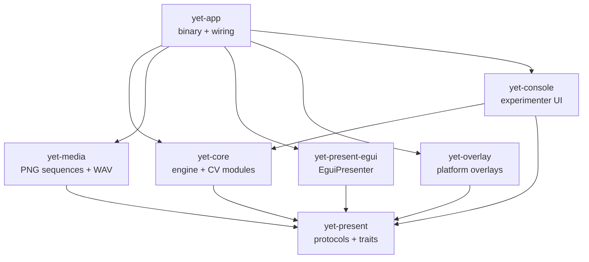
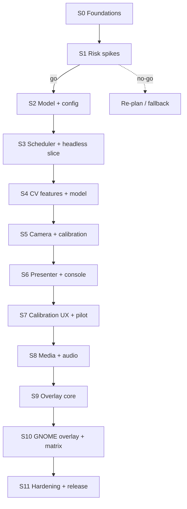

# Development Plan — yet-rs

**Status:** Draft for review · 2026-10-25
**Basis:** `UI_analysis.md`, `CV_analysis.md`, and the prior attempt in `Yex/`.
**Style:** milestone-driven, sprint-based, test-first.

---

## 0. Assumptions

This plan is written for **one developer** working about **five focused days per week**, in **one-week sprints**. The first three sprints calibrate velocity; re-plan at every milestone.

If the assumptions change:

- **Two developers:** split the UI/presenter track (S6–S7) from the media/overlay track (S8–S10) and run them in parallel. Their write scopes are disjoint.
- **Two-week sprints:** pair consecutive sprints; keep the same milestone gates.
- **Less than three days per week:** expect 18–24 calendar weeks. Do not compress the overlay or the pilot.

The plan deliberately keeps a **calendar buffer of two sprints** (no additional sprint IDs) for hardware access, platform surprises and usability findings.

---

## 1. What v1 is

### 1.1 The v1 demo

A researcher can, on Windows, macOS and Linux:

1. edit `config.toml` (monitors, camera, audio) and a `Stimuli.csv`;
2. start the console, see validation errors before the session;
3. run a calibration on the experiment monitor;
4. run a block of static-image trials and a block of PNG-sequence trials with audio;
5. see a gaze overlay over the desktop, click-through, on the experiment monitor;
6. finish the session and get a CSV that the existing R pipeline can read.

### 1.2 Success criteria

- All three desktop OSes build from source without a C/C++ compiler in our code, OpenCV or a media framework; ALSA development metadata on Linux and Xcode Command Line Tools for the macOS camera backend are documented prerequisites.
- `yet-core` and `yet-present` contain **no UI types**.
- The experiment engine is testable headlessly, with no sleeps and no window.
- A full session can be run without a terminal or a mouse.
- Frame timing, calibration error, audio drift and dropped frames are logged.
- The overlay meets R11 on Windows, macOS and at least one layer-shell Wayland compositor; GNOME is covered by the XWayland fallback or an explicit, documented fallback decision.
- `yet-rs/LICENSE` is GPL-3.0-only and dependency licenses are audited.

### 1.3 Non-goals for v1

- Eye detection / Haar cascade (CV R6).
- Native X11 as a supported target.
- Runtime H.264 decoding.
- Real-time AOIs or browser-window tracking.
- Out-of-process presenter.
- Browser/WASM version.
- XLSX support.
- Photodiode or hard-real-time guarantees.
- Porting Yex's `Participant`, `Consent` and `Demographics` flow unless the lab requires it.

---

## 2. Locked decisions

These come from the two analyses. If one changes, **update the analysis first**, then this plan. Do not fork the rationale.

| ID | Decision | Source |
|---|---|---|
| **D1** | `egui` + `eframe` (pinned 0.37 line) for console and in-process presenter. | UI §0.1, §9 |
| **D2** | Overlay is a separate `OverlayBackend`: `EguiOverlay` (Windows/macOS), `LayerShellOverlay` (KDE/wlroots/Sway), `XwaylandOverlay` (GNOME, in-process thread). Native X11 is deprecated. | UI R11, §7.5 |
| **D3** | Video is pre-decoded to PNG sequences at setup; no runtime decoder in v1. | UI R5, §6.6 |
| **D4** | Audio is extracted to WAV and played with `rodio` + `cpal`; audio clock is master when audio is present. | UI R12, §6.7 |
| **D5** | Project license: **GPL-3.0-only**. | UI R8 |
| **D6** | `config.toml` for machine settings; CSV for experiments/stimuli; no XLSX. | UI R9 |
| **D7** | Desktop-only v1; keep `yet-core` UI-free for a later browser version. | UI R7 |
| **D8** | Draw-command facade (`Scene`/`DrawCommand`), no full Pygame surface API. | UI R10 |
| **D9** | Camera: `linuxvideo` on Linux; `nokhwa` on macOS/Windows; no C/C++ toolchain. | CV R2, §1 |
| **D10** | No eye detection; fixed configurable `EyeRegion`. | CV R6 |
| **D11** | Features are four quadrant means; model is 4→2 linear regression via `nalgebra`, behind `GazeModel`. | CV R9, R10 |
| **D12** | CV/tracker lives in one crate with modules for v1; split later along existing traits. | CV R11 |
| **D13** | MSRV floor 1.88 (`image` 0.25.10); verify `eframe`/`wgpu` and raise only if required. | CV R13 |
| **D14** | The engine is a pure transition function plus effects — no blocking `run()` and no sleeps. | This plan, §3.2 |
| **D15** | Camera capture uses `CameraSource`; media sequences use `FrameSource`, resolving the name collision between CV §6.3 and UI §9.2. | This plan, §3.3 |

---

## 3. Architecture

### 3.1 Crate graph

Arrows point to dependencies. `yet-present` is the leaf: protocols and traits, no UI and no I/O.



Target layout:

| Crate | Contents | UI dependencies |
|---|---|---|
| `yet-present` | `Presenter`, `OverlayBackend`, `FrameSource`, `AudioPlayer`; `Scene`, `DrawCommand`, `PresenterCommand`, `FrameStamp`, geometry, IDs | None |
| `yet-core` | `experiment/` state machine, `tracking/` (frame, features, model, calibration), `camera/` (`CameraSource` + adapters), config, data records | None |
| `yet-media` | PNG sequence loader, prefetch, WAV audio player | None |
| `yet-present-egui` | `EguiPresenter`: viewport, textures, text, shapes | `egui` / `eframe` |
| `yet-overlay` | `EguiOverlay`, `LayerShellOverlay`, `XwaylandOverlay` | `egui` / `eframe`, `smithay-client-toolkit`, `calloop`, `x11rb` |
| `yet-console` | experimenter console only | `egui` / `eframe` |
| `yet-app` | config loading, wiring, CLI, lifecycle | all |

The CV modules stay inside `yet-core` for v1 (CV R11). `yet-camera` and `yet-ml` are later mechanical splits; do not create them before the seams have tests.

**Platform build prerequisites found in Sprint 1:** Linux audio needs ALSA development metadata (`alsa.pc`), now installed and verified; the macOS `nokhwa` camera path needs Xcode Command Line Tools for `objc_exception`. Neither is a C/C++ dependency of our own code, but both must be documented.

### 3.2 The key design rule: pure transition + effects

Yex's `run()` methods sleep and block. That makes timing untestable and couples the engine to a thread. Replace them with a pure step function:

```rust
// yet-core: no UI, no I/O, no sleeping.
pub fn step(
    state: &mut EngineState,
    event: EngineEvent,
    now: SessionTime,
) -> Vec<Effect>;

pub enum EngineEvent {
    Start,
    Pause,
    Resume,
    Abort,
    Tick,
    Key(Key),
    CalibrationSample(CalibrationSample),
    MediaReady(MediaId),
    Error(EngineError),
}

pub enum Effect {
    LoadMedia { id: MediaId, spec: MediaSpec },
    Presenter(PresenterCommand),
    Present(Scene),
    AppendFrame(FrameRecord),
    AppendTrial(TrialRecord),
    Overlay(OverlayCommand),
    NotifyConsole(ConsoleEvent),
}
```

Rules:

- `SessionTime(Duration)` is monotonic time since session start, not `Instant`. It is serializable and can be advanced by a test clock. Record UTC once at session start for joining external data.
- The app owns the loop and translates `Effect`s into presenter, recorder, overlay and console calls.
- The engine never waits. Every timed transition has an **absolute deadline**; `Tick` advances it.
- Effects own their payloads (`String`, `Arc<str>`, `MediaId`), so they can cross channels. The in-process presenter may borrow internally; the protocol contract does not. This makes the protocol `Scene` owning; UI §9.2's borrowed sketch is an in-process optimization, not the channel contract.
- No `RgbaImage` in `EngineState` or events. Media lives in a store; state and events carry `MediaId`.

This single rule is what makes R4, headless testing and a later out-of-process presenter cheap.

### 3.3 Protocol rules

- No `egui`, `winit`, `image`, `linuxvideo` or `nokhwa` types in `yet-present` or `yet-core` public APIs.
- **Resolve the `FrameSource` name collision in Sprint 0.** UI §9.2 uses `FrameSource` for a media sequence (`preload`, `frame_at`); CV §6.3 uses the same name for camera capture (`next_frame`, `resolution`, `fps`). Keep `FrameSource` for media in `yet-present` and rename the camera trait to `CameraSource` in `yet-core`; the CV trait shape is otherwise unchanged.
- All IDs, times and geometry are our own newtypes: `MediaId`, `FontId`, `PointPx`, `RectPx`, `SessionTime`.
- Channels are bounded. Camera uses a latest-frame mailbox of capacity 1; no growing queue.
- A closed console is a normal shutdown, not a panic. No `.unwrap()` on `send`.
- `Ok(None)` means “no frame this time”; `Err` means the source failed. Keep them distinct, as CV §6.3 requires.

---

## 4. What to harvest from Yex

Yex is a **reference**, not a dependency. It has useful ontology and protocol shapes, a working quadrant-brightness sketch, no tests, and known compilation issues (for example, `yex_1.rs` calls a `Yet::new()` that does not exist). Do not add it as a dependency. Take concepts; rewrite the runtime.

### 4.1 Reuse map

| Yex artifact | Where | Harvest | Change |
|---|---|---|---|
| `Session → Block → Trial` ontology | `Yex/src/yex/exp.rs` L14–L36, L104–L174, L242–L256 | Names, hierarchy, `State` enums, Prelude/Relax/Advance | No blocking `run()`; state carries IDs, not media payloads |
| Stimulus / response ontology | `exp.rs` L399–L422, L454–L518 | `Stimulus::{Blank, Text, Image}`, `Response` variants | Add `Sequence`; remove `todo!()`; keep only responses v1 needs |
| Timestamped event log | `Yex/src/yex/mod.rs` L84–L132 | One event enum plus timestamp wrapper | Use `SessionTime(Duration)` + UTC session start; make it serializable; do not store `Instant` in CSV |
| Demo driver | `mod.rs` L54–L74 | Ordering of session events | Replace `sleep()` loop with `step(state, event, now) → Vec<Effect>` |
| Channel wiring | `mod.rs` L23–L32; `Yex/src/bin/yex_proto.rs` L19–L44 | Multi-consumer event stream | Bounded channels; handle `Result`; no panics |
| Calibration state | `Yex/src/yex/yet.rs` L19–L50 | `Calibration { state, points, radius, … }`, active target | 3×3 configurable grid; scene-based rendering; quick recalibration; no UI colors in core |
| Quadrant features | `Yex/examples/quad_bright.rs` L19–L41 | Camera enumeration and ROI slicing | Fix NE/SW labels; use `GrayFrame`; Python is the oracle |
| UI sketches | `Yex/examples/yex_1.rs` L37–L42, L94–L123, L131–L176; `simple_ui.rs` | Console and calibration layout ideas | `eframe`, not `nannou`; no `Arc<Mutex<Session>>` bus |
| Earlier porting plan | `Yex/Porting Yet Zero Eye Tracking to Rust.md` L2607–L2806 | Historical phase list and checklist | Superseded: Haar cascade, `nannou`, `polars`, `input-native` |
| Dependency audit | same file L3129–L3226 | Lessons on `polars`/`imageproc` weight | Superseded by CV/UI analyses |

### 4.2 Yex as a test oracle — with a caveat

`quad_bright.rs` is useful for camera enumeration and slicing, **not** as numerical ground truth:

- `mean_brightness` averages `(R + G + B) / 3`; Python's `BGR2GRAY` computes luma. These are different features.
- `quadbright_2` names are rotated relative to its views. Its `ne` is top-left, its `nw` is bottom-left.
- Its `nokhwa` configuration enables `input-native`, which pulls V4L2 bindgen on Linux.

Therefore:

1. Generate parity fixtures from the **Python implementation** on the same frames, using its exact luma conversion and crop.
2. Define the canonical Rust order `(nw, ne, sw, se)` and the exact split from CV §2.1.
3. Use Yex only to compare camera setup and ROI geometry.

### 4.3 Do not port

- `polars`/`ndarray`/`linregress`/`imageproc` as the default stack. Use `csv` + `serde` for data, `nalgebra` for the model, direct loops for features.
- `nannou` / `nannou_egui`.
- Blocking `sleep()`-based `Block::run()` / `Trial::run()`.
- `Arc<Mutex<Session>>` as the runtime bus.
- `.send(...).unwrap()` and `todo!()` in runtime paths.
- Cloned `RgbaImage` inside state or events.
- Broken or duplicated `Observation → DataFrame` code.
- `Participant` / `Consent` / `Demographics` in v1.
- `nokhwa` `input-native` / `input-v4l` on Linux.

**License note:** `Yex/LICENSE` is GPL-3.0 (compatible with GPL-3.0-only); `yet-rs/LICENSE` is still MIT. Fix `yet-rs` in Sprint 0 before copying any prior art. Keep the Apache-2.0 notice for logic ported from `yet_zero`.

---

## 5. Agile mechanics

### 5.1 Cadence

- One-week sprints, about five ideal days of capacity.
- Story sizes: **S** ≤ 0.5 day, **M** ≤ 1.5 days, **L** ≤ 3 days. Split anything larger.
- WIP limit: two stories. Finish before starting.
- Every sprint ends with a **demo** and a **five-minute retrospective**. No demo, no done.

### 5.2 Backlog and story IDs

Stories use `PREFIX-N` IDs (`FND`, `SPK`, `ENG`, `CV`, `UI`, `UX`, `MED`, `OVL`, `REL`). The backlog is this document; keep it current rather than copying it into another tool.

Story template:

```text
ID:
As a <user>, I want <capability> so that <reason>.
Acceptance: <observable checks>
Test approach: <unit | integration | headless | hardware-in-the-loop | manual>
Depends on:
Size:
```

### 5.3 Definition of Ready

- The story names a real user and a reason.
- Acceptance criteria are observable, not “works”.
- The trait seam and crate are identified.
- The test approach is named.
- Size is at most 3 ideal days.
- Any prior art or Yex reference is linked.

### 5.4 Definition of Done

- [ ] A failing test was written first (or a manual test script for HIL-only work), then made to pass.
- [ ] Unit/integration tests cover the behavior; engine tests use a test clock, not sleeps.
- [ ] `cargo fmt --check`
- [ ] `cargo check --all-targets --all-features`
- [ ] `cargo test --all-features`
- [ ] `cargo clippy --all-targets --all-features -- -D warnings`
- [ ] `cargo doc --no-deps --all-features`
- [ ] No `unwrap`/`expect` on fallible runtime paths; errors are typed and actionable.
- [ ] No UI types in `yet-core` or `yet-present`.
- [ ] README/CHANGELOG/ROADMAP updated when behavior or usage changes.
- [ ] For HIL stories: test machine, OS/compositor and results recorded.
- [ ] For ported logic or prior art: license notice added.

### 5.5 Spike protocol

Spikes are timeboxed, disposable, and **not merged into the workspace**:

1. One day per spike; two days for a cross-platform matrix. If it needs more, stop and re-plan.
2. Code lives under `spikes/` and is not a workspace member.
3. Output is `docs/spikes/SPK-N.md`: question, method, measurements, decision, follow-up.
4. Keep only fixtures, scripts and findings. Delete or archive the rest.
5. No production refactors during a spike.

### 5.6 Change control

- A locked decision changes only by updating the relevant analysis first.
- A failed spike may change a decision; record the evidence in the spike report and this plan.
- At each milestone, re-estimate the remaining backlog. Do not preserve stale dates.

---

## 6. Roadmap



### Milestones

| Milestone | End of | Exit criterion |
|---|---|---|
| **M0 Foundations green** | S0 | Workspace builds on three OSes; license fixed; protocols and engine skeleton tested |
| **M1 Risks retired** | S1 | Spike reports and go/no-go for eframe, overlay, camera, audio |
| **M2 Headless experiment** | S3 | A 2-block experiment runs without a window and writes a compatible CSV |
| **M3 Eye tracking parity** | S5 | Quad features match Python; calibration works on the real camera |
| **M4 End-to-end experiment** | S7 | Console + fullscreen presenter + calibration + pilot session |
| **M5 Media complete** | S8 | PNG sequence + WAV in sync; drift and underruns logged |
| **M6 Overlay parity** | S10 | Windows/macOS/layer-shell Wayland/GNOME-XWayland matrix passes or is documented |
| **M7 v0.1.0** | S11 | Release checklist, pilot data and docs complete |

---

## 7. Sprint plan

### Sprint 0 — Foundations

**Goal:** a green workspace that encodes the architecture and the license decision.

| ID | Story | Size | Done when |
|---|---|---|---|
| FND-1 | Create the workspace, GPL-3.0-only license, MSRV 1.88, CI matrix (Linux/macOS/Windows) | M | `cargo test --workspace` green on all three; `Cargo.toml` license correct; no `bindgen`/libclang in `cargo tree -e build`; system prerequisites documented |
| FND-2 | Define protocol types and traits in `yet-present`; add `RecordingPresenter` | M | No `egui`/`image` types; coordinate and `SessionTime` unit tests; `RecordingPresenter` records scenes |
| FND-3 | Implement the pure engine skeleton (`EngineState`, `EngineEvent`, `Effect`, `step`, `TestClock`) | M | Start/pause/resume/abort/tick tests; no sleeps; no UI dependency |

**Prior work:** Yex's hierarchy (`exp.rs`) and event log (`mod.rs` L84–L132); rewrite the runtime.
**Status (2026-10-25):** implemented. Local `fmt`, `check`, `test`, `clippy`, `doc` and MSRV 1.88 checks pass; the three-OS CI workflow is defined and awaits its first run.
**Demo:** workspace builds, tests pass, license and CI evidence.
**Gate:** do not start overlay work until the license is GPL-3.0-only.

### Sprint 1 — Risk spikes

**Goal:** retire the four risks that can invalidate the architecture.

| ID | Story | Size | Done when |
|---|---|---|---|
| SPK-1 | eframe presentation spike: fullscreen on monitor 2, image/text/circle, frame log, 100% and 150% scaling | M | `docs/spikes/SPK-1.md` with frame p50/p95/p99, placement measurements, Go/No-Go |
| SPK-2 | Overlay matrix (two-day timebox): Windows, macOS, KDE or Sway layer-shell, GNOME via in-process XWayland thread | M | Report on transparency, always-on-top, click-through, focus, multi-monitor; Go/No-Go for R11 |
| SPK-3 | Camera spike: `linuxvideo` and `nokhwa` build, formats, 640×480 capture, `GrayFrame` conversion | M | No bindgen/libclang; format list; captured frames; parity plan against Python |
| SPK-4 | Media spike: FFmpeg PNG/WAV extraction, `rodio` playback, `get_pos()` clock, drift measurement | M | Script + report; measured A/V drift; failure modes documented |

**Status (2026-10-25):** four reports written to `docs/spikes/`. SPK-1 was measured on X11; SPK-2 ran the X11 proxy and compile-checked Windows/macOS/layer-shell; SPK-3 captured real frames and matched the Python Rec. 601 fixture; SPK-4 prepared exact media, validated the rodio API on Windows/macOS, and ran Linux playback after `libasound2-dev` was installed. Target-platform overlay/camera runtime checks remain.

**Findings:** eframe 0.37 uses `App::ui`, not `App::update`; monitor targeting settles after a few frames; `image::to_luma8()` is Rec. 709 and must not be used for OpenCV parity; YUYV capture was unstable on the test camera (MJPG was stable); rodio 0.23 has no `hound` feature; Linux `alsa-sys` requires ALSA development metadata; `get_pos()` measured ~128 ms behind wall clock; the X11 overlay proxy showed focus stealing and whole-desktop geometry.

**Prior work:** `Yex/examples/quad_bright.rs` for camera enumeration only; UI §14 and CV §10 for spike checklists.
**Demo:** four spike reports with measurements and explicit recommendations.
**Gate:** if SPK-2 fails on GNOME, decide between a GNOME Shell extension and a documented limitation **before** S9. If SPK-3 fails, decide on the `v4l` fallback and update CV analysis. If SPK-1 shows jank, keep the traits and choose the fallback presenter backend.

### Sprint 2 — Experiment model and configuration

**Goal:** the domain model and the inputs are real, not mocked.

| ID | Story | Size | Done when |
|---|---|---|---|
| ENG-1 | `Experiment`/`Block`/`Trial`/`Stimulus` model with serde and validation (runtime `Session` belongs to S3) | M | Invalid monitor, missing file, empty block and bad duration produce typed, actionable errors |
| ENG-2 | Load `config.toml` and `Stimuli.csv`; resolve media IDs and paths | M | Golden tests for valid and invalid files; no panics; paths relative to the experiment file |
| ENG-3 | Generate the trial order, including shuffle and seed, with a reproducible test | M | Same seed produces the same order; order is logged |

**Prior work:** Yex `exp.rs` L14–L174, L454–L518; drop `Participant`/`Consent` for v1.
**Status (2026-10-25):** implemented. `yet-core` loads `config.toml`, optional `Experiment.csv` and `Stimuli.csv`, validates typed errors, resolves media paths, and builds a deterministic per-block plan. `yet-app plan <dir>` prints it. 55 tests pass. The `block` column is optional and defaults to `default`; block `i` uses `seed + i` for an independent deterministic stream.
**Demo:** `cargo run -p yet-app -- plan examples/demo`.
**Gate:** met; the CSV schema is stable enough for the Sprint 3 data sink.

### Sprint 3 — Scheduler, data sink and headless slice

**Goal:** M2 — a complete experiment without a window.

| ID | Story | Size | Done when |
|---|---|---|---|
| ENG-4 | Absolute-deadline scheduler with pause/resume/abort and late-tick handling | M | Test-clock tests cover on-time, late, paused and aborted transitions; no accumulated `dt` drift |
| ENG-5 | `RecordingPresenter` scene assertions and golden scenes | M | Calibration grid, stimulus placement and text are asserted from recorded commands |
| ENG-6 | CSV data sink with trial and frame records, flush per trial | M | yet_zero-compatible column names; new columns appended; timestamps monotonic; interrupted session keeps completed rows |
| ENG-7 | `yet-app --headless` CLI | S | Runs a 2-block, 6-trial experiment from config to CSV |

**Prior work:** Yex `mod.rs` L84–L132 for the event shape; replace `YexRecord(Instant, …)` with `SessionTime`.
**Demo:** run headless, show the CSV and a scene log, then `cargo test`.
**Gate:** no sleeps, no UI dependencies, no unwrap on runtime paths; all state transitions covered.

### Sprint 4 — CV features and model

**Goal:** eye tracking is correct before it is live.

| ID | Story | Size | Done when |
|---|---|---|---|
| CV-1 | `GrayFrame`, `EyeRegion`, `QuadBrightness`, `quad_brightness` with odd-dimension handling | M | Property tests for sums; canonical `(nw, ne, sw, se)`; documented remainder rule |
| CV-2 | `LinearGazeModel` with `nalgebra` SVD/QR and centering | M | Synthetic linear data recovered within tolerance; repeated fit is cheap; `reset` tested |
| CV-3 | Calibration buffer, grid geometry and error metric | M | 3×3 grid generated in physical pixels; fit after calibration; RMSE computed |
| CV-4 | Python parity fixtures from recorded frames, including the odd-sized Rec. 601 fixture | M | Same frames through Python and Rust; per-quadrant differences within an agreed tolerance; canonical `(nw, ne, sw, se)` and explicit Rec. 601 documented |

**Prior work:** Yex `yet.rs` L19–L50 for calibration state; `quad_bright.rs` only as a slicing reference. Do **not** use its RGB-average numbers as ground truth.
**Demo:** print gaze at 30 Hz and calibration RMSE from a recorded sequence.
**Gate:** parity and refit budget; if parity fails, fix the feature definition before building the camera adapter.

### Sprint 5 — Camera and calibration on real hardware

**Goal:** M3 — live gaze from the actual camera.

| ID | Story | Size | Done when |
|---|---|---|---|
| CV-5 | Camera adapters: `linuxvideo` (Linux) and `nokhwa` (macOS/Windows); format negotiation, stride, YUYV/GRAY/MJPEG to `GrayFrame` with explicit Rec. 601; capture thread with latest-frame mailbox; corrupt-frame counter and format fallback | L | Real camera on Linux and at least one of macOS/Windows; no bindgen; camera stays on one thread; `Send` asserted; permissions documented; mock source for tests |
| CV-6 | Calibration flow and quick recalibration | M | Grid → samples → fit → validate; quick recalibration refits without restarting the session |
| CV-7 | Hardware-in-the-loop smoke test on the lab machine | S | Test record: OS, camera, format, fps, calibration RMSE, notes |

**Prior work:** `Yex/examples/quad_bright.rs` L45–L60 for camera setup; replace `input-native` and RGB averaging.
**Demo:** live gaze printout at 30 Hz with a visible calibration error; re-run quick calibration.
**Gate:** both platform adapters build; no UI dependencies in the camera modules.

### Sprint 6 — Presenter and console shell

**Goal:** the first end-to-end visual experiment, still with static images.

| ID | Story | Size | Done when |
|---|---|---|---|
| UI-1 | `EguiPresenter`: viewport, monitor targeting, physical-pixel conversion, image decode/scale/center, text, circle, line, cached blur | L | Placement golden tests at 100% and 150%; texture reuse for sequences; bundled deterministic font |
| UI-2 | `yet-console` shell: start/pause/resume/abort, monitor selection, status, logs, validation errors | M | Console never renders the stimulus; commands reach the engine; errors name the field and fix |
| UI-3 | Deferred viewport and channel wiring | S | Console repaint does not force a stimulus repaint; shutdown is clean |
| UI-4 | Frame statistics and low-latency surface configuration | S | `FrameStamp` log, dropped-frame counter, present mode and refresh rate at startup |

**Prior work:** `Yex/examples/yex_1.rs` L37–L42, L94–L123, L131–L176 and `simple_ui.rs` for layout ideas only; use eframe, not nannou.
**Demo:** static-image experiment on monitor 2, console on monitor 1, frame log shown.
**Gate:** correct placement on HiDPI; p99 within budget; console interaction does not stall presentation.

### Sprint 7 — Calibration UX and pilot

**Goal:** M4 — an experimenter can run a session without a terminal.

| ID | Story | Size | Done when |
|---|---|---|---|
| UX-1 | Calibration scene: grid, active target, progress, keyboard flow | M | Target order and active color are visible; abort is always available |
| UX-2 | Live camera and gaze preview in the console | M | Toggle on/off; capped frame rate; no effect on stimulus timing |
| UX-3 | Quick recalibration and drift feedback | M | Recalibration is reachable in-session; failure is explained; no dead end |
| UX-4 | Pilot usability test with 2–3 users | S | Notes, timings and top three usability problems recorded; fixes scheduled |

**Prior work:** Yex `yet.rs` calibration target state and `yex_1.rs` drawing; Python calibration grid behavior.
**Demo:** a pilot participant completes calibration and a short experiment.
**Gate:** time-to-first-trial, actionable errors, no mouse-only paths.

### Sprint 8 — Media and audio

**Goal:** M5 — PNG sequences and WAV in sync.

| ID | Story | Size | Done when |
|---|---|---|---|
| MED-1 | FFmpeg preparation script and manifest validation | S | One command prepares frames + WAV; bad/missing output fails with a clear message; docs updated |
| MED-2 | Sequence `FrameSource`: preload, prefetch, pacing, late-frame drop, last-frame behavior | L | Generated sequence test; no UI-thread disk blocking; drop counts logged |
| MED-3 | Audio player: `hound` WAV decode into `rodio::buffer::SamplesBuffer`; load, play, pause, resume, stop, volume, `get_pos()`, device validation | M | Audio clock exposed; device failure before session; underruns logged; no Symphonia/MPL dependency |
| MED-4 | A/V integration and failure policy | S | Audio master when present; monotonic master otherwise; drift log; compensate the measured output-latency offset; mid-trial failure aborts the trial |

**Prior work:** UI §6.6–§6.7; Yex has no media pipeline to reuse.
**Demo:** a 3 s clip with a beep at 1 s; show drift and underrun logs.
**Gate:** drift p95 within the agreed budget; no UI blocking; deterministic last frame.

### Sprint 9 — Overlay core

**Goal:** the overlay works on Windows, macOS and a layer-shell Wayland compositor.

| ID | Story | Size | Done when |
|---|---|---|---|
| OVL-1 | `EguiOverlay` for Windows/macOS: transparent, topmost, click-through, no taskbar, no focus steal | M | Manual matrix passes; clicks reach the app below; monitor targeting works |
| OVL-2 | `LayerShellOverlay`: `calloop` + `smithay-client-toolkit`, one surface per output, empty input region | L | KDE or Sway: topmost, click-through, correct monitor; no focus steal |
| OVL-3 | `OverlayBackend` selection and `config.toml` `overlay = "auto"` | S | Clear error when a backend is unavailable; manual override works |
| OVL-4 | Overlay manual test matrix for Windows/macOS/KDE/Sway | M | Results recorded with OS/compositor versions; limitations documented |

**Prior work:** UI §7.1–§7.5; `wanderlay`, `ianny` and `procmod/overlay` as references, subject to GPL obligations.
**Demo:** gaze dot over the desktop, click-through, no focus steal, on three platforms/compositors.
**Gate:** R11 partially met; GNOME still open; no regression in presenter timing.
**Note:** S9–S10 are the highest-variance sprints. If the platform matrix cannot fit, use the calendar buffer rather than dropping the click-through or z-order checks.

### Sprint 10 — GNOME overlay and parity

**Goal:** M6 — close the last platform gap or document it precisely.

| ID | Story | Size | Done when |
|---|---|---|---|
| OVL-5 | `XwaylandOverlay`: in-process thread, `x11rb`, override-redirect, input shape, monitor geometry | L | GNOME: transparent, topmost, click-through, correct monitor; no console blocking |
| OVL-6 | GNOME matrix, z-order and multi-monitor tests; fallback decision | M | Pass criteria or a written decision (extension vs documented limitation) with evidence |
| OVL-7 | Overlay troubleshooting docs and known limitations | S | README section covers GNOME, KDE, wlroots, permissions and click-through |

**Prior work:** UI §7.5; `wanderlay --x11` as the reference. Do not claim native GNOME Wayland layer-shell support.
**Demo:** GNOME overlay session plus the full platform matrix.
**Gate:** R11 met or explicitly documented; no silent fallback.

### Sprint 11 — Hardening and release

**Goal:** M7 — v0.1.0 that a researcher can use.

| ID | Story | Size | Done when |
|---|---|---|---|
| REL-1 | CI artifacts and three-OS builds; document system prerequisites | S | Builds produced on all three; no C/C++ toolchain required; checks green |
| REL-2 | Timing, HiDPI and 60-minute soak | M | Frame stats stable; memory stable; no coordinate drift; results recorded |
| REL-3 | Complete README, CHANGELOG, ROADMAP and troubleshooting | M | Install, permissions, config, experiment authoring, media prep and known limitations covered |
| REL-4 | Pilot experiment and data compatibility check | M | Real session; CSV rows complete; R pipeline reads the file; calibration report |
| REL-5 | Release checklist and `v0.1.0` tag | S | License audit, notices, version metadata, artifacts, docs and rollback note |

**Demo:** pilot session end-to-end and the release artifacts.
**Gate:** Definition of Done; no open release blocker.

---

## 8. Post-v1 backlog

Ordered by value, not commitment.

| Priority | Item | Why later |
|---|---|---|
| Should | Out-of-process presenter (`macroquad`/`winit`/SDL) | Valuable for timing and process isolation; the trait boundary must be proven first |
| Should | GNOME Shell extension overlay | Only if XWayland fails; adds a non-Rust component |
| Should | Real-time AOIs and window tracking | R3 deliberately scoped it out; needs platform-specific work |
| Should | Runtime video decode (`video-rs`/`ffmpeg-sidecar`) | Only when pre-decoding becomes an operational burden |
| Could | Experiment editor / CSV authoring UI | Usability win, but the CSV is workable for v1 |
| Could | More draw primitives (polygons, paths) and text shaping | Depends on stimulus demand |
| Could | Participant/consent/demographics flow from Yex | Only if the lab needs it |
| Could | Adaptive calibration and drift detection | Needs a baseline first |
| Could | Browser/WASM version | R7; keep `yet-core` reusable |
| Won't (v1) | Native X11, XLSX, Haar detection, photodiode gate, runtime H.264 | Explicit non-goals |

---

## 9. Risk register

| Risk | Likelihood / impact | Trigger | Mitigation | Story |
|---|---|---|---|---|
| XWayland overlay fails on GNOME | High / high | SPK-2 X11 proxy passes the empty input region but shows focus stealing; GNOME/Wayland still untested | Test the GNOME matrix at S10; use a GNOME Shell extension or a documented limitation; never treat the X11 proxy as R11 evidence | SPK-2, OVL-5, OVL-6 |
| YUYV capture is unstable on the target camera | High / medium | SPK-3 measured 17.7–24.1 fps with 6–21 corrupt warm-up frames; MJPG was stable at 28.9 fps | Prefer YUYV only if it sustains the rate; add MJPG fallback and a corrupt-frame counter; record format in calibration | CV-5, CV-7 |
| eframe timing is visibly janky | Medium / medium | SPK-1 measured 17.57 ms p99 on X11; Wayland/Windows/macOS untested | Keep traits; retest in UI-4; switch to `winit + wgpu`/`pixels` if needed | SPK-1, UI-4 |
| A/V drift or audio device failure | Medium / medium | SPK-4 measured `get_pos()` −100…−151 ms behind wall clock uncompensated | Add ALSA dev to CI; measure a per-device offset in S8; apply it before claiming the 50 ms budget | SPK-4, MED-3, MED-4 |
| HiDPI/multi-monitor coordinate bug | Medium / high | SPK-1 passed 1.167 and 1.75 ppp; SPK-2 showed whole-desktop X11 geometry | Physical-pixel canonical model; golden tests; monitor-specific geometry | UI-1, OVL-5, REL-2 |
| Rec. 709 vs Rec. 601 luma mismatch | High / high | SPK-3 `image::to_luma8` produced 54/182/18 vs Python 76/150/29 | Explicit Rec. 601 conversion and fixture test; never use `to_luma8` | CV-1, CV-4 |
| Linux audio build needs ALSA dev metadata | Medium / high | A fresh Linux machine or CI image lacks `alsa.pc`; `alsa-sys` fails | Document `libasound2-dev`/`alsa-lib-devel`; add to CI; or provide an audio-off feature | MED-3, REL-1 |
| macOS `nokhwa` needs Xcode CLT | Medium / medium | SPK-3 macOS cross-check fails in `objc_exception` | Document Xcode CLT; test on a real Mac; do not infer from Windows | CV-5, REL-1 |
| Cross-platform CI cannot exercise hardware | High / medium | CI green but lab behavior differs | Manual HIL matrix each sprint; record OS/compositor versions | Every HIL story |
| Data format diverges from yet_zero | Low / high | R pipeline cannot read the CSV | Keep column names, append new columns; golden file test | ENG-6, REL-4 |
| Scope creep from Yex features | High / medium | New “while we are here” stories | Non-goals and post-v1 backlog; WIP limit | All sprints |
| License mistake | Low / high | MIT LICENSE or missing notices | GPL-3.0-only in S0; audit prior art and dependencies | FND-1, REL-5 |

---

## 10. Traceability

### 10.1 UI requirements

| Requirement | Covered by |
|---|---|
| R1 three OSes equally supported | S0 (FND-1), S1 (SPK-1/2), S9–S11 |
| R2 reasonable timing | S1 (SPK-1), S6 (UI-4), S11 (REL-2) |
| R3 whole-monitor overlay | S1 (SPK-2), S9–S10 |
| R4 console controls flow; presenter only presents | S0 (FND-2/3), S2–S3 (ENG), S6 (UI-2/3), S7 (UX-1) |
| R5 images and video clips | S2 (ENG-1), S8 (MED-1/2) |
| R6 multi-monitor and HiDPI | S1 (SPK-1), S6 (UI-1), S11 (REL-2) |
| R7 desktop only v1 | Non-goals; `yet-core` stays UI-free |
| R8 GPL-3.0-only | S0 (FND-1), S9–S10, S11 (REL-5) |
| R9 TOML + CSV, no XLSX | S2 (ENG-1/2), S11 (REL-3) |
| R10 draw-command facade | S0 (FND-2), S6 (UI-1) |
| R11 overlay on all three platforms | S1 (SPK-2), S9–S10 |
| R12 audio enabled | S1 (SPK-4), S8 (MED-3/4) |

### 10.2 CV requirements

| Requirement | Covered by |
|---|---|
| R1 three OSes | S1 (SPK-3), S5 (CV-5), S11 (REL-1) |
| R2 build from source; no C/C++ toolchain | S0 (FND-1), S1 (SPK-3), S5 (CV-5) |
| R3 swappable implementations | S0 (FND-2), S5 (CV-5) |
| R4 YUYV/GRAY/MJPEG | S5 (CV-5) |
| R5 no exposure/gain control | Non-goal; do not add controls |
| R6 eye detection removed | Scope; fixed `EyeRegion` in S4 (CV-1) |
| R7 frequent quick recalibration | S4 (CV-3), S5 (CV-6), S7 (UX-3) |
| R8 blurred stimulus preview | S6 (UI-1, cached once) |
| R9 quadrant means | S4 (CV-1) |
| R10 4→2 linear model behind `GazeModel` | S4 (CV-2) |
| R11 one crate with modules | S0 (FND-1), S2–S5 layout |
| R12 tracking independent of UI | S0 (FND-2), S4–S5 (CV modules) |
| R13 MSRV 1.88 | S0 (FND-1) |
| R14 capture thread, latest frame only | S5 (CV-5) |

---

## 11. Metrics and validation

### 11.1 Validation ladder

1. **Unit tests** — state transitions, geometry, features, model.
2. **Integration tests** — config → engine → `RecordingPresenter` → CSV.
3. **Headless runs** — full sessions with a test clock.
4. **Hardware-in-the-loop** — camera, audio, monitors, overlay; manual checklist.
5. **Pilot** — real experimenter and participant; usability notes.
6. **Soak** — 60-minute session; memory, timing, data integrity.

### 11.2 Proposed budgets

These are starting points, not scientific claims. Confirm or revise after S1–S4.

| Metric | Proposed budget | Confirm in |
|---|---|---|
| Frame interval p99 | ≤ 2 display refresh periods | SPK-1, UI-4 |
| Dropped frames | ≤ 0.5% per trial | SPK-1, REL-2 |
| Calibration RMSE | ≤ Python baseline + 10% per axis | CV-4, CV-7 |
| Refit time | ≤ 5 ms per calibration | CV-2, CV-6 |
| A/V drift p95 | ≤ 50 ms after output-latency compensation; SPK-4 measured ~128 ms uncompensated | SPK-4, MED-4 |
| Time to first trial | ≤ 5 min for a trained experimenter | UX-4 |
| Terminal use during a session | None | UX-4 |
| CSV completeness | 100% of started trials have a row; timestamps monotonic | ENG-6, REL-4 |
| Soak | 60 min, no crash, RSS growth < 10% | REL-2 |

**Sprint 1 evidence (environment-specific, not release guarantees):** SPK-1 measured 17.57 ms p99 after warm-up at ~60 Hz on X11; SPK-3 measured YUYV 17.7–24.1 fps vs MJPG 28.9 fps and found the Rec. 709/601 mismatch; SPK-4 produced 90 frames/3.000 s with the beep at 1000.1 ms (frame 30) and measured `get_pos()` ~128 ms behind wall clock. SPK-2 is a conditional go pending the target-platform matrix; Linux playback now runs with ALSA installed.

---

## 12. Decisions needed now

| # | Question | Default if you do not decide | Needed by |
|---|---|---|---|
| 1 | Is the one-developer, one-week-sprint assumption right? | Yes; 12 sprints + buffer | Now |
| 2 | Are the proposed timing/accuracy budgets acceptable? | Yes, revise after S1 | End S1 |
| 3 | How is the fixed ROI acquired: normalized config, pixels, or a one-time setup screen? | Normalized ROI in `config.toml`; setup screen only if pilot demands it | S5 |
| 4 | Does the overlay ever accept input? (Your earlier item 5 was blank.) | Visual only; click-through stays on | S9 |
| 5 | What happens if audio fails mid-trial? | Abort the trial and log it; do not silently continue | S8 |
| 6 | Must the CSV stay exactly compatible with yet_zero column names? | Yes; append new columns, never rename | S2 |
| 7 | Do we need Yex's participant/consent/demographics flow in v1? | No; post-v1 | S2 |
| 8 | Is the release target source builds only, or installers too? | Source builds + CI artifacts for `v0.1.0` | S11 |
| 9 | Which hardware is available for HIL: camera, second monitor, Windows/macOS machines, GNOME and KDE/Sway? | Assume all are available at least once per milestone | S1 |
| 10 | Accept `libasound2-dev`/`alsa-lib-devel` on Linux and Xcode CLT on macOS as documented build prerequisites? | **Linux confirmed** (`libasound2-dev` installed; playback measured). macOS Xcode CLT still to confirm on hardware. | S5 |
| 11 | Adopt the SPK-3 corrections: explicit Rec. 601 luma, format-aware calibration, and MJPG fallback? | Yes; implement in S4/S5 | S4 |

---

## 13. First action

Sprints 0–2 are complete. Sprint 3 starts with ENG-4/ENG-5: the absolute-deadline scheduler and `RecordingPresenter` assertions. Linux ALSA is confirmed and the audio offset is measured; macOS Xcode CLT and the overlay runtime matrix still need hardware. Run the overlay matrix before S9.
