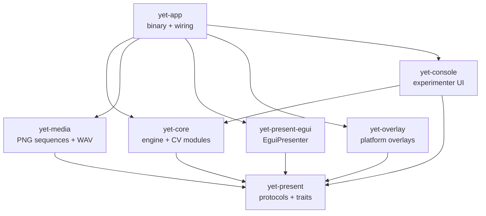
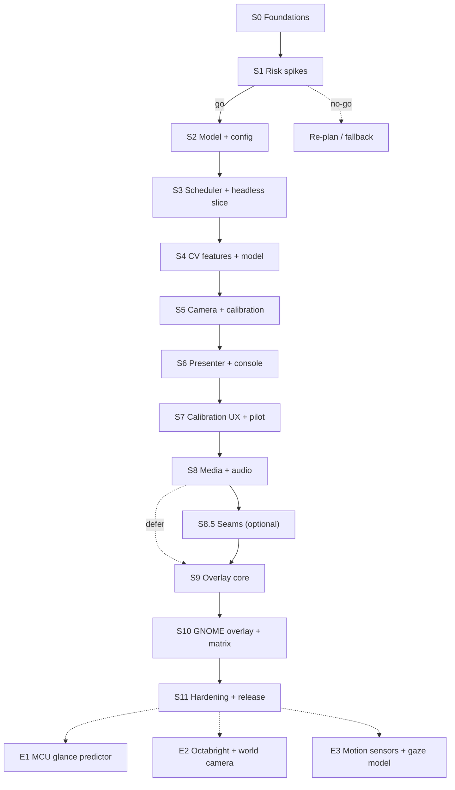

# Development Plan — yet-rs

**Status:** Living plan · v1 implemented through S8 (S9 next) · future-sensing guardrails added 2026-10-25
**Basis:** `UI_analysis.md`, `CV_analysis.md`, and the prior attempt in `Yex/`.
**Style:** milestone-driven, sprint-based, test-first.

> **Implementation snapshot (2026-10-25).** S0–S8 are implemented: 221 workspace
> tests pass, with three ignored hardware tests (camera, tracker, audio) that
> pass on the lab machine. S7's pilot (UX-4) and parts of the M3/M5 gates remain
> open. The new evolution requirements E1–E3 in §0.2 are **guardrails, not v1
> scope**: no Octabright, world camera, motion sensor or MCU runtime is built in
> v1. They are integrated here so the later step is a mechanical extension, not
> a rewrite.

---

## 0. Assumptions

This plan is written for **one developer** working about **five focused days per week**, in **one-week sprints**. The first three sprints calibrate velocity; re-plan at every milestone.

If the assumptions change:

- **Two developers:** split the UI/presenter track (S6–S7) from the media/overlay track (S8–S10) and run them in parallel. Their write scopes are disjoint.
- **Two-week sprints:** pair consecutive sprints; keep the same milestone gates.
- **Less than three days per week:** expect 18–24 calendar weeks. Do not compress the overlay or the pilot.

The plan deliberately keeps a **calendar buffer of two sprints** (no additional sprint IDs) for hardware access, platform surprises and usability findings.

### 0.2 Evolution requirements (2026-10-25; not v1 scope)

These requirements are accepted for the future. They must not force a redesign
when they arrive. v1 implements only the first column.

| ID | Future requirement | v1 today | Seam that must exist |
|---|---|---|---|
| **E1** | Quadbright (feature) compression and prediction may run on a microcontroller | Host `LinearGazeModel` (f64, `nalgebra` fit); features are `f32` | Inference and training are separate; prediction uses a plain, fixed-capacity parameter block and no `std`/`nalgebra`/UI types; features can be quantized |
| **E2** | Two eye cameras (**Octabright**) and/or a world camera | One `Camera`, one 4-quadrant `EyeRegion` | Camera roles and timestamped frame sets; a feature layout with configurable dimension; one source per device; multi-camera configuration is additive |
| **E3** | Several motion sensors; a **gaze** model with head/body movement | Eye-only **glance** model: 4 features → screen point | Timestamped motion/pose source; a `GazeInput` that can carry pose; calibration observations that can carry pose; engine stays pure |

**Terminology.** A **glance** is eye-in-head position while head and body are
assumed fixed; that is the v1 model. **Gaze** is the point of regard after head
and body pose are included. The current `LinearGazeModel` is a glance model;
the type name stays for v1 compatibility, but the documentation and traits must
not imply that gaze is only ocular.

**Explicit non-goal now:** do not add a second camera, a world camera, a motion
sensor, a quantized predictor or a new model equation in v1. Only the seams
below are in scope.

### 0.3 Plan health check (2026-10-25)

**On target:** the v1 scope is intact. S0–S8 delivered the workspace, spikes,
experiment/CSV model, pure scheduler, CV parity, camera and calibration,
presenter/console, calibration UX and media/audio. The current test suite and
the manual media run match the S8 note. The remaining work is S9–S11.

**Open gates, not plan failures:**

- M3: no human calibration RMSE; macOS/Windows camera runtime unverified.
- M4: UX-4 pilot not run; the S7 desktop flow was only partially validated.
- M5: A/V drift has point measurements, no p95 series; Windows/macOS audio
  runtime unverified; frame decode is just-in-time, not a prefetch worker.
- The overlay matrix (S9–S10) is still the highest-variance work.

**Architecture gaps against E1–E3:** the current code is correct for v1 but not
future-proof in four places:

1. `QuadBrightness` is a four-field struct, `CalibrationSample` stores it, and
   `LinearGazeModel` hard-codes four coefficients. Octabright (8) or extra
   sensors would force changes in the model, calibration and data records.
2. `GazeModel` combines `fit` and `predict`; `nalgebra` and `f64` sit in the
   same module. An MCU predictor cannot reuse that module without `std`/`alloc`.
3. `Tracker` and `config.toml` assume exactly one camera; there is no camera
   role, frame-set timestamp or rig abstraction.
4. There is no `GazeInput`, `PoseSample` or motion-source seam; `GazeSample` is
   an output only. Adding head/body later would touch the engine, calibration
   and CSV path at once.

**Adjustment:** insert a **timeboxed 2–3 day seam sprint (S8.5)** before S9. It
changes types and traits only; it must not change v1 output, timing or the model
equation. It fits inside the two-sprint calendar buffer. If the schedule cannot
absorb it, do it directly after S11 and before any E1–E3 work, but then the
"no refactor" goal is at risk. This is decision 12 in §12.

---

## 1. What v1 is

### 1.1 The v1 demo

A researcher can, on Windows, macOS and Linux:

1. edit `config.toml` (monitors, camera, audio) and a `Stimuli.csv`;
2. start the console, see validation errors before the session;
3. run a calibration on the experiment monitor;
4. run a block of static-image trials and a block of PNG-sequence trials with audio;
5. see a gaze overlay over the desktop, click-through, on the experiment monitor;
6. finish the session and get a CSV that the existing R pipeline can read.

### 1.2 Success criteria

- All three desktop OSes build from source without a C/C++ compiler in our code, OpenCV or a media framework; ALSA development metadata on Linux and Xcode Command Line Tools for the macOS camera backend are documented prerequisites.
- `yet-core` and `yet-present` contain **no UI types**.
- The experiment engine is testable headlessly, with no sleeps and no window.
- A full session can be run without a terminal or a mouse.
- Frame timing, calibration error, audio drift and dropped frames are logged.
- The overlay meets R11 on Windows, macOS and at least one layer-shell Wayland compositor; GNOME is covered by the XWayland fallback or an explicit, documented fallback decision.
- `yet-rs/LICENSE` is GPL-3.0-only and dependency licenses are audited.

### 1.3 Non-goals for v1

- Eye detection / Haar cascade (CV R6).
- Two eye cameras (Octabright), a world camera or motion/IMU sensors; see E1–E3.
- A microcontroller/no_std build, quantized features or fixed-point prediction.
- Head/body pose fusion or a true gaze (as opposed to glance) model.
- Native X11 as a supported target.
- Runtime H.264 decoding.
- Real-time AOIs or browser-window tracking.
- Out-of-process presenter.
- Browser/WASM version.
- XLSX support.
- Photodiode or hard-real-time guarantees.
- Porting Yex's `Participant`, `Consent` and `Demographics` flow unless the lab requires it.

---

## 2. Locked decisions

These come from the two analyses. If one changes, **update the analysis first**, then this plan. Do not fork the rationale.

| ID | Decision | Source |
|---|---|---|
| **D1** | `egui` + `eframe` (pinned 0.37 line) for console and in-process presenter. | UI §0.1, §9 |
| **D2** | Overlay is a separate `OverlayBackend`: `EguiOverlay` (Windows/macOS), `LayerShellOverlay` (KDE/wlroots/Sway), `XwaylandOverlay` (GNOME, in-process thread). Native X11 is deprecated. | UI R11, §7.5 |
| **D3** | Video is pre-decoded to PNG sequences at setup; no runtime decoder in v1. | UI R5, §6.6 |
| **D4** | Audio is extracted to WAV and played with `rodio` + `cpal`; audio clock is master when audio is present. | UI R12, §6.7 |
| **D5** | Project license: **GPL-3.0-only**. | UI R8 |
| **D6** | `config.toml` for machine settings; CSV for experiments/stimuli; no XLSX. | UI R9 |
| **D7** | Desktop-only v1; keep `yet-core` UI-free for a later browser version. | UI R7 |
| **D8** | Draw-command facade (`Scene`/`DrawCommand`), no full Pygame surface API. | UI R10 |
| **D9** | Camera: `linuxvideo` on Linux; `nokhwa` on macOS/Windows; no C/C++ toolchain. | CV R2, §1 |
| **D10** | No eye detection; fixed configurable `EyeRegion`. | CV R6 |
| **D11** | Features are four quadrant means; model is 4→2 linear regression via `nalgebra`, behind `GazeModel`. | CV R9, R10 |
| **D12** | CV/tracker lives in one crate with modules for v1; split later along existing traits. | CV R11 |
| **D13** | MSRV 1.95, raised for eframe 0.37's `ViewportBuilder::with_monitor`; `image` 0.25.10 sets the previous floor. | CV R13 |
| **D14** | The engine is a pure transition function plus effects — no blocking `run()` and no sleeps. | This plan, §3.2 |
| **D15** | Camera capture uses `CameraSource`; media sequences use `FrameSource`, resolving the name collision between CV §6.3 and UI §9.2. | This plan, §3.3 |
| **D16** | **Inference and training are separate.** `GazePredictor` only predicts from a `GazeInput` and plain parameters; `GazeTrainer` fits. `nalgebra` may appear only in the trainer and stays out of the portable predictor. | E1, §3.4 |
| **D17** | **Features have a layout, not a fixed struct.** `FeatureLayout` names and orders features; `QuadBrightness` is the v1 4-feature layout, Octabright is a future 8-feature layout. Models consume a slice or fixed-capacity vector, never named fields. | E1/E2, §3.4 |
| **D18** | **Cameras are role-tagged sources.** One `CameraSource` per device; a rig maps roles (`eye_left`, `eye_right`, `world`) and carries timestamps. There is no global camera or single-device assumption in tracking. | E2, §3.4 |
| **D19** | **Sensors are event sources.** Motion/pose samples are timestamped `SensorSource`s; fusion happens on the controller, never in the pure engine. The engine may receive samples as events but never blocks on a sensor. | E3, §3.4 |
| **D20** | **Glance is the v1 model; gaze is the future pipeline.** Keep `LinearGazeModel` as the v1 glance implementation, but new APIs take a `GazeInput` that can grow a pose field without changing call sites. | E3, §3.4 |
| **D21** | **Portable prediction is `no_std`-ready by construction.** The prediction path uses `f32`/fixed-point-capable arithmetic, fixed-capacity buffers and versioned plain parameters; host fitting may use `f64`, `alloc` and `nalgebra`. | E1, §3.4 |

---

## 3. Architecture

### 3.1 Crate graph

Arrows point to dependencies. `yet-present` is the leaf: protocols and traits, no UI and no I/O.



Target layout:

| Crate | Contents | UI dependencies |
|---|---|---|
| `yet-present` | `Presenter`, `OverlayBackend`, `FrameSource`, `AudioPlayer`; `Scene`, `DrawCommand`, `PresenterCommand`, `FrameStamp`, geometry, IDs | None |
| `yet-core` | `experiment/` state machine, `tracking/` (frame, features, model, calibration), `camera/` (`CameraSource` + adapters), config, data records | None |
| `yet-media` | PNG sequence loader, prefetch, WAV audio player | None |
| `yet-present-egui` | `EguiPresenter`: viewport, textures, text, shapes | `egui` / `eframe` |
| `yet-overlay` | `EguiOverlay`, `LayerShellOverlay`, `XwaylandOverlay` | `egui` / `eframe`, `smithay-client-toolkit`, `calloop`, `x11rb` |
| `yet-console` | experimenter console only | `egui` / `eframe` |
| `yet-app` | config loading, wiring, CLI, lifecycle | all |

The CV modules stay inside `yet-core` for v1 (CV R11). `yet-camera` and `yet-ml` are later mechanical splits; do not create them before the seams have tests.

**Platform build prerequisites found in Sprint 1:** Linux audio needs ALSA development metadata (`alsa.pc`), now installed and verified; the macOS `nokhwa` camera path needs Xcode Command Line Tools for `objc_exception`. Neither is a C/C++ dependency of our own code, but both must be documented.

### 3.2 The key design rule: pure transition + effects

Yex's `run()` methods sleep and block. That makes timing untestable and couples the engine to a thread. Replace them with a pure step function:

```rust
// yet-core: no UI, no I/O, no sleeping.
pub fn step(
    state: &mut EngineState,
    event: EngineEvent,
    now: SessionTime,
) -> Vec<Effect>;

pub enum EngineEvent {
    Start,
    Pause,
    Resume,
    Abort,
    Tick,
    Key(Key),
    CalibrationSample(CalibrationSample),
    MediaReady(MediaId),
    Error(EngineError),
}

pub enum Effect {
    LoadMedia { id: MediaId, spec: MediaSpec },
    Presenter(PresenterCommand),
    Present(Scene),
    AppendFrame(FrameRecord),
    AppendTrial(TrialRecord),
    Overlay(OverlayCommand),
    NotifyConsole(ConsoleEvent),
}
```

Rules:

- `SessionTime(Duration)` is monotonic time since session start, not `Instant`. It is serializable and can be advanced by a test clock. Record UTC once at session start for joining external data.
- The app owns the loop and translates `Effect`s into presenter, recorder, overlay and console calls.
- The engine never waits. Every timed transition has an **absolute deadline**; `Tick` advances it.
- Effects own their payloads (`String`, `Arc<str>`, `MediaId`), so they can cross channels. The in-process presenter may borrow internally; the protocol contract does not. This makes the protocol `Scene` owning; UI §9.2's borrowed sketch is an in-process optimization, not the channel contract.
- No `RgbaImage` in `EngineState` or events. Media lives in a store; state and events carry `MediaId`.

This single rule is what makes R4, headless testing and a later out-of-process presenter cheap.

### 3.3 Protocol rules

- No `egui`, `winit`, `image`, `linuxvideo` or `nokhwa` types in `yet-present` or `yet-core` public APIs.
- **Resolve the `FrameSource` name collision in Sprint 0.** UI §9.2 uses `FrameSource` for a media sequence (`preload`, `frame_at`); CV §6.3 uses the same name for camera capture (`next_frame`, `resolution`, `fps`). Keep `FrameSource` for media in `yet-present` and rename the camera trait to `CameraSource` in `yet-core`; the CV trait shape is otherwise unchanged.
- All IDs, times and geometry are our own newtypes: `MediaId`, `FontId`, `PointPx`, `RectPx`, `SessionTime`.
- Channels are bounded. Camera uses a latest-frame mailbox of capacity 1; no growing queue.
- A closed console is a normal shutdown, not a panic. No `.unwrap()` on `send`.
- `Ok(None)` means “no frame this time”; `Err` means the source failed. Keep them distinct, as CV §6.3 requires.

### 3.4 Portability and future-sensing seams

E1–E3 do not need a new model now, but they need the following **six seams**.
They are deliberately few: one per changing axis, not one trait per noun.

```text
v1:      GrayFrame ─ quad_brightness(EyeRegion) ─ QuadBrightness ─ LinearGazeModel ─ GazePoint

future:  FrameSet(role, timestamp) ─ FeatureExtractor(layout) ─ FeatureVector ─┐
         MotionSource/PoseFusion ──────────────────────── PoseSample ──────────┼─ GazeInput ─ GazePredictor ─ GazePoint/WorldPoint
         WorldCamera/WorldMapper ─────────────────────── ScenePoint ───────────┘

host:    CalibrationObservation ─ GazeTrainer ─ ModelParameters(versioned) ─ portable predictor
```

```rust
// yet-present or a future no_std yet-gaze-portable crate
pub const MAX_FEATURES: usize = 16;

pub struct FeatureLayout {
    pub name: &'static str,       // "quad", "octa", "quad+head", …
    pub len: usize,               // 4, 8, …
    pub regions: &'static [FeatureRegion], // name + quadrant within a camera
}

pub struct FeatureVector {
    values: [f32; MAX_FEATURES],
    len: usize,
}

pub trait FeatureExtractor {
    fn layout(&self) -> FeatureLayout;
    fn extract(&self, frames: &FrameSet<'_>) -> Option<FeatureVector>;
}

pub struct GazeInput<'a> {
    pub features: &'a [f32],
    pub pose: Option<&'a PoseSample>, // None = glance (v1)
}

pub trait GazePredictor {
    fn predict(&self, input: GazeInput<'_>) -> Result<GazePoint, ModelError>;
    fn is_fitted(&self) -> bool;
}

pub trait GazeTrainer {
    fn fit(&mut self, samples: &[CalibrationObservation]) -> Result<(), ModelError>;
    fn reset(&mut self);
}

pub trait GazeModel: GazePredictor + GazeTrainer {}
impl<T: GazePredictor + GazeTrainer> GazeModel for T {}
```

`FeatureRegion`, `PoseSample`, `HeadPose`, `BodyPose` and `WorldPoint` are target
names, not v1 APIs. S8.5 introduces only the concrete types needed to make the
mapping compile; the pose payloads may be opaque placeholders until E3.

Camera and motion seams:

```rust
pub enum CameraRole { EyeLeft, EyeRight, World }

pub struct CameraFrame {
    pub role: CameraRole,
    pub captured_at: SessionTime,
    pub frame: GrayFrame,
}

pub struct FrameSet<'a> {
    pub frames: &'a [CameraFrame],
    pub reference_at: SessionTime,
}

pub trait SensorSource {
    fn latest(&self) -> Option<PoseSample>;
}

pub struct PoseSample {
    pub at: SessionTime,
    pub head: Option<HeadPose>,
    pub body: Option<BodyPose>,
}
```

One `SensorSource` exists per device; a future `PoseFusion` trait combines head,
body and auxiliary samples into one timestamped `PoseSample`. The engine only
ever sees the fused pose, so adding a sensor does not add engine branches.

**Current code → seam (mechanical, no behavior change):**

| Current | Seam | v1 behavior kept |
|---|---|---|
| `QuadBrightness` | `QuadLayout` + `FeatureVector(4)` | Named fields can remain as a convenience; conversion is lossless |
| `quad_brightness` | `QuadExtractor` implementing `FeatureExtractor` | Same pixel rule and `(nw, ne, sw, se)` order |
| `LinearGazeModel::fit` | `LinearTrainer` (host; `nalgebra`, `f64`) | Same SVD fit and RMSE |
| `LinearGazeModel::predict` | `LinearPredictor` (portable; `f32`/fixed-point-capable) | Same coefficients and output within parity tolerance |
| `LinearParameters` | `ModelParameters { version, feature_count, coefficients, intercept }` | Plain arrays only; no `nalgebra` in the saved model |
| `CalibrationSample` | `CalibrationObservation { features, target, pose: Option }` | v1 constructs `pose: None` |
| `Camera` / `Tracker` | One `CameraSource` per device + `CameraRig { roles }` | One eye camera, one `EyeRegion` |
| `[camera]` config | `[[cameras]]` list with `role`; keep `[camera]` as shorthand | Same one-camera config parses unchanged |
| `GazeSample` (output) | `GazeEstimate`; `GazeInput` is the input | CSV columns unchanged in v1 |

**Rules that make the later extension mechanical:**

1. **No host types in the prediction path.** Feature extraction and prediction
   must not use `std::time`, `image`, `egui`, `nalgebra` or an unbounded `Vec`.
   A fixed-capacity `FeatureVector` and `f32` arithmetic are enough for v1 and
   for a Cortex-M later; quantization is a separate `FeatureCodec` and
   `Predictor` implementation, not a change to the extractor.
2. **Train on the host, deploy parameters.** The MCU never runs `nalgebra` or a
   least-squares solver. `ModelParameters` is versioned, plain, and small enough
   to store in flash; a `no_std` predictor consumes it.
3. **No dimension in the type names.** `LinearGazeModel` is the v1 glance
   implementation, not “4-to-2”; `feature_count` comes from the layout. An
   8-feature Octabright model is another parameter block, not a new model type.
4. **Cameras are sources, not globals.** `CameraSource` can be instantiated per
   device. Multi-camera fusion uses timestamped frames and a documented sync
   policy (nearest frame, maximum skew); there is no hardware-sync assumption.
5. **Pose is optional and additive.** `GazeInput.pose = None` is the glance
   model. A future gaze model consumes the same input with `Some(pose)`; the
   engine, presenter and CSV path do not need new control flow.
6. **Append, do not rename.** Future CSV columns for camera role, feature
   layout, head pose and body pose are appended after the eight yet_zero
   columns. Old files remain readable.
7. **One calibration protocol, richer observations.** A future gaze calibration
   records the same targets with a pose alongside the eye features; it does not
   replace the 3×3 quick-recalibration flow.
8. **The minimum sample count follows the layout.** A full-rank fit needs
   `feature_count + 1` samples (5 for Quadbright, 9 for Octabright). The v1 code
   currently accepts 4 and relies on the minimum-norm SVD solution; S8.5 keeps
   that behavior for the 4-feature layout (with a test pinning it) and makes the
   limit layout-derived for 8-feature models. Raising the v1 minimum is a
   separate, explicitly tested correctness change.

A compile-only guard belongs in S8.5: the feature/prediction modules must build
without `std`/`alloc` in a future crate. It is a `cargo check` against a
`no_std` target, not a hardware test.

---

## 4. What to harvest from Yex

Yex is a **reference**, not a dependency. It has useful ontology and protocol shapes, a working quadrant-brightness sketch, no tests, and known compilation issues (for example, `yex_1.rs` calls a `Yet::new()` that does not exist). Do not add it as a dependency. Take concepts; rewrite the runtime.

### 4.1 Reuse map

| Yex artifact | Where | Harvest | Change |
|---|---|---|---|
| `Session → Block → Trial` ontology | `Yex/src/yex/exp.rs` L14–L36, L104–L174, L242–L256 | Names, hierarchy, `State` enums, Prelude/Relax/Advance | No blocking `run()`; state carries IDs, not media payloads |
| Stimulus / response ontology | `exp.rs` L399–L422, L454–L518 | `Stimulus::{Blank, Text, Image}`, `Response` variants | Add `Sequence`; remove `todo!()`; keep only responses v1 needs |
| Timestamped event log | `Yex/src/yex/mod.rs` L84–L132 | One event enum plus timestamp wrapper | Use `SessionTime(Duration)` + UTC session start; make it serializable; do not store `Instant` in CSV |
| Demo driver | `mod.rs` L54–L74 | Ordering of session events | Replace `sleep()` loop with `step(state, event, now) → Vec<Effect>` |
| Channel wiring | `mod.rs` L23–L32; `Yex/src/bin/yex_proto.rs` L19–L44 | Multi-consumer event stream | Bounded channels; handle `Result`; no panics |
| Calibration state | `Yex/src/yex/yet.rs` L19–L50 | `Calibration { state, points, radius, … }`, active target | 3×3 configurable grid; scene-based rendering; quick recalibration; no UI colors in core |
| Quadrant features | `Yex/examples/quad_bright.rs` L19–L41 | Camera enumeration and ROI slicing | Fix NE/SW labels; use `GrayFrame`; Python is the oracle |
| UI sketches | `Yex/examples/yex_1.rs` L37–L42, L94–L123, L131–L176; `simple_ui.rs` | Console and calibration layout ideas | `eframe`, not `nannou`; no `Arc<Mutex<Session>>` bus |
| Earlier porting plan | `Yex/Porting Yet Zero Eye Tracking to Rust.md` L2607–L2806 | Historical phase list and checklist | Superseded: Haar cascade, `nannou`, `polars`, `input-native` |
| Dependency audit | same file L3129–L3226 | Lessons on `polars`/`imageproc` weight | Superseded by CV/UI analyses |

### 4.2 Yex as a test oracle — with a caveat

`quad_bright.rs` is useful for camera enumeration and slicing, **not** as numerical ground truth:

- `mean_brightness` averages `(R + G + B) / 3`; Python's `BGR2GRAY` computes luma. These are different features.
- `quadbright_2` names are rotated relative to its views. Its `ne` is top-left, its `nw` is bottom-left.
- Its `nokhwa` configuration enables `input-native`, which pulls V4L2 bindgen on Linux.

Therefore:

1. Generate parity fixtures from the **Python implementation** on the same frames, using its exact luma conversion and crop.
2. Define the canonical Rust order `(nw, ne, sw, se)` and the exact split from CV §2.1.
3. Use Yex only to compare camera setup and ROI geometry.

### 4.3 Do not port

- `polars`/`ndarray`/`linregress`/`imageproc` as the default stack. Use `csv` + `serde` for data, `nalgebra` for the model, direct loops for features.
- `nannou` / `nannou_egui`.
- Blocking `sleep()`-based `Block::run()` / `Trial::run()`.
- `Arc<Mutex<Session>>` as the runtime bus.
- `.send(...).unwrap()` and `todo!()` in runtime paths.
- Cloned `RgbaImage` inside state or events.
- Broken or duplicated `Observation → DataFrame` code.
- `Participant` / `Consent` / `Demographics` in v1.
- `nokhwa` `input-native` / `input-v4l` on Linux.

**License note:** `Yex/LICENSE` is GPL-3.0 (compatible with GPL-3.0-only); `yet-rs/LICENSE` is still MIT. Fix `yet-rs` in Sprint 0 before copying any prior art. Keep the Apache-2.0 notice for logic ported from `yet_zero`.

---

## 5. Agile mechanics

### 5.1 Cadence

- One-week sprints, about five ideal days of capacity.
- Story sizes: **S** ≤ 0.5 day, **M** ≤ 1.5 days, **L** ≤ 3 days. Split anything larger.
- WIP limit: two stories. Finish before starting.
- Every sprint ends with a **demo** and a **five-minute retrospective**. No demo, no done.

### 5.2 Backlog and story IDs

Stories use `PREFIX-N` IDs (`FND`, `SPK`, `ENG`, `CV`, `UI`, `UX`, `MED`, `OVL`, `REL`). The backlog is this document; keep it current rather than copying it into another tool.

Story template:

```text
ID:
As a <user>, I want <capability> so that <reason>.
Acceptance: <observable checks>
Test approach: <unit | integration | headless | hardware-in-the-loop | manual>
Depends on:
Size:
```

### 5.3 Definition of Ready

- The story names a real user and a reason.
- Acceptance criteria are observable, not “works”.
- The trait seam and crate are identified.
- The test approach is named.
- Size is at most 3 ideal days.
- Any prior art or Yex reference is linked.

### 5.4 Definition of Done

- [ ] A failing test was written first (or a manual test script for HIL-only work), then made to pass.
- [ ] Unit/integration tests cover the behavior; engine tests use a test clock, not sleeps.
- [ ] `cargo fmt --check`
- [ ] `cargo check --all-targets --all-features`
- [ ] `cargo test --all-features`
- [ ] `cargo clippy --all-targets --all-features -- -D warnings`
- [ ] `cargo doc --no-deps --all-features`
- [ ] No `unwrap`/`expect` on fallible runtime paths; errors are typed and actionable.
- [ ] No UI types in `yet-core` or `yet-present`.
- [ ] README/CHANGELOG/ROADMAP updated when behavior or usage changes.
- [ ] For HIL stories: test machine, OS/compositor and results recorded.
- [ ] For ported logic or prior art: license notice added.

### 5.5 Spike protocol

Spikes are timeboxed, disposable, and **not merged into the workspace**:

1. One day per spike; two days for a cross-platform matrix. If it needs more, stop and re-plan.
2. Code lives under `spikes/` and is not a workspace member.
3. Output is `docs/spikes/SPK-N.md`: question, method, measurements, decision, follow-up.
4. Keep only fixtures, scripts and findings. Delete or archive the rest.
5. No production refactors during a spike.

### 5.6 Change control

- A locked decision changes only by updating the relevant analysis first.
- A failed spike may change a decision; record the evidence in the spike report and this plan.
- At each milestone, re-estimate the remaining backlog. Do not preserve stale dates.

---

## 6. Roadmap



### Milestones

| Milestone | End of | Exit criterion | Status |
|---|---|---|---|
| **M0 Foundations green** | S0 | Workspace builds on three OSes; license fixed; protocols and engine skeleton tested | Met locally; CI awaits its first remote run |
| **M1 Risks retired** | S1 | Spike reports and go/no-go for eframe, overlay, camera, audio | Conditional go; target-platform runtime matrix open |
| **M2 Headless experiment** | S3 | A 2-block experiment runs without a window and writes a compatible CSV | Met |
| **M3 Eye tracking parity** | S5 | Quad features match Python; calibration works on the real camera | Partial: Linux and synthetic parity; human RMSE and macOS/Windows open |
| **M4 End-to-end experiment** | S7 | Console + fullscreen presenter + calibration + pilot session | Partial: flow implemented; UX-4 pilot open |
| **M5 Media complete** | S8 | PNG sequence + WAV in sync; drift and underruns logged | Partial: Linux point measurements; p95 and macOS/Windows open |
| **M6 Overlay parity** | S10 | Windows/macOS/layer-shell Wayland/GNOME-XWayland matrix passes or is documented | Not started |
| **M7 v0.1.0** | S11 | Release checklist, pilot data and docs complete | Not started |

### 6.1 Post-v1 evolution path

These phases are ordered by dependency, not scheduled. They start only after
v1 is released and the open M3/M4/M5 gates are closed.

| Phase | Scope | Prerequisite | First output |
|---|---|---|---|
| **E1 — portable glance** | A `no_std` predictor with a versioned parameter block; optional quantized features | SEAM-1/2/4 | Same calibration fitted on the host predicts on a Cortex-M class target within a stated error budget |
| **E2 — Octabright and world camera** | Two role-tagged eye cameras (8 features), optional world camera, timestamped frame sets and a sync policy | SEAM-1/3; E1 not required | 8-feature calibration matches the 4-feature RMSE or better; role-aware config and CSV |
| **E3 — gaze model** | Head/body motion sources, pose fusion, `GazeInput` with pose, gaze calibration and world/screen output | SEAM-3; E2 recommended for world coordinates | Gaze error under controlled head movement; glance remains the fallback when pose is absent |

E1 and E2 can proceed in parallel; E3 follows because it needs a pose source and
a calibration protocol, not because it needs 8 features.

---

## 7. Sprint plan

### Sprint 0 — Foundations

**Goal:** a green workspace that encodes the architecture and the license decision.

| ID | Story | Size | Done when |
|---|---|---|---|
| FND-1 | Create the workspace, GPL-3.0-only license, MSRV 1.95, CI matrix (Linux/macOS/Windows) | M | `cargo test --workspace` green on all three; `Cargo.toml` license correct; no `bindgen`/libclang in `cargo tree -e build`; system prerequisites documented |
| FND-2 | Define protocol types and traits in `yet-present`; add `RecordingPresenter` | M | No `egui`/`image` types; coordinate and `SessionTime` unit tests; `RecordingPresenter` records scenes |
| FND-3 | Implement the pure engine skeleton (`EngineState`, `EngineEvent`, `Effect`, `step`, `TestClock`) | M | Start/pause/resume/abort/tick tests; no sleeps; no UI dependency |

**Prior work:** Yex's hierarchy (`exp.rs`) and event log (`mod.rs` L84–L132); rewrite the runtime.
**Status (2026-10-25):** implemented. Local `fmt`, `check`, `test`, `clippy`, `doc` and MSRV 1.95 checks pass; the three-OS CI workflow is defined and awaits its first run.
**Demo:** workspace builds, tests pass, license and CI evidence.
**Gate:** do not start overlay work until the license is GPL-3.0-only.

### Sprint 1 — Risk spikes

**Goal:** retire the four risks that can invalidate the architecture.

| ID | Story | Size | Done when |
|---|---|---|---|
| SPK-1 | eframe presentation spike: fullscreen on monitor 2, image/text/circle, frame log, 100% and 150% scaling | M | `docs/spikes/SPK-1.md` with frame p50/p95/p99, placement measurements, Go/No-Go |
| SPK-2 | Overlay matrix (two-day timebox): Windows, macOS, KDE or Sway layer-shell, GNOME via in-process XWayland thread | M | Report on transparency, always-on-top, click-through, focus, multi-monitor; Go/No-Go for R11 |
| SPK-3 | Camera spike: `linuxvideo` and `nokhwa` build, formats, 640×480 capture, `GrayFrame` conversion | M | No bindgen/libclang; format list; captured frames; parity plan against Python |
| SPK-4 | Media spike: FFmpeg PNG/WAV extraction, `rodio` playback, `get_pos()` clock, drift measurement | M | Script + report; measured A/V drift; failure modes documented |

**Status (2026-10-25):** four reports written to `docs/spikes/`. SPK-1 was measured on X11; SPK-2 ran the X11 proxy and compile-checked Windows/macOS/layer-shell; SPK-3 captured real frames and matched the Python Rec. 601 fixture; SPK-4 prepared exact media, validated the rodio API on Windows/macOS, and ran Linux playback after `libasound2-dev` was installed. Target-platform overlay/camera runtime checks remain.

**Findings:** eframe 0.37 uses `App::ui`, not `App::update`; monitor targeting settles after a few frames; `image::to_luma8()` is Rec. 709 and must not be used for OpenCV parity; YUYV capture was unstable on the test camera (MJPG was stable); rodio 0.23 has no `hound` feature; Linux `alsa-sys` requires ALSA development metadata; `get_pos()` measured ~128 ms behind wall clock; the X11 overlay proxy showed focus stealing and whole-desktop geometry.

**Prior work:** `Yex/examples/quad_bright.rs` for camera enumeration only; UI §14 and CV §10 for spike checklists.
**Demo:** four spike reports with measurements and explicit recommendations.
**Gate:** if SPK-2 fails on GNOME, decide between a GNOME Shell extension and a documented limitation **before** S9. If SPK-3 fails, decide on the `v4l` fallback and update CV analysis. If SPK-1 shows jank, keep the traits and choose the fallback presenter backend.

### Sprint 2 — Experiment model and configuration

**Goal:** the domain model and the inputs are real, not mocked.

| ID | Story | Size | Done when |
|---|---|---|---|
| ENG-1 | `Experiment`/`Block`/`Trial`/`Stimulus` model with serde and validation (runtime `Session` belongs to S3) | M | Invalid monitor, missing file, empty block and bad duration produce typed, actionable errors |
| ENG-2 | Load `config.toml` and `Stimuli.csv`; resolve media IDs and paths | M | Golden tests for valid and invalid files; no panics; paths relative to the experiment file |
| ENG-3 | Generate the trial order, including shuffle and seed, with a reproducible test | M | Same seed produces the same order; order is logged |

**Prior work:** Yex `exp.rs` L14–L174, L454–L518; drop `Participant`/`Consent` for v1.
**Status (2026-10-25):** implemented. `yet-core` loads `config.toml`, optional `Experiment.csv` and `Stimuli.csv`, validates typed errors, resolves media paths, and builds a deterministic per-block plan. `yet-app plan <dir>` prints it. 55 tests pass. The `block` column is optional and defaults to `default`; block `i` uses `seed + i` for an independent deterministic stream.
**Demo:** `cargo run -p yet-app -- plan examples/demo`.
**Gate:** met; the CSV schema is stable enough for the Sprint 3 data sink.

### Sprint 3 — Scheduler, data sink and headless slice

**Goal:** M2 — a complete experiment without a window.

| ID | Story | Size | Done when |
|---|---|---|---|
| ENG-4 | Absolute-deadline scheduler with pause/resume/abort and late-tick handling | M | Test-clock tests cover on-time, late, paused and aborted transitions; no accumulated `dt` drift |
| ENG-5 | `RecordingPresenter` scene assertions and golden scenes | M | Calibration grid, stimulus placement and text are asserted from recorded commands |
| ENG-6 | CSV data sink with trial and frame records, flush per trial | M | yet_zero-compatible column names; new columns appended; timestamps monotonic; interrupted session keeps completed rows |
| ENG-7 | `yet-app --headless` CLI | S | Runs a 2-block, 6-trial experiment from config to CSV |

**Prior work:** Yex `mod.rs` L84–L132 for the event shape; replace `YexRecord(Instant, …)` with `SessionTime`.
**Demo:** `cargo run -p yet-app -- run --headless examples/demo --participant demo01`.
**Gate:** met; see status below.
**Status (2026-10-25):** implemented. 89 workspace tests pass, including 22 engine
scheduler tests, 11 golden-scene tests, 7 data-sink tests and 7 headless/CLI tests.

- **ENG-4:** `step` schedules by absolute deadline. A late tick records `late_by`,
  completes the overdue trial at the tick time and starts the next trial there;
  no trial is skipped and no `dt` error accumulates. Pause/resume shifts the
  deadline by the pause duration. Aborting mid-trial emits a record with
  `completed: false`.
- **ENG-5:** `CalibrationGrid` reproduces the Python 3×3 proportions
  (0.125/0.5/0.875), radius 20, stroke 10, grey `(160,160,160)` and active
  orange `(255,120,0)`. Targets are row-major; Python's `itertools.product(x,y)`
  visits the same points column-major. `StimulusPlacement` reproduces
  `scale = min(surface/media)` and centering, rounded to the nearest pixel
  (Python truncates, so a placement can differ by one pixel). Instruction text
  uses the Python `(0.1, 0.9)` anchor and `min(surface)/60` size.
- **ENG-6:** `DataSink` writes exactly the eight yet_zero columns and nothing
  else; new columns, if needed, will be appended. Gaze/frame observations
  become rows; trial records drive flushing and the run report, because the
  yet_zero schema has no trial row. Times are
  `epoch_start + SessionTime`, formatted with microsecond precision; pixel
  coordinates use two decimals and normalized coordinates four. Header on
  creation, flush at every `AppendTrial`, so an aborted session keeps the rows
  up to the abort.
- **ENG-7:** `yet-app run --headless <dir>` uses a 10 ms synthetic clock and
  jumps to trial deadlines; the demo completes 5 of 5 trials in milliseconds.
  The result file defaults to the experiment directory as
  `yet1_<Exp>_<Part>.csv`. Without a camera the CSV has the header but no gaze
  rows; the gaze closure in `drive` is the injection point for Sprint 5.

**Findings:** the first headless demo exposed a loop guard that counted ticks
instead of simulated time; the guard now derives from the sum of planned
stimulus durations. Building `yet-app` as a library plus binary made the runner
and the CLI testable through `CARGO_BIN_EXE_yet-app` without a window.

### Sprint 4 — CV features and model

**Goal:** eye tracking is correct before it is live.

| ID | Story | Size | Done when |
|---|---|---|---|
| CV-1 | `GrayFrame`, `EyeRegion`, `QuadBrightness`, `quad_brightness` with odd-dimension handling | M | Property tests for sums; canonical `(nw, ne, sw, se)`; documented remainder rule |
| CV-2 | `LinearGazeModel` with `nalgebra` SVD/QR and centering | M | Synthetic linear data recovered within tolerance; repeated fit is cheap; `reset` tested |
| CV-3 | Calibration buffer, grid geometry and error metric | M | 3×3 grid generated in physical pixels; fit after calibration; RMSE computed |
| CV-4 | Python parity fixtures from recorded frames, including the odd-sized Rec. 601 fixture | M | Same frames through Python and Rust; per-quadrant differences within an agreed tolerance; canonical `(nw, ne, sw, se)` and explicit Rec. 601 documented |

**Prior work:** Yex `yet.rs` L19–L50 for calibration state; `quad_bright.rs` only as a slicing reference. Do **not** use its RGB-average numbers as ground truth.
**Demo:** print gaze at 30 Hz and calibration RMSE from a recorded sequence.
**Gate:** parity and refit budget; if parity fails, fix the feature definition before building the camera adapter.
**Status (2026-10-25):** CV-1–CV-4 implemented; parity checked against the Python
oracle on committed synthetic fixtures. 25 new tests; 114 workspace tests pass
on stable and the then-current MSRV (since raised to 1.95 for eframe 0.37).

- **CV-1:** `GrayFrame` validates its buffer length; `EyeRegion` is checked at the
  boundary; `quad_brightness` uses canonical `(nw, ne, sw, se)` and splits at
  `width/2`/`height/2`, with the remainder pixel in the east/south quadrants.
  Tests cover 4×4 quadrants, a 5×5 odd frame, a cropped region, and every
  invalid-region shape. `rec601_luma` reproduces the SPK-3 OpenCV values
  (red/green/blue → 76/150/29).
- **CV-2:** `LinearGazeModel` centers features and targets and solves by SVD via
  `nalgebra` 0.34. Tests recover a known 4→2 map on held-out features to within
  0.01 px, replace a previous map on refit, reject fewer than four samples, keep
  the old fit after a failed fit, handle a rank-deficient calibration by
  predicting the mean target, and clear on `reset`.
- **CV-3:** the physical-pixel grid was already implemented in S3.
  `CalibrationBuffer` now collects samples, fits a `dyn GazeModel`, and reports
  Euclidean RMS error in target units. Tests pin the RMSE definition and the
  empty/unfitted cases.
- **CV-4:** the parity harness is in place. `tools/cv4_fixtures.py` generated
  committed fixtures with NumPy 2.2.6, OpenCV 4.11.0 and scikit-learn 1.7.2:
  four raw grayscale patterns (7×5, 5×7, 8×6, 103×77), 12 calibration rows
  (9 training, 3 held out), and an odd 7×5 RGB/luma pair.
  `tests/cv4_parity.rs` checks canonical quadrant means within 1e-3, sklearn
  predictions within 0.5 px, coefficients and intercepts within 1e-6, and every
  luma pixel exactly. Features and targets are quantized to `f32` before
  sklearn fits, so both sides consume identical numbers. Remaining: append real
  eye-ROI frames from the target camera and rerun the same test; the format is
  in [`docs/fixtures/CV-4.md`](docs/fixtures/CV-4.md).

**Findings:** the prototype virtualenv contains NumPy, OpenCV and scikit-learn,
so a genuine oracle could be generated locally instead of waiting for a
recording. OpenCV's 8-bit `BGR2GRAY` uses fixed-point coefficients and can
differ from the Rec. 601 rounding formula by one level on arbitrary colors;
Sprint 5 parity must allow ±1, while the committed odd fixture matches exactly.
The refit budget is guarded by a test: 1000 fits of the 9-sample calibration
must finish within one second. Real-frame parity and a timing measurement on the
live calibration path stay open.

### Sprint 5 — Camera and calibration on real hardware

**Goal:** M3 — live gaze from the actual camera.

| ID | Story | Size | Done when |
|---|---|---|---|
| CV-5 | Camera adapters: `linuxvideo` (Linux) and `nokhwa` (macOS/Windows); format negotiation, stride, YUYV/GRAY/MJPEG to `GrayFrame` with explicit Rec. 601; capture thread with latest-frame mailbox; corrupt-frame counter and format fallback | L | Real camera on Linux and at least one of macOS/Windows; no bindgen; camera stays on one thread; `Send` asserted; permissions documented; mock source for tests |
| CV-6 | Calibration flow and quick recalibration | M | Grid → samples → fit → validate; quick recalibration refits without restarting the session |
| CV-7 | Hardware-in-the-loop smoke test on the lab machine | S | Test record: OS, camera, format, fps, calibration RMSE, notes |

**Prior work:** `Yex/examples/quad_bright.rs` L45–L60 for camera setup; replace `input-native` and RGB averaging.
**Carry-over from S4:** append real eye-ROI frames to
`crates/yet-core/tests/fixtures/cv4/features/` and rerun
`cargo test -p yet-core --test cv4_parity` before trusting the adapters.
**Demo:** live gaze printout at 30 Hz with a visible calibration error; re-run quick calibration.
**Gate:** both platform adapters build; no UI dependencies in the camera modules.
**Status (2026-10-25):** CV-5 and CV-6 implemented, including a graphical
calibration window; CV-7 partially measured.

- **CV-5:** `yet-core/src/camera/` adds `CaptureConfig`, `CameraInfo`,
  `CameraStats`, `CameraError`, a dedicated capture thread with a one-slot
  latest-frame mailbox, YUYV/GRAY/MJPEG conversion with explicit Rec. 601, and
  format fallback. Linux uses `linuxvideo` 0.3.5; macOS/Windows use `nokhwa`
  0.10.11 with `input-avfoundation`/`input-msmf` only. No bindgen or C/C++
  toolchain on Linux. The camera is opened, read and dropped on one thread.
  Unit tests cover YUYV stride, GRAY padding, truncation, MJPEG decode, the
  mailbox, the capture loop and config validation. `--device N` overrides the
  configured index. A Windows all-targets check passes; macOS needs a real Mac.
- **CV-6:** `Calibration` records target/feature pairs, fits or refits without
  resetting the session, and reports sample count and Euclidean RMSE. The
  default `yet-app calibrate` now opens a borderless window on the presenter
  monitor, draws the 3×3 grid and collects frames automatically (Space starts,
  Escape cancels). Fitting uses the window's physical pixels, so model, grid
  and live dot share one coordinate system. `--terminal` retains the
  coordinate-printing fallback. The window used eframe 0.33 (`presenter_origin`)
  at the time; S6 moved to eframe 0.37 and `with_monitor`, and removed the
  origin workaround.
- **CV-7:** the Yet camera is the GEMBIRD/AppoTech on `/dev/video2`, not the
  StreamCam. It exposes YUYV only and sustained 25.6 fps with 1 corrupt frame in
  3 s. The StreamCam (`video0`) sustained 26.0 fps in MJPG with 6 warm-up/corrupt
  frames, and 16.0 fps in YUYV with 35 corrupt frames. Release builds are
  required for MJPEG (debug: 12 fps). The graphical flow was exercised on the
  portrait presenter monitor (1440×2560 at `+2560+0`): grid, nine targets, RMSE
  report, quick refit and live dot. A valid **human** calibration RMSE, macOS
  runtime and Windows runtime are still pending. See
  [`docs/spikes/SPK-5.md`](docs/spikes/SPK-5.md).

**Findings:** the Yet camera is the GEMBIRD and must use YUYV; the StreamCam is
faster in MJPG but is not the tracker camera. The presenter is a portrait
1440×2560 display at x=2560. Eframe viewport sizes and positions are logical
points. S6 replaced the S5 origin workaround: eframe 0.37's `with_monitor`
places the viewport and the painter converts physical pixels to logical points
at its boundary. Calibration targets must still be fitted in the window's
actual physical size rather than the nominal config size. Quadrant means drift
under auto-exposure, confirming absolute features plus quick recalibration. The
scripted RMSE values are not tracking measurements because no human fixated the
targets.

**Gate:** Linux builds and runs; Windows compiles; macOS is unverified. The gate
stays open until a human calibration and the macOS/Windows runtime checks. The
graphical calibration window is the S5 slice; S6's full presenter is described
below.

### Sprint 6 — Presenter and console shell

**Goal:** the first end-to-end visual experiment, still with static images.

| ID | Story | Size | Done when |
|---|---|---|---|
| UI-1 | `EguiPresenter`: viewport, monitor targeting, physical-pixel conversion, image decode/scale/center, text, circle, line, cached blur | L | Placement golden tests at 100% and 150%; texture reuse for sequences; bundled deterministic font |
| UI-2 | `yet-console` shell: start/pause/resume/abort, monitor selection, status, logs, validation errors | M | Console never renders the stimulus; commands reach the engine; errors name the field and fix |
| UI-3 | Deferred viewport and channel wiring | S | Console repaint does not force a stimulus repaint; shutdown is clean |
| UI-4 | Frame statistics and low-latency surface configuration | S | `FrameStamp` log, dropped-frame counter, present mode and refresh rate at startup |

**Prior work:** `Yex/examples/yex_1.rs` L37–L42, L94–L123, L131–L176 and `simple_ui.rs` for layout ideas only; use eframe, not nannou.
**Demo:** static-image experiment on monitor 2, console on monitor 1, frame log shown.
**Gate:** correct placement on HiDPI; p99 within budget; console interaction does not stall presentation.

**Implementation note (S6, 2026-10-25):** UI-1 to UI-4 are implemented for
static images. 174 workspace tests pass on stable and MSRV 1.95.

- **Crate split:** `yet-present-egui` implements `Presenter` and owns the
deferred viewport; `yet-console` owns the controls and status; `yet-app` wires
both. `yet-present` and `yet-core` still contain no egui type. `yet-present`
gained `Presenter::media_size` (the driver composes placed scenes without
decoding media) and `DrawCommand::BlurredImage` (one cached box blur per media
and radius).
- **One event loop, two viewports:** the console is the root viewport and the
stimulus is `Context::show_viewport_deferred` on `display.presenter_monitor`
via `ViewportBuilder::with_monitor`. Changing the monitor recreates the
viewport with a monitor-keyed viewport id; KWin ignored
`ViewportCommand::SetMonitor` on the existing fullscreen window. Measured on the
X11 two-monitor setup: the stimulus window is `1440x2560+2560+0` on DP-3 and
the console is a normal window on DP-1. Switching the presenter to monitor 0
produced a new `2560x1600+0+0` window on DP-1. Console repaints at ~10 Hz leave
the stimulus paint counter unchanged while idle and while paused.
- **Startup and resize:** the first paint of a new viewport is 800×600 before
the window manager applies fullscreen. Readiness waits until the viewport fills
`ViewportInfo::monitor_size`, and `SessionRunner::refresh_placement` recomposes
the current scene if the surface changes later. Without this, the first trial
would be composed for the wrong surface.
- **Measured full run (`examples/demo-gui`, debug build):** 4 trials in 12.0 s,
720 presented, 60.0 Hz measured paint rate, ~7% coalesced frames, maximum
trial lateness 0.4 ms. The 60 Hz tick against 3 s deadlines produces sub-ms
lateness on every trial; the console displays one decimal instead of truncating
to "0 ms". Clean shutdown sends `Shutdown`, aborts if necessary, flushes the
result file and joins the controller thread.
- **Compositor finding:** KWin's *Dim Inactive* effect multiplies an unfocused
window by 75% (measured: white 255→191, grey 128→96). This changes stimulus
luminance and would bias quadrant tracking. The presenter requests focus on
Start/Resume and reports `focused` in its status; the console warns when the
stimulus is unfocused. KWin refused `ViewportCommand::Focus` in this X11 test,
so the documented remedy is to disable the effect or click the stimulus window.
- **Deferred at the end of S6 (delivered later):** sequences and audio were S8
  work; the camera was wired into the session in S7; the console window is
  placed by the desktop; latency/accuracy budgets are measured later. The
  eframe 0.37 dependency raised the MSRV to 1.95 and removed
  `display.presenter_origin`.

### Sprint 7 — Calibration UX and pilot

**Goal:** M4 — an experimenter can run a session without a terminal.

| ID | Story | Size | Done when |
|---|---|---|---|
| UX-1 | Calibration scene: grid, active target, progress, keyboard flow | M | Target order and active color are visible; abort is always available |
| UX-2 | Live camera and gaze preview in the console | M | Toggle on/off; capped frame rate; no effect on stimulus timing |
| UX-3 | Quick recalibration and drift feedback | M | Recalibration is reachable in-session; failure is explained; no dead end |
| UX-4 | Pilot usability test with 2–3 users | S | Notes, timings and top three usability problems recorded; fixes scheduled |

**Prior work:** Yex `yet.rs` calibration target state and `yex_1.rs` drawing; Python calibration grid behavior.
**Demo:** a pilot participant completes calibration and a short experiment.
**Gate:** time-to-first-trial, actionable errors, no mouse-only paths.

**Implementation note (S7, 2026-10-25):** UX-1 to UX-3 are implemented;
UX-4 (pilot) is not done. 194 workspace tests pass; two ignored tests require
real camera hardware, and the new tracker test passed against the GEMBIRD Yet
camera.

- **UI-free calibration flow:** `yet-core::CalibrationRun` owns the state machine
  (`Idle`, `Settle`, `Collect`, `FullReport`, `QuickSettle`, `QuickCollect`,
  `QuickReport`, `Done`, `Failed`, `Cancelled`). It never reads a camera; the
  application feeds it `QuadBrightness` and presents `run.scene()`. Each target
  settles for 800 ms, then 20 frames are collected within a 500–1500 ms window;
  the report holds for 2 s. Cancellation and failures restore the previous model
  and buffer for a full run, while a failed quick run keeps the last full report.
  A full run requires 9 targets; a quick run requires an existing fit and records
  the center target as a tenth sample.
- **Console, not presenter, drives calibration:** the controller thread owns
  `Tracker` and `CalibrationRun`, presents calibration scenes through the same
  `SessionRunner` used for stimuli, and pushes snapshots to `yet-console`. The
  presenter still receives only scenes and has no camera or experiment state. The
  console panel shows phase, target progress, collected frames, RMSE and drift
  against the previous quick run (or the full run for the first quick run).
- **Gating:** full calibration is enabled while idle or finished; quick
  recalibration also while paused. Start, pause, resume and abort are disabled
  during calibration, and presenter settings stay locked while calibrating.
  Starting without a fit runs the experiment but logs that no gaze rows will be
  written.
- **Camera in the session path:** `yet-app::tracker::Tracker` polls the capture
  thread only when `CameraStats::captured` advanced, so the 60 Hz controller does
  not count one frame repeatedly. The preview crops the eye region and
  downscales it to at most 480×320 on the controller thread; the console only
  uploads the texture. Preview uploads are capped at about 15 Hz and do not
  repaint the stimulus. A camera error leaves the session runnable and offers
  retry; a stale camera becomes a visible "no frames for … s" error after 2 s.
- **Gaze mapping:** the gaze closure receives the frame record and the current
  scene placement, converts monitor pixels to stimulus pixels and normalized
  coordinates, and leaves out-of-surface points unclamped. The CSV therefore
  keeps the yet_zero columns and the mapping is covered by unit tests.
- **Measured:** the ignored `the_yet_camera_delivers_frames` test opened
  `/dev/video2`, consumed 10 frames in under a second, produced a non-empty
  preview and quadrant means in `0..=255`. The full state machine, gating, drift
  and preview texture paths are covered by tests. **Not measured:** the
  interactive two-window calibration run, a human RMSE, time-to-first-trial and
  the pilot. The desktop session was locked during S7, so the GUI validation
  could not be performed; the README documents the pilot procedure.

**Gate status:** open. Actionable errors and mouse-free paths are covered by
code and tests; time-to-first-trial and the pilot need an unlocked desktop and
2–3 participants.

### Sprint 8 — Media and audio

**Goal:** M5 — PNG sequences and WAV in sync.

| ID | Story | Size | Done when |
|---|---|---|---|
| MED-1 | FFmpeg preparation script and manifest validation | S | One command prepares frames + WAV; bad/missing output fails with a clear message; docs updated |
| MED-2 | Sequence `FrameSource`: preload, prefetch, pacing, late-frame drop, last-frame behavior | L | Generated sequence test; no UI-thread disk blocking; drop counts logged |
| MED-3 | Audio player: `hound` WAV decode into `rodio::buffer::SamplesBuffer`; load, play, pause, resume, stop, volume, `get_pos()`, device validation | M | Audio clock exposed; device failure before session; underruns logged; no Symphonia/MPL dependency |
| MED-4 | A/V integration and failure policy | S | Audio master when present; monotonic master otherwise; drift log; compensate the measured output-latency offset; mid-trial failure aborts the trial |

**Prior work:** UI §6.6–§6.7; Yex has no media pipeline to reuse.
**Demo:** a 3 s clip with a beep at 1 s; show drift and underrun logs.
**Gate:** drift p95 within the agreed budget; no UI blocking; deterministic last frame.

**Implementation note (S8, 2026-10-25):** MED-1 to MED-4 are implemented for
the Linux workstation. 221 workspace tests pass (three ignored hardware tests).

- **Media separation:** the new `yet-media` crate owns PNG scanning/decoding
  (`PngSequence`), WAV decoding (`WavAudio`) and rodio playback
  (`RodioAudioPlayer`, `NullAudioPlayer`). It has no UI or experiment types;
  `yet-present-egui` owns pacing and composition, and `yet-app` owns policy.
- **Decoding off the UI thread:** `EguiPresenter::present` runs on the
  controller thread. It decodes the selected frame *before* locking the painting
  state, then hands the image over; the viewport reuses one GPU texture per
  medium (`TextureHandle::set`). The UI thread never reads the disk. Unchanged
  scenes no longer request a repaint, which removed redundant paints at 60 Hz.
- **Audio master:** when a sequence has a WAV, frames are chosen from
  `get_pos() + output_latency`; otherwise from experiment time. Pause/Resume now
  emit `PresenterCommand::Pause`/`Resume` from the engine, so both clocks stop.
  Each present reports `media_pts`, `audio_pts`, `ClockSource`, skipped frames,
  drift and underruns.
- **Measured (`examples/media-demo`, release):** 3 s / 90 frames / 30 fps with a
  1 kHz beep at 1 s. At 2.1 s of experiment time the console showed
  `media 2.10 s · audio drift +24.9 ms`; the beep and frame 30 therefore stay
  within one frame. About 7–14 of 63 frames were skipped while the portrait
  1440×2560 presenter painted; they are counted and non-blocking. With the
  SPK-4 128 ms offset the drift read +128 ms, so the integrated default is 0 and
  `audio.output_latency_ms` is an explicit per-device override. Pause froze both
  the media position and the audio clock; Resume continued and finished the
  trial 14.7 ms late. The ignored audio test opened the default device and its
  clock advanced past 50 ms in 250 ms.
- **Validation:** `yet-app media <dir>` reports frames, fps, duration, size and
  WAV metadata and warns about a >100 ms duration mismatch. `prepare_media.sh`
  produces frames plus a 48 kHz stereo WAV and fails clearly for a missing
  input, FFmpeg errors, zero frames or audio extraction errors.
- **The console:** 2× text and controls, a 1400×860 default window clamped to
  92% of the monitor, and a wide two-column layout (controls/presenter left,
  preview/log right; single column below 860 points). Log lines wrap. This is
  the notebook-oriented layout requested after S8; the same console remains
  usable maximized on the lab's 2560×1600 monitor.
- **Deferred:** frame decoding is just-in-time, not a background prefetch
  worker; a looped clip does not restart its WAV; underruns are a best-effort
  empty-queue signal. Windows/macOS playback and a screen-and-sound A/V
  recording remain open.

**Gate status:** partially met. No UI-thread disk I/O and deterministic last
frames are tested; drift has a point measurement within budget but no p95
series, and the Windows/macOS runtime is unverified.

### Sprint 8.5 — Seam hardening (timeboxed, proposal)

**Goal:** make E1–E3 mechanical without extending the model, the data schema or
the user-visible behavior. This is a types-and-traits sprint.

**Timebox:** 2–3 days. If it grows beyond that, stop and defer the remainder;
do not turn it into a model sprint. Decision 12 in §12 must be approved before
this sprint starts.

| ID | Story | Size | Done when |
|---|---|---|---|
| SEAM-1 | `FeatureLayout`, fixed-capacity `FeatureVector`, `FeatureExtractor`; `QuadBrightness` becomes the 4-feature layout | S | Quad output is bit-identical; Octabright is representable as an 8-feature layout; no host types in the extractor |
| SEAM-2 | Split `GazeModel` into `GazePredictor` + `GazeTrainer`; plain versioned `ModelParameters`; `LinearPredictor` (f32) and `LinearTrainer` (f64/nalgebra); keep the combined trait as an alias | M | Fit and prediction match the current tests; parameters contain no `nalgebra` type; predictor uses a feature slice |
| SEAM-3 | `GazeInput`, `CalibrationObservation`, `CameraRole`, `FrameSet`, `PoseSample` stubs; one-camera `CameraRig` wraps today's `Camera` | S | v1 constructs `pose: None`; no behavior change; one camera remains the only wired configuration |
| SEAM-4 | Portability guard: a `no_std` compile check for the feature/prediction modules, plus SPK-6 (one-page MCU feasibility note: target class, RAM/flash, fixed-point error budget) | S | Guard runs in CI; SPK-6 names the target and constraints; no hardware required |

**Prior work:** `crates/yet-core/src/tracking/{features,model,calibration}.rs`,
`camera/mod.rs`, and `yet-app/src/tracker.rs` are the current single-camera,
4-feature implementation. The seam pass moves code; it does not change the
quadrant rule, the SVD fit, the RMSE or the CSV.

**Demo:** the S8 media demo and the headless demo still produce identical
results; the `no_std` guard passes.
**Gate:** all existing tests pass unchanged; no new feature or sensor is wired;
`LinearGazeModel` remains the v1 glance model.

### Sprint 9 — Overlay core

**Goal:** the overlay works on Windows, macOS and a layer-shell Wayland compositor.

| ID | Story | Size | Done when |
|---|---|---|---|
| OVL-1 | `EguiOverlay` for Windows/macOS: transparent, topmost, click-through, no taskbar, no focus steal | M | Manual matrix passes; clicks reach the app below; monitor targeting works |
| OVL-2 | `LayerShellOverlay`: `calloop` + `smithay-client-toolkit`, one surface per output, empty input region | L | KDE or Sway: topmost, click-through, correct monitor; no focus steal |
| OVL-3 | `OverlayBackend` selection and `config.toml` `overlay = "auto"` | S | Clear error when a backend is unavailable; manual override works |
| OVL-4 | Overlay manual test matrix for Windows/macOS/KDE/Sway | M | Results recorded with OS/compositor versions; limitations documented |

**Prior work:** UI §7.1–§7.5; `wanderlay`, `ianny` and `procmod/overlay` as references, subject to GPL obligations.
**Demo:** gaze dot over the desktop, click-through, no focus steal, on three platforms/compositors.
**Gate:** R11 partially met; GNOME still open; no regression in presenter timing.
**Note:** S9–S10 are the highest-variance sprints. If the platform matrix cannot fit, use the calendar buffer rather than dropping the click-through or z-order checks.

### Sprint 10 — GNOME overlay and parity

**Goal:** M6 — close the last platform gap or document it precisely.

| ID | Story | Size | Done when |
|---|---|---|---|
| OVL-5 | `XwaylandOverlay`: in-process thread, `x11rb`, override-redirect, input shape, monitor geometry | L | GNOME: transparent, topmost, click-through, correct monitor; no console blocking |
| OVL-6 | GNOME matrix, z-order and multi-monitor tests; fallback decision | M | Pass criteria or a written decision (extension vs documented limitation) with evidence |
| OVL-7 | Overlay troubleshooting docs and known limitations | S | README section covers GNOME, KDE, wlroots, permissions and click-through |

**Prior work:** UI §7.5; `wanderlay --x11` as the reference. Do not claim native GNOME Wayland layer-shell support.
**Demo:** GNOME overlay session plus the full platform matrix.
**Gate:** R11 met or explicitly documented; no silent fallback.

### Sprint 11 — Hardening and release

**Goal:** M7 — v0.1.0 that a researcher can use.

| ID | Story | Size | Done when |
|---|---|---|---|
| REL-1 | CI artifacts and three-OS builds; document system prerequisites | S | Builds produced on all three; no C/C++ toolchain required; checks green |
| REL-2 | Timing, HiDPI and 60-minute soak | M | Frame stats stable; memory stable; no coordinate drift; results recorded |
| REL-3 | Complete README, CHANGELOG, ROADMAP and troubleshooting | M | Install, permissions, config, experiment authoring, media prep and known limitations covered |
| REL-4 | Pilot experiment and data compatibility check | M | Real session; CSV rows complete; R pipeline reads the file; calibration report |
| REL-5 | Release checklist and `v0.1.0` tag | S | License audit, notices, version metadata, artifacts, docs and rollback note |

**Demo:** pilot session end-to-end and the release artifacts.
**Gate:** Definition of Done; no open release blocker.

---

## 8. Post-v1 backlog

Ordered by value, not commitment.

| Priority | Item | Why later |
|---|---|---|
| Must | Seam hardening (SEAM-1..4) | Prerequisite for E1–E3; 2–3 days, no user-visible change |
| Should | **E1** `no_std`/fixed-point glance predictor and versioned model file | Only useful once a target MCU and memory/error budget are chosen |
| Should | **E2a** Octabright: two eye cameras, 8-feature layout, role-aware config | Needs a second camera and a sync policy; the v1 feature layout must stay intact |
| Should | **E2b** World camera and world/AOI mapping | Needs a camera role, timestamps and a decision on the output coordinate frame |
| Should | **E3** Motion/head/body sources, pose fusion, gaze calibration | Needs sensor hardware, sync and a new calibration protocol; glance remains the fallback |
| Could | Feature quantization/compression (`FeatureCodec`) | Only after the portable predictor has a measured error budget |
| Could | Multi-camera previews and a camera-rig console page | Follows E2; the console currently shows one preview |
| Could | Out-of-process presenter (`macroquad`/`winit`/SDL) | Valuable for timing and process isolation; the trait boundary must be proven first |
| Could | GNOME Shell extension overlay | Only if XWayland fails; adds a non-Rust component |
| Could | Real-time AOIs and window tracking | R3 deliberately scoped it out; needs platform-specific work |
| Could | Runtime video decode (`video-rs`/`ffmpeg-sidecar`) | Only when pre-decoding becomes an operational burden |
| Could | Experiment editor / CSV authoring UI | Usability win, but the CSV is workable for v1 |
| Could | More draw primitives (polygons, paths) and text shaping | Depends on stimulus demand |
| Could | Participant/consent/demographics flow from Yex | Only if the lab needs it |
| Could | Adaptive calibration and drift detection | Needs a baseline first |
| Could | Browser/WASM version | R7; keep `yet-core` reusable |
| Won't (v1) | Octabright, world camera, motion sensors, MCU build, native X11, XLSX, Haar detection, photodiode gate, runtime H.264 | Explicit non-goals |

---

## 9. Risk register

| Risk | Likelihood / impact | Trigger | Mitigation | Story |
|---|---|---|---|---|
| XWayland overlay fails on GNOME | High / high | SPK-2 X11 proxy passes the empty input region but shows focus stealing; GNOME/Wayland still untested | Test the GNOME matrix at S10; use a GNOME Shell extension or a documented limitation; never treat the X11 proxy as R11 evidence | SPK-2, OVL-5, OVL-6 |
| YUYV capture is unstable on the target camera | High / medium | SPK-3 measured 17.7–24.1 fps with 6–21 corrupt warm-up frames; MJPG was stable at 28.9 fps | Prefer YUYV only if it sustains the rate; add MJPG fallback and a corrupt-frame counter; record format in calibration | CV-5, CV-7 |
| eframe timing is visibly janky | Medium / medium | SPK-1 measured 17.57 ms p99 on X11; Wayland/Windows/macOS untested | Keep traits; retest in UI-4; switch to `winit + wgpu`/`pixels` if needed | SPK-1, UI-4 |
| A/V drift or audio device failure | Medium / medium | SPK-4 measured `get_pos()` −100…−151 ms behind wall clock on its harness; the integrated S8 run measured +8…+25 ms with no offset | Keep the 128 ms spike value as a per-device calibration option, default 0; add a beep/flash recording; measure p95 in S11; document `output_latency_ms` | SPK-4, MED-3, MED-4, REL-2 |
| Future features are hard-coded to four | High / high | E2 needs 8 features; `QuadBrightness`, `CalibrationSample` and `LinearGazeModel` currently name four | `FeatureLayout` + `FeatureVector` + slice-based predictor in S8.5; no model extension | SEAM-1/2, E2a |
| MCU path needs `nalgebra`/`f64`/`std` | High / high | E1 targets a Cortex-M without an FPU or allocator | Split predictor/trainer; plain versioned parameters; `no_std` guard; optional fixed-point predictor | SEAM-2/4, E1 |
| Multi-camera timestamp skew or focus/bandwidth contention | High / medium | Two USB cameras rarely share a hardware clock; both may fight for bandwidth | Role-tagged sources, timestamped `FrameSet`, explicit nearest-frame/skew policy, one capture thread per camera | SEAM-3, E2a |
| Motion sensors add latency and a moving calibration frame | High / high | Head/body pose arrives at a different rate from the eye camera | Timestamped `PoseSample`, fusion on the controller, latency budget, a pose-aware calibration study before E3 | SEAM-3, E3 |
| World camera privacy and coordinate-frame ambiguity | Medium / high | A scene camera records the participant's environment; screen vs world output differ | Decide the coordinate frame and retention policy before E2b; record only what is needed | E2b, decision 13 |
| Future hardware work leaks into v1 | High / medium | A “while we are here” second camera or IMU | E1–E3 are non-goals; S8.5 changes types only; every feature has its own post-v1 story | §0.2, S8.5 |
| HiDPI/multi-monitor coordinate bug | Medium / high | SPK-1 passed 1.167 and 1.75 ppp; SPK-2 showed whole-desktop X11 geometry | Physical-pixel canonical model; golden tests; monitor-specific geometry | UI-1, OVL-5, REL-2 |
| Rec. 709 vs Rec. 601 luma mismatch | High / high | SPK-3 `image::to_luma8` produced 54/182/18 vs Python 76/150/29 | Explicit Rec. 601 conversion and fixture test; never use `to_luma8` | CV-1, CV-4 |
| Linux audio build needs ALSA dev metadata | Medium / high | A fresh Linux machine or CI image lacks `alsa.pc`; `alsa-sys` fails | Document `libasound2-dev`/`alsa-lib-devel`; add to CI; or provide an audio-off feature | MED-3, REL-1 |
| macOS `nokhwa` needs Xcode CLT | Medium / medium | SPK-3 macOS cross-check fails in `objc_exception` | Document Xcode CLT; test on a real Mac; do not infer from Windows | CV-5, REL-1 |
| Cross-platform CI cannot exercise hardware | High / medium | CI green but lab behavior differs | Manual HIL matrix each sprint; record OS/compositor versions | Every HIL story |
| Data format diverges from yet_zero | Low / high | R pipeline cannot read the CSV | Keep column names, append new columns; golden file test | ENG-6, REL-4 |
| Scope creep from Yex features | High / medium | New “while we are here” stories | Non-goals and post-v1 backlog; WIP limit | All sprints |
| License mistake | Low / high | MIT LICENSE or missing notices | GPL-3.0-only in S0; audit prior art and dependencies | FND-1, REL-5 |

---

## 10. Traceability

### 10.1 UI requirements

| Requirement | Covered by |
|---|---|
| R1 three OSes equally supported | S0 (FND-1), S1 (SPK-1/2), S9–S11 |
| R2 reasonable timing | S1 (SPK-1), S6 (UI-4), S11 (REL-2) |
| R3 whole-monitor overlay | S1 (SPK-2), S9–S10 |
| R4 console controls flow; presenter only presents | S0 (FND-2/3), S2–S3 (ENG), S6 (UI-2/3), S7 (UX-1) |
| R5 images and video clips | S2 (ENG-1), S8 (MED-1/2) |
| R6 multi-monitor and HiDPI | S1 (SPK-1), S6 (UI-1), S11 (REL-2) |
| R7 desktop only v1 | Non-goals; `yet-core` stays UI-free |
| R8 GPL-3.0-only | S0 (FND-1), S9–S10, S11 (REL-5) |
| R9 TOML + CSV, no XLSX | S2 (ENG-1/2), S11 (REL-3) |
| R10 draw-command facade | S0 (FND-2), S6 (UI-1) |
| R11 overlay on all three platforms | S1 (SPK-2), S9–S10 |
| R12 audio enabled | S1 (SPK-4), S8 (MED-3/4) |

### 10.2 CV requirements

| Requirement | Covered by |
|---|---|
| R1 three OSes | S1 (SPK-3), S5 (CV-5), S11 (REL-1) |
| R2 build from source; no C/C++ toolchain | S0 (FND-1), S1 (SPK-3), S5 (CV-5) |
| R3 swappable implementations | S0 (FND-2), S5 (CV-5) |
| R4 YUYV/GRAY/MJPEG | S5 (CV-5) |
| R5 no exposure/gain control | Non-goal; do not add controls |
| R6 eye detection removed | Scope; fixed `EyeRegion` in S4 (CV-1) |
| R7 frequent quick recalibration | S4 (CV-3), S5 (CV-6), S7 (UX-3) |
| R8 blurred stimulus preview | S6 (UI-1, cached once) |
| R9 quadrant means | S4 (CV-1) |
| R10 4→2 linear model behind `GazeModel` | S4 (CV-2) |
| R11 one crate with modules | S0 (FND-1), S2–S5 layout |
| R12 tracking independent of UI | S0 (FND-2), S4–S5 (CV modules) |
| R13 MSRV 1.95 | S0 (FND-1), S6 (framework) |
| R14 capture thread, latest frame only | S5 (CV-5) |

### 10.3 Evolution requirements (not v1)

| Requirement | Covered by seam | Future stories |
|---|---|---|
| E1 Quadbright prediction/compression on a microcontroller | SEAM-1 (layout), SEAM-2 (predictor/trainer, plain parameters), SEAM-4 (`no_std` guard, SPK-6) | EMB-1 (portable glance predictor), EMB-2 (quantized features/model format) |
| E2 Two eye cameras (Octabright) and/or world camera | SEAM-1 (8-feature layout), SEAM-3 (camera roles, frame sets) | GAZE-1 (Octabright), GAZE-2 (world camera/AOI) |
| E3 Motion sensors and a gaze (not glance) model | SEAM-3 (`PoseSample`, `GazeInput`), SEAM-2 (`CalibrationObservation` with pose) | GAZE-3 (pose fusion, gaze calibration) |

The v1 requirements R1–R14 above remain the release gate; E1–E3 do not block
v0.1.0.

---

## 11. Metrics and validation

### 11.1 Validation ladder

1. **Unit tests** — state transitions, geometry, features, model.
2. **Integration tests** — config → engine → `RecordingPresenter` → CSV.
3. **Headless runs** — full sessions with a test clock.
4. **Hardware-in-the-loop** — camera, audio, monitors, overlay; manual checklist.
5. **Pilot** — real experimenter and participant; usability notes.
6. **Soak** — 60-minute session; memory, timing, data integrity.

### 11.2 Proposed budgets

These are starting points, not scientific claims. Confirm or revise after S1–S4.

| Metric | Proposed budget | Confirm in |
|---|---|---|
| Frame interval p99 | ≤ 2 display refresh periods | SPK-1, UI-4 |
| Dropped frames | ≤ 0.5% per trial | SPK-1, REL-2 |
| Calibration RMSE | ≤ Python baseline + 10% per axis | CV-4, CV-7 |
| Refit time | ≤ 5 ms per calibration | CV-2, CV-6 |
| A/V drift p95 | ≤ 50 ms after output-latency compensation; SPK-4 measured ~128 ms uncompensated | SPK-4, MED-4 |
| Time to first trial | ≤ 5 min for a trained experimenter | UX-4 |
| Terminal use during a session | None | UX-4 |
| CSV completeness | 100% of started trials have a row; timestamps monotonic | ENG-6, REL-4 |
| Soak | 60 min, no crash, RSS growth < 10% | REL-2 |

**Sprint 1 evidence (environment-specific, not release guarantees):** SPK-1 measured 17.57 ms p99 after warm-up at ~60 Hz on X11; SPK-3 measured YUYV 17.7–24.1 fps vs MJPG 28.9 fps and found the Rec. 709/601 mismatch; SPK-4 produced 90 frames/3.000 s with the beep at 1000.1 ms (frame 30) and measured `get_pos()` ~128 ms behind wall clock on its harness. The integrated S8 run instead measured `media 2.10 s · audio drift +24.9 ms` at 2.1 s with `output_latency_ms = 0`, so the 128 ms value is a startup/device-dependent option, not a default. SPK-2 is a conditional go pending the target-platform matrix; Linux playback now runs with ALSA installed.

**Future metrics (E1–E3)** are defined before their sprints, not now. They will
need at least: prediction latency and flash/RAM on the MCU target; Octabright
feature parity and multi-camera timestamp skew; gaze error with controlled head
motion and the glance fallback boundary. Do not add these budgets to the v1 gate.

---

## 12. Decisions needed now

| # | Question | Default if you do not decide | Needed by |
|---|---|---|---|
| 1 | Is the one-developer, one-week-sprint assumption right? | Yes; 12 sprints + buffer | Now |
| 2 | Are the proposed timing/accuracy budgets acceptable? | Yes, revise after S1 | End S1 |
| 3 | How is the fixed ROI acquired: normalized config, pixels, or a one-time setup screen? | Normalized ROI in `config.toml`; setup screen only if pilot demands it | S5 |
| 4 | Does the overlay ever accept input? (Your earlier item 5 was blank.) | Visual only; click-through stays on | S9 |
| 5 | What happens if audio fails mid-trial? | Abort the trial and log it; do not silently continue | S8 |
| 6 | Must the CSV stay exactly compatible with yet_zero column names? | Yes; append new columns, never rename | S2 |
| 7 | Do we need Yex's participant/consent/demographics flow in v1? | No; post-v1 | S2 |
| 8 | Is the release target source builds only, or installers too? | Source builds + CI artifacts for `v0.1.0` | S11 |
| 9 | Which hardware is available for HIL: camera, second monitor, Windows/macOS machines, GNOME and KDE/Sway? | Assume all are available at least once per milestone | S1 |
| 10 | Accept `libasound2-dev`/`alsa-lib-devel` on Linux and Xcode CLT on macOS as documented build prerequisites? | **Linux confirmed** (`libasound2-dev` installed; playback measured). macOS Xcode CLT still to confirm on hardware. | S5 |
| 11 | Adopt the SPK-3 corrections: explicit Rec. 601 luma, format-aware calibration, and MJPG fallback? | Yes; implement in S4/S5 | S4 |
| 12 | Insert the 2–3 day seam-hardening sprint S8.5 before S9? | **Recommended yes.** If no, record the deferral and accept that E1–E3 will start with a refactor | Before S9 |
| 13 | What is the future **world camera** for: scene/AOI mapping, head-mounted scene capture, or a second view of the participant? | Scene/AOI mapping on the experiment monitor; store no raw scene frames by default | Before E2b |
| 14 | Which motion sensors and mounting: head IMU, body tracker, external optical tracker, or a combination? At what rates? | Head IMU at ≥100 Hz; body pose optional | Before E3 |
| 15 | What is the MCU target class (Cortex-M0+/M4/M7), RAM/flash budget, FPU availability, and acceptable fixed-point error? | Cortex-M4F, 256 KB RAM, 1 MB flash, f32 prediction; fixed-point only if needed | Before E1 |
| 16 | Octabright geometry: two cameras viewing the two eyes, or two views of one eye? Which four regions each? | Two eye cameras, 4 quadrants each; 8 features in layout order | Before E2a |
| 17 | Gaze output frame: screen pixels, world coordinates, or both? Does the CSV gain a coordinate-frame column? | Screen pixels first; world coordinates as an appended column in E2b/E3 | Before E2b |

---

## 13. First action

Sprints 0–8 are complete, including the notebook console layout and media/audio.
221 tests pass; three ignored hardware tests pass on the lab machine. The next
v1 sprint is **S9 Overlay core**, but it should not start until decision 12 is
resolved:

1. **Approve S8.5 (recommended).** Freeze the feature layout, split
   predictor/trainer, add camera-role and gaze-input stubs, and add the `no_std`
   guard. It is 2–3 days, changes no user-visible behavior and prevents the
   refactor E1–E3 would otherwise require.
2. **Or defer S8.5.** Then go directly to S9 and schedule SEAM-1..4 immediately
   after S11, before any E1–E3 work.

In parallel, close the open v1 gates: S7 pilot (UX-4), a human calibration RMSE,
macOS/Windows camera and audio runtime, and the p95 A/V measurement. The overlay
matrix (S9–S10) is the highest-variance remaining work; confirm the GNOME and
KDE/Sway machines before starting it.
