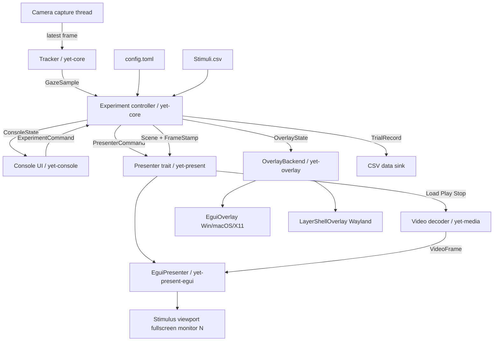

# UI & Graphics Crate Analysis — yet_zero → Rust

**Status:** analysis revised after requirements confirmation, 2026-10-25.
**Scope:** UI toolkit, image/video presentation, multi-window, desktop overlay, configuration and licensing consequences. Camera capture, eye detection, and ML are out of scope.

---

## 0. Confirmed requirements (2026-10-25)

These supersede the earlier assumptions and are the basis for the conclusions below.

| ID | Requirement | Consequence |
|---|---|---|
| **R1** | Windows, macOS and Linux are equally supported. | Wayland is first-class. Core app, console and presenter must work on all three. The desktop overlay needs a platform-specific Wayland backend; see R11 and §7.5. |
| **R2** | Presentation timing must be reasonable, not extreme. | Stable frame pacing, low latency and frame logging; no photodiode or hard-real-time guarantee required. `eframe` is acceptable. |
| **R3** | The overlay covers a whole monitor. | One fullscreen overlay per monitor; no window-following or real-time AOIs required. |
| **R4** | The console controls experiment flow; the presenter only presents. | Controller/presenter split. The console issues experiment commands, `yet-core` owns the state machine, and the `Presenter` trait must be replaceable and must not own state transitions. |
| **R5** | Stimuli are static images and video clips. | Video decode and frame pacing are in scope; the canvas must accept a stream of frames. |
| **R6** | Multi-monitor and HiDPI are required. | Canonical physical-pixel geometry, per-monitor targeting, scale-factor handling. |
| **R7** | Desktop only for v1; a simplified browser version may come later. | No WASM requirement now; keep `yet-core` UI-free so it can be reused later. |
| **R8** | GPL is acceptable. | Slint is no longer license-excluded. If GPL code is linked or copied, the distributed work must be GPL-compatible; see §11. |
| **R9** | TOML for machine config (screens, screen size, USB port); CSV for experiment/stimuli; no XLSX. | Split `config.toml` from `Stimuli.csv`/experiment CSV; add typed validation. |
| **R10** | The draw-command facade is sufficient for now. | No full Pygame `Surface`/`blit` API; keep `DrawCommand`/`Scene` small. |
| **R11** | The overlay must work on all three platforms. | **Conflict:** GNOME Wayland has no reliable native client-side always-on-top/click-through overlay. Options are a GNOME Shell extension or an XWayland fallback (as `wanderlay` does). See §7.5; this needs a spike/decision. |

**Still open (see §12):** final project license if GPL code is used; the GNOME/Wayland overlay strategy; the video decode pipeline; audio in video clips; the overlay interaction model.

---

## 0.1 TL;DR

**Recommendation: keep `egui` + `eframe` as the console/presenter UI substrate, but treat the desktop overlay as a separate, platform-backed subsystem.**

- `egui`/`eframe` still wins for the console plus a windowed/fullscreen presenter: pure Rust, mature, native multi-viewport, custom canvas, and low-latency `wgpu` configuration.
- It does **not** satisfy R1/R11 natively on GNOME Wayland. No client-side stack does. Use an `EguiOverlay` on Windows/macOS/X11, a `LayerShellOverlay` (Smithay client toolkit) on KDE/wlroots, and either an XWayland fallback or a separate GNOME Shell extension for GNOME.
- The console drives the experiment, `yet-core` owns the state machine, and the presenter is a dumb, replaceable media renderer. This matches R4 and makes a later `macroquad`/`winit`/SDL presenter possible.
- Video: there is no mature pure-Rust H.264 decoder. Choose pre-decoded image sequences (pure Rust, simple) or `video-rs`/`ffmpeg-next`/`gstreamer` (C dependency). See §6.6.
- GPL is now acceptable; Slint is no longer rejected on license, but remains a weaker fit for canvas and overlay.
- Timing: `eframe` is sufficient for R2. Keep frame logs; do not make a photodiode a release gate.

**Main remaining risk:** R11. Equal support is achievable for the core app, console and presenter. For the overlay, Windows/macOS/X11 and KDE/wlroots Wayland are covered; GNOME Wayland needs an XWayland fallback or a GNOME Shell extension, and that choice must be spiked.

**Important caveat:** `eframe` is not a hard-real-time stimulus presenter. It can be configured for low latency, and it exposes the underlying `winit` window and `wgpu` surface. Keep the `Presenter` boundary so the canvas backend can later be swapped to `winit + wgpu`, `pixels`, `macroquad`, or SDL3 without touching the tracker or experiment logic.

---

## 1. What the current UI actually does

The analysis is grounded in the Python implementation, not in an abstract wish list.

| yet_zero behavior | Evidence | Rust requirement |
|---|---|---|
| 900×900 window from `Config.csv`; title `Yeta1` | `main.py` L357–431, `Config.csv` | Configurable logical/physical surface size |
| Clear to white every loop, then present | `main.py` L285, L354 | `clear` + `present` |
| Load image, scale by `min(surface/image)`, center | `lib.py` L62–77 | Image decode, high-quality scale, centered placement |
| Static images only; no video | `lib.py` L62–77 | Image **and video-frame** presentation |
| Blurred stimulus preview | `lib.py` L79–85 | One-time blur, cached per stimulus |
| Average brightness of stimulus | `lib.py` L87–88 | Image statistics |
| Text at relative positions, three font sizes | `lib.py` L30–49; `main.py` L419–421 | Text with relative/physical positioning, bundled font |
| Calibration grid: gray circles, one orange active | `lib.py` L398–482 | Filled/stroked circles, state-driven color |
| Gaze feedback: red/green/blue circles | `lib.py` L382–395 | Circles at physical pixel coordinates |
| Live camera frame, BGR→RGB, rotate, half-size | `lib.py` L125–130; `main.py` L292–304 | Streaming texture, orientation/scale transform |
| Keyboard-only interaction: Space / Backspace / quit | `main.py` L94–188 | Key events, close event |
| Timed slide, automatic state transitions | `main.py` L197–235 | Monotonic clock, absolute-time scheduling |
| Data saved after every slide | `main.py` L219–221 | UI emits trial/frame timestamps to core |
| CSV config; no XLSX | `Config.csv`, `Stimuli.csv` | TOML machine config + CSV experiment/stimuli (R9) |

Derived functional requirements:

- **F1** Fixed-size window, optional borderless fullscreen on a chosen monitor; console and presenter may be on different monitors.
- **F2** Image and video-frame load/scale/center, alpha, optional blur.
- **F3** Text at relative and physical positions, multiple sizes, deterministic font.
- **F4** Filled and stroked circles; ideally rectangles/lines/polygons later.
- **F5** Live camera texture with orientation and scale control.
- **F6** Keyboard and window-close events.
- **F7** Timed state machine with automatic transitions, owned by the experiment controller; the console only issues commands.
- **F8** Per-frame timestamp logging, tied to trial and stimulus.
- **F9** Video clips: preload, play/stop/loop, PTS-based frame pacing, and a drop-late policy.
- **F10** Typed configuration: `config.toml` for machine/display/camera settings; CSV for experiment/stimuli; no XLSX.
- **F11** Console controls: load experiment/stimuli, start/pause/abort, select the presenter monitor, run calibration, show live camera/gaze feedback, and display status/logs.
- **F12** Console validation: surface bad monitor/camera/stimulus configuration as actionable errors before a session starts.

Derived non-functional requirements:

- **N1** Physical-pixel accuracy across HiDPI and multiple monitors.
- **N2** Reasonable frame pacing, controllable vsync/present mode, low latency; no hard-real-time requirement.
- **N3** A separate experimenter console that controls experiment flow; the presenter only presents.
- **N4** A whole-monitor transparent, always-on-top, click-through desktop overlay.
- **N5** Stable, mature dependencies; pure Rust preferred, GPL acceptable.
- **N6** Strict separation of tracking and experiment logic from graphics via traits/enums.
- **N7** Lean dependency graph and acceptable compile time.
- **N8** Headless testability of experiment logic (a recording presenter, no window needed).
- **N9** Windows/macOS/Linux parity for the core app, console and presenter; the Wayland overlay backend is selected per compositor capability.
- **N10** Presenter replaceability: no `egui` types in the trait; in-process and out-of-process implementations must both be conceivable.
- **N11** A GPL-compatible distribution if GPL crates or GPL prior art are linked or copied.

---

## 2. Method and snapshot

Sources:

- **crates.io API** (`/api/v1/crates?q=…`) for versions, download counts, last update, and license strings.
- **docs.rs** for the actual API surface of the shortlisted crates.
- **GitHub search API** and repository metadata for prior art, activity, and licenses.

This revision incorporates the confirmed requirements of 2026-10-25 (R1–R11 above), in particular platform parity, video stimuli, GPL acceptance, and the TOML/CSV split.

Queries included: `egui`, `eframe`, `macroquad`, `ggez`, `bevy`, `pixels`, `minifb`, `softbuffer`, `speedy2d`, `nannou`, `slint`, `iced`, `sdl2`, `raylib`, `tauri`, `winit`, `wgpu`, `smithay-client-toolkit`, `gtk4-layer-shell`, `tiny-skia`, `cosmic-text`, `overlay`, `click-through window`, `layer-shell`, `always-on-top`, `psychophysics`, `eye tracking`, `stimulus`, `stimulus presentation`, `experiment framework`, `pygame`, `psychtoolbox`, `video-rs`, `ffmpeg-next`, `ffmpeg-sidecar`, `gstreamer`, `egui-video`, `toml`, `csv`.

GitHub searches included: `eye tracking language:Rust`, `psychophysics language:Rust`, `eye tracker rust`, and `pygame rust clone`, sorted by stars.

Not shortlisted without deep evaluation:

- `druid` (discontinued), `relm4`/GTK (C dependencies), `dioxus`/`leptos`/`yew` (web-first), `makepad`/`floem`/GPUI forks (not mature/stable on crates.io), `kiss3d` (3D), `tetra`/`coffee`/`piston` (stale or no advantage).
- `vello` (promising GPU 2D renderer, still evolving), `raqote` (CPU 2D, less active), `skia-safe`/`cairo` (C/C++ dependencies), and SDL3 bindings (same non-pure-Rust tradeoff as SDL2, newer ecosystem).

The numbers below are a **snapshot**; re-check before pinning versions. Most candidates are still pre-1.0 (`egui` 0.37, `macroquad` 0.4, `bevy` 0.20, `iced` 0.14, `pixels` 0.17), so pin exact versions and keep the UI adapter thin.

---

## 3. Candidate landscape

### 3.1 UI toolkits

| Crate / version | Model | Pure Rust | License | Multi-window | Overlay: transparent / on-top / click-through | Custom canvas | Weight | Verdict |
|---|---|---|---|---|---|---|---|---|
| **`egui` 0.37 + `eframe` 0.37** | Immediate mode | Yes | MIT/Apache-2.0 | **Yes**, native viewports | **Yes / Yes / Yes** on Windows/macOS/X11; Wayland needs layer-shell | `Painter`, `TextureHandle`, `ColorImage`, custom `wgpu` callback | Medium (default `wgpu`); lower with `glow` | **Adopt** |
| `iced` 0.14 | Elm architecture | Yes | MIT | Yes | No / limited / no | `Canvas` widget | Medium | **Hold** (UI alternative) |
| `slint` 1.18.1 | Declarative | Runtime is Rust | **GPL-3.0-only OR royalty-free/commercial** (acceptable per R8) | Yes | No / limited / no | Image/path elements, custom renderer | Medium | **Hold** (weaker canvas/overlay) |
| `bevy` 0.20 + `bevy_egui` 0.43.1 | ECS game engine | Yes | MIT/Apache-2.0 | Yes | Yes / Yes / **No** (platform code needed) | Sprites, meshes, materials | Heavy; MSRV 1.97.1 | **Hold** (canvas grows) |
| `tauri` 2.12.5 | Webview shell | No (webview) | MIT/Apache-2.0 | Yes | Yes / Yes / Yes on Win/macOS/X11; Wayland compositor-dependent | HTML canvas (bad for timing) | Heavy | **Reject for presentation**; possible companion console |
| GPUI forks | Retained/GPU UI | Yes | Varies | Yes | Limited | Custom | Heavy | Not stable; skip |

Video is orthogonal to this table: all viable toolkits can display decoded frames as textures. The hard part is the decoder and frame pacing, covered in §6.6.

### 3.2 Pygame-like canvases

| Crate / version | API style | Pure Rust | Window model | Overlay | Timing control | Verdict |
|---|---|---|---|---|---|---|
| **`macroquad` 0.4.16** | Closest to Pygame: `clear_background`, `draw_texture_ex`, `draw_circle`, `draw_text`, `next_frame().await` | Yes | Single | No | `miniquad::conf::Platform::swap_interval` (hint only) | **Trial as out-of-process presenter** |
| `ggez` 0.10 | Love2D-like, wgpu 29 | Yes | Single | `transparent` flag only | No explicit vsync field in `WindowMode`/`Conf` | **Reject** (no advantage over macroquad here) |
| `pixels` 0.17.2 | GPU pixel framebuffer + `winit` | Yes | DIY per window | DIY | **Explicit**: `enable_vsync`, `present_mode` | **Trial as precision fallback** |
| `minifb` 0.29 | Minimal framebuffer | Yes | Single | No | Frame-rate limiting, not present-mode control | Reject (too low-level) |
| `softbuffer` 0.4.8 | Software framebuffer for `winit` | Yes | DIY per window | DIY | Present on blit; no renderer | Reject as canvas; useful fallback |
| `speedy2d` 3.1 | Simple 2D shapes/images/text | Yes | Single | No | Basic | Niche; low adoption |
| `nannou` 0.20 | Creative coding | Yes | Multi | No | Bevy-based | Reject (now Bevy-based and heavy) |
| `sdl2` 0.38 | SDL2 bindings; closest functional Pygame match | **No** | Multi | Yes (SDL window flags + hit test) | Explicit vsync/present | **Hold** (fallback if pure Rust fails) |
| `raylib` 6.0 | C bindings, simple 2D | **No** | Single | No | Basic | Reject |
| `processing` 0.3.2 | Processing-like | Yes | — | — | — | Dead since 2019 |

### 3.3 Overlay candidates

| Crate / approach | Platform | What it gives | Verdict |
|---|---|---|---|
| **`eframe` viewport** | Windows, macOS, X11 | Transparent + always-on-top + mouse passthrough + non-activating + monitor targeting | **Adopt** for Windows/macOS/X11; insufficient alone for GNOME Wayland |
| **`smithay-client-toolkit` 0.21.1 + layer-shell** | Wayland (KDE, wlroots, Sway) | `zwlr_layer_shell_v1`: top/overlay layer, anchor, exclusive zone, input region | **Adopt** as the Wayland overlay backend |
| XWayland + `x11rb`/`winit` | GNOME Wayland fallback | Override-redirect X11 window; click-through via input shape; `wanderlay --x11` reports this works on GNOME | **Trial** for GNOME (position/z-order spike required) |
| `gtk4-layer-shell` 0.8.1 | Wayland (wlroots/KDE) | GTK4 wrapper around layer-shell | Alternative, but pulls GTK4/C dependencies; GNOME still unsupported |
| `winit` + platform code | All (with per-OS work) | Full control: `WS_EX_LAYERED/TRANSPARENT`, input regions, `NSWindow` level | Fallback / advanced |
| `tauri` 2.12.5 | All | Multi-window, transparent, always-on-top, `set_ignore_cursor_events` | Companion app only; Wayland compositor-dependent |
| `procmod-overlay` 3.0.1 | **Windows only** (D3D11) | Exactly the game-overlay pattern; MIT | **Reference only** |
| `wanderlay` 0.3 | GNOME Wayland claim; `--x11` fallback | Click-through always-on-top text overlay | Investigate technique; upstream layer-shell docs say GNOME-on-Wayland is unsupported |
| `see-the-arrow` 0.2 | Windows/Linux | Click-through, non-focusing overlay | Reference only |
| `rightkit-overlay-win` 0.1 | Windows | Layered-window painter, DWM pacing | Reference only |
| `tristim-display` 0.3 | Wayland | Layer-shell RGB patches + color management | Reference for color calibration |
| `always-on-top-windows` 0.1.1 | Windows | Tiny helper | Not needed with egui |

### 3.4 Supporting crates worth knowing

| Crate | Role |
|---|---|
| `winit` 0.30.13 | Window/event loop foundation; escape hatch from eframe |
| `wgpu` 30.0.1 | GPU API; present modes, custom canvas |
| `egui-winit` 0.37, `egui-wgpu` 0.37 | Build a custom multi-window shell if eframe becomes limiting |
| `image` 0.25 | Decode/scale images (also an eframe dependency); animated GIF/WebP/APNG via `AnimationDecoder` |
| `video-rs` 0.12 | High-level FFmpeg-based video decoding; not pure Rust |
| `ffmpeg-next` 9.0 | Lower-level FFmpeg bindings; not pure Rust |
| `ffmpeg-sidecar` 2.7 | Drives a standalone `ffmpeg` binary; avoids linking FFmpeg, adds an external runtime dependency |
| `gstreamer` 0.25 | LGPL GStreamer bindings; robust pipeline/appsink, C dependencies |
| `calloop` | Event loop used by `smithay-client-toolkit` for the Wayland overlay |
| `x11rb` | Pure Rust X11 bindings; GNOME XWayland overlay fallback |
| `egui-video` 0.9 | Stale egui video widget (last updated 2024-10); do not depend on it |
| `toml` + `serde` | Machine configuration (`config.toml`) |
| `csv` + `serde` | Experiment/stimulus tables (`Stimuli.csv`) |
| `tiny-skia` 0.12 | CPU 2D rendering; deterministic offscreen stimuli / snapshot tests |
| `cosmic-text` 0.19 | Text shaping if building a custom backend |
| `fastblur` / `imageproc` | One-time Gaussian blur for stimulus previews |

---

## 4. Deep dive: `egui` + `eframe`

### 4.1 Why it fits

`eframe` 0.37 documents native multi-viewport support, and `egui::ViewportBuilder` exposes exactly the window features this project needs:

- `with_fullscreen(true)`
- `with_monitor(index)` — borderless fullscreen on a chosen monitor; works on Windows, macOS, Linux X11 and Wayland; takes precedence over position/fullscreen.
- `with_transparent(true)`
- `with_window_level(WindowLevel::AlwaysOnTop)` / `with_always_on_top()`
- `with_mouse_passthrough(true)` — desktop click-through for non-interactable overlays.
- `with_decorations(false)`, `with_taskbar(false)`, `with_active(false)` (the last is a no-op on X11/Wayland; see §7)
- X11-specific `with_window_type(X11WindowType::…)` and `with_override_redirect(true)`

Multi-window comes in two flavours:

- **Immediate viewports** (`Context::show_viewport_immediate`): simple, closure-based, but parent and child repaint together. N viewports can mean N× CPU work.
- **Deferred viewports** (`Context::show_viewport_deferred`): independently repainted, better for a console that should not force the stimulus window to redraw. Communication must go through channels or `Arc<Mutex<…>>`.

This maps well to R4:

- root viewport = experimenter console (small, normal window); it owns the state machine and experiment flow;
- deferred or immediate viewport = stimulus presenter (fullscreen on the experiment monitor); it only renders the scene it is given;
- one viewport per monitor = optional overlay(s).

Because the presenter is intentionally dumb, an in-process `EguiPresenter` is the first implementation, but the same `Scene`/`DrawCommand` can later be rendered by `macroquad`, `winit + wgpu`, or a separate process.

### 4.2 Canvas capabilities

`egui` is not a game engine, but it has the primitives yet_zero needs:

- `Painter::rect_filled`, `circle_filled`, `circle_stroke`, `line_segment`, `text`, `image`.
- `TextureHandle` for stimulus images and the live camera frame; `ColorImage` for uploads. Reuse the texture for video: allocate once, then call `TextureHandle::set` with each decoded frame; do not create a texture per frame.
  Note: `Color32` is **premultiplied** sRGB. Use `ColorImage::from_rgba_unmultiplied` for PNG/JPEG alpha, or transparent edges will darken.
- `FontDefinitions` / `FontId` for a bundled font; `layout` for measuring text.
- `Context::request_repaint()` for continuous animation; `request_repaint_after()` for idle states.
- `InputState::stable_dt`, `Instant`, and per-viewport `ViewportInfo` for the clock and geometry.

For high-quality image scaling, pre-resize with the `image` crate (Lanczos/Triangle) once per stimulus, then upload. For the blurred preview, blur once and cache the texture; do **not** re-blur every frame as `Stimulus.draw_preview` currently does.

### 4.3 Timing and presentation

`eframe::WgpuConfiguration` exposes:

```rust
SurfaceConfig {
    present_mode: wgpu::PresentMode,
    desired_maximum_frame_latency: Option<u32>,
}
```

`SurfaceConfig::LOW_LATENCY` is the documented low-latency default; `Frame::set_wgpu_surface_config()` changes it at runtime. `Frame::wgpu_surface_config()` reads the current value. The config may silently fall back if the surface does not support the requested present mode.

`eframe::Frame` also exposes:

- `winit_window() -> Option<&Arc<winit::Window>>` — monitor enumeration, physical geometry, cursor hit-testing, platform tweaks.
- `wgpu_render_state()` — custom wgpu resources and `egui::PaintCallback` if the egui tessellator is not enough.

**What this does not guarantee:** egui is an immediate-mode UI. It collects shapes, tessellates, and presents once per frame. It is not a fixed-timestep, exclusive-fullscreen presentation engine. For R2 (reasonable, not extreme), log frame timestamps and verify that frames are not visibly late; no photon-level measurement is required.

### 4.4 Geometry: the important trap

`egui::ViewportInfo` reports `inner_rect`, `outer_rect`, and `monitor_size` in **egui points**, not physical pixels. Convert with:

```
pixels_per_point = ctx.zoom_factor() * info.native_pixels_per_point
physical_px     = point * pixels_per_point
```

Also, on Wayland, `inner_rect` and `outer_rect` are **always `None`** because the compositor does not expose window position. `with_monitor(index)` still targets a monitor correctly; treat the fullscreen window as monitor-local `(0, 0)` and use `Frame::winit_window()` for the monitor handle.

Do not mix logical points and physical pixels in the tracker. This is the most likely source of a silent calibration offset on HiDPI or multi-monitor systems.

### 4.5 Weaknesses

- Pre-1.0 API churn: pin `egui`/`eframe` exactly (or rely on a committed `Cargo.lock`) and keep all egui-specific code in `yet-console`, `yet-present-egui`, and `yet-overlay`.
- Default `eframe` pulls `wgpu`; compile time and binary size are medium, not tiny. `glow` is an option, but verify its swap-interval controls before relying on it.
- For a lean build, disable unused `eframe` defaults deliberately (`accesskit`, `persistence`, `system_fonts`, `clipboard`, `links`). For deterministic text, disable `system_fonts` and bundle the exact font via `FontDefinitions`.
- Color is handled in sRGB. For luminance-controlled experiments, pre-linearize and calibrate outside egui; do not assume `Color32` is linear.
- `NativeOptions::dithering` defaults to `true`; disable it for flat-color stimuli if exact pixel values matter.
- No exclusive fullscreen (eframe uses borderless fullscreen).
- Per-frame tessellation is unnecessary for a static stimulus but usually cheap at this scale.
- Text metrics differ from Pygame; bundle the same font and accept small layout differences.
- No built-in video decode. Pair it with a decoder thread and texture upload (see §6.6); `egui-video` is stale and should not be used.
- Overlay support is platform- and compositor-dependent; eframe alone does not solve GNOME Wayland (see §7.5).

---

## 5. Deep dive: `macroquad`

### 5.1 Why it is attractive

`macroquad` is the closest Rust analogue to Pygame:

```rust
loop {
    clear_background(WHITE);
    draw_texture_ex(&texture, x, y, WHITE, DrawTextureParams { dest_size: Some(size), .. });
    draw_circle(x, y, r, ORANGE);
    draw_text("Follow the orange circle", x, y, size, BLACK);
    next_frame().await;
}
```

It is pure Rust, MIT/Apache-2.0, compact, fast to compile (the project advertises ~16 s clean builds), and has image loading, fonts, shapes, input, and animation. For the stimulus window alone, it is an excellent fit.

### 5.2 Why it cannot be the primary

- **Single window.** There is no multi-window API; `screen_width()`/`screen_height()` refer to one context. That is acceptable for a presenter-only process (one fullscreen stimulus window), but not for console + presenter in one process.
- **No overlay.** No transparency/always-on-top/click-through window API. `miniquad` is a game window, not a desktop overlay.
- **No monitor enumeration / fullscreen-per-monitor.** `set_fullscreen(true)` toggles fullscreen on the current monitor; `set_window_position`/`set_window_size` can position a borderless window, but you must compute monitor geometry yourself. There is no `with_monitor(index)` equivalent.
- **Timing is a hint.** `miniquad::conf::Platform::swap_interval: Option<i32>` exists, but the docs explicitly say it is a hint and not a reliable FPS limiter. `next_frame().await` is simple, but there is no `present_mode` / frame-latency control.
- **HiDPI default is off.** `Conf::high_dpi` defaults to `false`. If enabled, coordinate conversions must be handled explicitly.
- **Mixing with egui is not viable in one process.** `egui-macroquad` 0.17.3 (May 2025) and `new-egui-macroquad` 0.16.0 (Dec 2024) are far behind egui 0.37; neither gives native multi-viewport or overlay. Two winit event loops cannot coexist cleanly in one process.

**Verdict:** keep `macroquad` as a strong **out-of-process presenter** candidate: egui console + `macroquad` presenter is the cleanest way to get a Pygame-like API without compromising the console or overlay. It is not the primary single-process stack because of IPC, focus, clock-sync, and packaging complexity. Start with an in-process `EguiPresenter`; the `Presenter` trait keeps this door open.

---

## 6. Deep dive: the other contenders

### 6.1 `bevy`

- Multi-window, sprites, animation, asset loading, timing: all strong.
- `bevy_egui` 0.43.1 is active and aligned with Bevy 0.20.
- Windows can be transparent and always-on-top, but **click-through is not first-class**; you would drop to `winit`/platform code.
- Heavy compile times, ECS ceremony, and a large dependency surface. Not "lean".
- Prior art: `altunenes/weber_fechner` is a MIT-licensed Bevy psychophysics experiment. Good reference for state/timing patterns, but it has been inactive since 2023.
- Bevy 0.20 declares MSRV 1.97.1; check the lab's toolchain policy.

**Verdict:** hold. Revisit if the stimulus canvas grows beyond simple 2D.

### 6.2 `iced`

- MIT, pure Rust, multi-window, good UI architecture.
- `Canvas` widget can draw shapes, text, and images.
- No first-class overlay/click-through; timing control is less explicit.
- Elm-style architecture adds ceremony for a fullscreen stimulus loop.

**Verdict:** viable console alternative, not the best overall.

### 6.3 `slint`

- Excellent declarative UI, multi-window, animations, small runtime.
- License is `GPL-3.0-only OR LicenseRef-Slint-Royalty-free-2.0 OR LicenseRef-Slint-Software-3.0`. GPL is acceptable per R8, so license is no longer the blocker.
- The remaining blockers are functional: no first-class click-through overlay, and a declarative UI model that is not a Pygame-like canvas.

**Verdict:** hold. Usable for a console, but not a better fit than egui for this project.

### 6.4 `pixels` / `winit`

- `pixels` 0.17 gives a GPU-backed pixel buffer with explicit `enable_vsync` and `present_mode`.
- You own the window, event loop, text, and shape rendering (`cosmic-text`, `lyon`, or `tiny-skia`).
- Multi-window and overlay are possible via `winit` + platform code, but you write the plumbing.
- This is the best **precision fallback** if eframe's timing or tessellation becomes a problem.

**Verdict:** trial only as a fallback backend.

### 6.5 SDL2 / SDL3

- Functionally the closest to Pygame: multiple windows, vsync, fullscreen, transparent/always-on-top windows, hit-testing for click-through.
- Not pure Rust, adds a C build/runtime dependency. SDL2 itself is zlib-licensed; bindings are MIT.
- Worth keeping as a "break glass" option if the pure-Rust overlay path fails on the lab's OS.

### 6.6 Video stimuli

R5 changes the canvas from static images to a frame stream. The display side is easy: upload each decoded frame into a texture and draw it. The hard part is decoding and pacing.

| Option | Pure Rust | Formats | Integration | Tradeoff |
|---|---|---|---|---|
| `image` animation decoder | Yes | GIF/WebP (APNG depends on decoder) | Trivial | No H.264/MP4 |
| Pre-decode to image sequence (FFmpeg at setup time) | Yes at runtime | Any format FFmpeg supports | Presenter only sees images | Disk size and preprocessing step |
| `video-rs` 0.12 | No (FFmpeg) | Broad | Worker thread → RGB frames → texture | FFmpeg libs and build complexity |
| `ffmpeg-next` 9.0 | No (FFmpeg) | Broad | Lower-level FFmpeg API | Same, more code |
| `ffmpeg-sidecar` 2.7 | Rust crate, external `ffmpeg` binary | Broad | Iterator over raw frames | Requires FFmpeg installed at runtime |
| `gstreamer` 0.25 | No (LGPL C libraries) | Broad | `appsink` → frames | Robust but heavy |
| `egui-video` 0.9 | — | — | Stale egui widget | Do not use (last update 2024-10) |

**Recommendation for R5:**

- **v1: pre-decode video clips to an image sequence**, or use the `image` animation decoder for simple GIF/WebP clips. The presenter stays a frame presenter, and timing is based on frame timestamps or a fixed frame rate. This keeps the runtime pure Rust and avoids a decoder in the render loop.
- If arbitrary MP4/H.264 playback at runtime is mandatory, use `video-rs` (preferred) or `ffmpeg-next` on a decoder thread with a bounded frame queue. GPL is acceptable per R8, so FFmpeg/GStreamer licensing is not a blocker.
- Do **not** use `egui-video`; it is stale relative to egui 0.37.
- Video timing: preload the first frame before the trial starts, schedule frames by presentation timestamp, drop late frames instead of blocking, and let the console issue play/stop/loop commands. Audio is out of scope unless confirmed in §12.

---

## 7. Desktop overlay deep dive

### 7.1 Capability matrix

| Capability | Windows | macOS | Linux X11 | Linux Wayland |
|---|---|---|---|---|
| Transparent window | Yes (`with_transparent`) | Yes + `with_has_shadow(false)` | Yes (compositor required) | Compositor-dependent |
| Always-on-top | Yes | Yes | Yes (`_NET_WM_STATE_ABOVE`) | **Only via layer-shell**; normal toplevels are usually ignored |
| Click-through | Yes (`mouse_passthrough`) | Yes | Yes (input shape) | **Only via layer-shell** input region (or compositor-specific) |
| Non-activating / no focus steal | Yes (`with_active(false)`) | Yes | Not via `with_active`; use override-redirect/WM hints | Layer-shell with no keyboard interactivity |
| Position/size known | Yes | Yes | Yes | Monitor-local fullscreen: yes; global position: no |
| Target a specific monitor | Yes | Yes | Yes | Yes via `with_monitor(index)` or one layer-shell surface per output |
| Whole-monitor overlay (R3) | Yes | Yes | Yes | Yes on layer-shell compositors (KDE, wlroots, Sway) |
| Robust overlay above fullscreen apps | Usually | Special collection behavior | Yes | Layer-shell top/overlay layer |
| Follow another app's window | Not required by R3 | Not required | Not required | Not required |

### 7.2 Overlay construction: `EguiOverlay` (Windows/macOS/X11)

Use a dedicated viewport:

```rust
ViewportBuilder::default()
    .with_title("YET overlay")
    .with_transparent(true)
    .with_decorations(false)
    .with_always_on_top()
    .with_mouse_passthrough(true)
    .with_taskbar(false)
    .with_active(false) // no-op on X11/Wayland; use override-redirect/WM hints there
    .with_monitor(monitor_index)
    .with_fullscreen(true)
```

Set `App::clear_color` to transparent, draw only the gaze dot/heatmap, and keep the window click-through. For interaction, send `ViewportCommand::MousePassthrough(false)` and `ViewportCommand::Focus` from the console; send the inverse to return to recording mode.

Caveats:

- **Click-through means no keyboard.** Control the overlay from the console window or a global hotkey. Do not expect the overlay to receive keys.
- **X11 non-activation:** `with_active(false)` is documented as unsupported on X11/Wayland. For a non-activating X11 overlay, use `with_override_redirect(true)` plus an appropriate `X11WindowType`, or set WM hints yourself via `Frame::winit_window()`.
- **macOS:** may need `NSWindowCollectionBehavior::CanJoinAllSpaces` for full-screen apps; use `Frame::winit_window()` + `objc2` if egui does not expose it.
- **X11:** compositing must be enabled for transparency. `with_override_redirect(true)` + an appropriate `X11WindowType` can help for non-managed overlays.
- **Wayland:** not handled by this backend. `EguiOverlay` is for Windows/macOS/X11; use `LayerShellOverlay` for KDE/wlroots Wayland (see §7.5).

### 7.3 Whole-monitor overlay for "website navigation" tasks

R3 removes window-following from the scope. The v1 design is:

1. **Whole-monitor recording.**
   - A fullscreen transparent overlay on the experiment monitor draws a gaze dot (optional).
   - Log gaze in monitor-local physical pixels with monotonic timestamps.
   - Record the screen during the session.
   - Map gaze to page coordinates offline using the recording and known browser geometry.
   - No per-OS window tracking, no browser extension, robust.

2. **Real-time AOIs (later, not v1).**
   - Needs foreground-window tracking, browser content-rect detection, and page scroll/DOM state.
   - Much more platform-specific and brittle. Do not put this in v1.

For web-page experiments, also consider that browser chrome (tabs, URL bar) is not part of the page. Record the page viewport separately, or use a kiosk/fullscreen browser.

### 7.4 Existing overlay code worth reading

- `procmod/overlay` (MIT): Windows `WS_EX_LAYERED | WS_EX_TRANSPARENT`, target-window tracking, D3D11. Excellent Win32 reference, not cross-platform.
- `zefr0x/ianny` (GPL-3.0): egui/winit overlay on Wayland; reusable if yet-rs adopts GPL, otherwise reference only.
- `wanderlay` (GPL-3.0): claims a GNOME Wayland overlay, but also ships an `--x11` fallback. Upstream `gtk4-layer-shell` documentation explicitly lists GNOME-on-Wayland as **unsupported**, so treat the GNOME claim as unproven until spiked.
- `see-the-arrow` (Windows/Linux), `rightkit-overlay-win` (Win32): small, focused overlay implementations. Verify licenses before reuse.
- `smithay-client-toolkit` / `gtk4-layer-shell`: layer-shell implementations for KDE/wlroots/Sway.
- `tristim-display`: Wayland layer-shell and color-management reference.

### 7.5 Platform parity and the GNOME Wayland conflict (R11)

This is the one place where R1 and R11 cannot both be met natively by a Wayland client. An XWayland fallback or a GNOME Shell extension is required.

| Platform | Overlay strategy | Status |
|---|---|---|
| Windows | `EguiOverlay`: transparent + always-on-top + `mouse_passthrough` + no taskbar/focus | Full support |
| macOS | `EguiOverlay` + `with_has_shadow(false)`; `NSWindowCollectionBehavior::CanJoinAllSpaces` via `Frame::winit_window()` + `objc2` | Full support, needs a small platform shim |
| Linux X11 | `EguiOverlay` + override-redirect/WM hints; compositor for transparency | Full support |
| Linux Wayland (KDE, wlroots, Sway) | `LayerShellOverlay` via `smithay-client-toolkit` + `zwlr_layer_shell_v1`; one surface per output; empty input region | Full support |
| Linux Wayland (GNOME/Mutter) | Native: no reliable always-on-top/click-through protocol; layer-shell is not supported by upstream `gtk4-layer-shell`/GNOME-on-Wayland. XWayland fallback: reported working by `wanderlay --x11`. | **Needs an XWayland spike or a GNOME Shell extension** |

Upstream `gtk4-layer-shell` (checked 2026-10-25) lists wlroots, Smithay, Mir, and KDE Plasma as supported, and explicitly lists **GNOME-on-Wayland** as unsupported. `wanderlay`'s GNOME claim is therefore likely its `--x11` fallback, not native GNOME Wayland.

Windows/macOS/X11 support depends on `winit`'s cursor hit-test and window-level implementations; the overlay spike must confirm it on the target OS versions.

Options for GNOME Wayland:

1. **Document the limitation** and scope the overlay to Windows/macOS/X11 + layer-shell compositors. Lowest-risk, but fails strict R11.
2. **Ship a small GNOME Shell extension** that creates a topmost, click-through actor controlled by the app (D-Bus). This adds a non-Rust component, a separate install path, and GNOME-version maintenance.
3. **Use an XWayland fallback.** `wanderlay` ships `--x11` and claims it works on GNOME. Test multi-monitor positioning, z-order, and click-through before relying on it; if it passes, it is the cheapest way to meet R11 without an extension.

**Implementation note:** a layer-shell surface is **not** a `winit` window, so it cannot be an eframe viewport. `LayerShellOverlay` needs its own Wayland event loop (`calloop` + `smithay-client-toolkit`) and a small renderer (`softbuffer`/`tiny-skia` or `wgpu`). It can run as a separate thread or process, controlled by the console. This is why the overlay is a separate `OverlayBackend` trait, not just another eframe viewport. The presenter itself can still use eframe `with_monitor` for fullscreen stimulus windows on Wayland. `OverlayBackend` hides whether the implementation is an eframe viewport, an in-process SCTK loop, or an IPC client to a separate overlay process.

**Recommendation:** implement `EguiOverlay` and `LayerShellOverlay` behind an `OverlayBackend` trait, and add an XWayland overlay backend for GNOME if the spike passes. If strict R11 parity is non-negotiable and XWayland fails, treat the GNOME extension as a separate deliverable and spike it before committing. This is the main unresolved requirement.

---

## 8. Timing and presentation

### 8.1 What yet_zero does today

`main.py` uses `time.time()` for the slide clock and `pg.display.update()` at the end of the loop. Pygame is created without an explicit vsync flag. The loop runs as fast as the machine allows, and the presentation duration is checked against wall-clock time. This is fine for a prototype but not a timing guarantee. Under R2, the Rust target is stable, low-latency presentation with frame logs, not photon-level timing.

### 8.2 What the Rust port should measure

Define a `FrameStamp`:

```rust
struct FrameStamp {
    experiment_t: Duration,       // monotonic since experiment start
    requested_at: Instant,        // before submitting the frame
    presented_at: Instant,        // after present returns (or next frame callback)
    dt: Duration,                 // since previous frame
    media_pts: Option<Duration>,  // video presentation timestamp, if any
    dropped: bool,
}
```

Log at least:

- requested/presented timestamps per frame;
- frame interval and jitter (p50/p95/p99);
- dropped or late frames;
- stimulus on/off timestamps and trial IDs;
- display refresh rate, present mode, monitor index, and scale factor at startup.

eframe does not expose a direct post-present callback. Record `requested_at` at the start of the UI callback and derive an upper bound for presentation from the next frame's start plus `stable_dt`; for a precise backend, use a `wgpu::Queue::submit`/surface-present hook.

### 8.3 Timing controls by backend

| Backend | Vsync / present control | Notes |
|---|---|---|
| `eframe` + `wgpu` | `SurfaceConfig { present_mode, desired_maximum_frame_latency }`; `SurfaceConfig::LOW_LATENCY`; `Frame::set_wgpu_surface_config` | Best pure-Rust option; still not hard real-time |
| `macroquad` | `miniquad::conf::Platform::swap_interval` | Explicitly a hint, not a reliable limiter |
| `pixels` | `enable_vsync(bool)`, `present_mode(PresentMode)` | Good control; you own the loop and rendering |
| `ggez` | No explicit field in `WindowMode`/`Conf` | wgpu defaults apply |
| SDL2 | Vsync flag / `present_vsync` | Good control, but not pure Rust |

### 8.4 Presentation strategy

- Use **borderless fullscreen** on the experiment monitor (`with_monitor`), not a resizable window.
- Request continuous repaint while a stimulus is visible; use absolute-time transitions, not accumulated `dt`.
- Warm up for a few frames after mode changes or window creation; discard the warm-up from analysis.
- Prefer `Fifo`/`AutoVsync` for tear-free presentation unless latency measurements justify `Mailbox`.
- Set `desired_maximum_frame_latency = Some(1)` for low latency.
- Disable OS animations, notifications, and display scaling changes during a session.
- **Video pacing:** drive frames by presentation timestamp, not decode speed; preload the first frame before trial start; drop late frames instead of blocking the UI thread; log `media_pts` and the number of dropped frames.
- Validate visually and with frame logs. A photodiode/high-speed-camera measurement is optional, not a release gate for R2.

**Decision gate:** if the frame log shows visible jank, repeated late frames, or dropped frames above the agreed budget, move the stimulus window to a `winit + wgpu`/`pixels` backend (or SDL3) behind the same `Presenter` trait. Do not change the tracker or experiment state machine.

---

## 9. Recommended architecture



The experiment controller (`yet-core`) is the only component that decides state transitions. The console issues commands; the presenter has no experiment logic and does not know what a trial is. It applies `PresenterCommand`s and draws the `Scene` it is handed.

### 9.1 Crate layout

| Crate | Responsibility | UI dependencies |
|---|---|---|
| `yet-core` | Experiment controller/state machine, tracker traits, calibration, regression, data model | **None** |
| `yet-present` | `Presenter`, `OverlayBackend` and `VideoSource` traits; `Scene`/`DrawCommand`, `PresenterCommand`, `ScreenGeometry`, `FrameStamp` | **None** |
| `yet-console` | egui experimenter console; sends commands; never renders the stimulus | `egui` / `eframe` |
| `yet-present-egui` | `EguiPresenter`; viewport, textures, text/shapes, video-frame upload | `egui` / `eframe` |
| `yet-overlay` | `EguiOverlay` (Windows/macOS/X11), `LayerShellOverlay` (KDE/wlroots Wayland), `XwaylandOverlay` (GNOME fallback) | `egui` / `eframe`, `smithay-client-toolkit`, `x11rb` |
| `yet-media` | Image/video decode, preloading, frame mailbox; `VideoSource` implementation | decoder crates |
| `yet-app` | Binary: config, camera, tracker, wiring | all |
| `yet-camera` (later) | Camera capture, frame mailbox | None |
| `yet-ml` (later) | Regression/model | None |

The important rule: **no `egui` types in `yet-core` or `yet-present`.** If the tracker or experiment logic imports `egui`, the separation has failed.

`LayerShellOverlay` is not an eframe viewport: it owns a Wayland event loop and renders to a layer-shell surface. Treat it as a separate overlay service controlled by the console.

Console scope (F11–F12): experiment load/start/pause/abort, calibration triggers, presenter-monitor selection, live camera preview, gaze trace, status/logs, and config editing. The console may display a camera texture, but it is not the stimulus presentation path.

Use the `eframe::egui` re-export rather than adding `egui` as a separate direct dependency. A version mismatch creates two incompatible `egui::Context` types and confusing errors.

Minimal starting set for the first spike:

```toml
[dependencies]
eframe = "0.37"   # start with defaults; trim features after the spike
image = "0.25"    # stimulus decode/scale; already in eframe's tree
```

Add `serde`, `toml`, `csv`, `thiserror`, `tracing`, and `crossbeam-channel` when the corresponding spike needs them. Do not add `macroquad` or a video decoder until the optional backend is actually evaluated.

### 9.2 Trait and display-list sketch

```rust
pub struct ScreenGeometry {
    pub monitor_index: usize,
    pub origin_px: Option<(i32, i32)>, // None on Wayland; monitor-local when unknown
    pub size_px: (u32, u32),
    pub scale_factor: f32,             // native pixels per point
}

pub struct Scene<'a> {
    pub commands: Vec<DrawCommand<'a>>,
}

pub struct PresentStats {
    pub frame: FrameStamp,
    pub dropped_frames: u32,
}

pub trait Presenter {
    fn geometry(&self) -> ScreenGeometry;
    fn apply(&mut self, cmd: PresenterCommand) -> Result<(), PresenterError>;
    fn present(&mut self, frame: &FrameStamp, scene: &Scene<'_>) -> PresentStats;
}

pub enum ExperimentCommand {
    Start,
    Pause,
    Resume,
    NextTrial,
    Abort,
    ToggleOverlay,
    SetOverlayMonitor(usize),
}

pub enum PresenterCommand {
    LoadImage { id: MediaId, path: PathBuf },
    LoadVideo { id: MediaId, path: PathBuf, looped: bool },
    ShowMonitor { monitor: usize, fullscreen: bool },
    Play { id: MediaId },
    Stop,
    Shutdown,
}

pub trait OverlayBackend {
    fn show(&mut self, monitor: usize) -> Result<(), OverlayError>;
    fn set_visible(&mut self, visible: bool);
    fn set_passthrough(&mut self, enabled: bool) -> Result<(), OverlayError>;
}

pub trait VideoSource {
    fn preload(&mut self) -> Result<(), MediaError>;
    fn next_frame(&mut self, now: Duration) -> Option<VideoFrame>;
}

pub enum DrawCommand<'a> {
    Clear(Color),
    Image { media: MediaId, dest_px: RectPx, filter: Filter, alpha: f32 },
    Circle { center_px: PointPx, radius_px: f32, stroke_px: f32, color: Color },
    Text { pos_px: PointPx, text: &'a str, font: FontId, size_px: f32, color: Color, anchor: Anchor },
    Line { from_px: PointPx, to_px: PointPx, width_px: f32, color: Color },
}
```

`MediaId`, `FontId`, `PointPx`, and `RectPx` are our own newtypes/enums. None of them may be `egui` types. The presenter owns the `MediaId → texture` mapping, so the console never handles backend texture IDs. `MediaId` is stable and console-owned, so the presenter can preload media without knowing the experiment state.

The sketch borrows text for in-process efficiency. If the presenter becomes out-of-process, make `Scene` serializable (owned strings/IDs) or define a wire format; do not put borrowed buffers on the wire.

The draw-command facade is the interface for now (R10). For reference, the mapping to the old Pygame calls is:

| Pygame | Rust facade |
|---|---|
| `SURF.fill(color)` | `scene.clear(color)` |
| `SURF.blit(img, pos)` | `scene.image(media, dest_px)` |
| `pg.draw.circle(...)` | `scene.circle(...)` |
| `draw_text(...)` | `scene.text(...)` |
| `pg.display.update()` | `presenter.present(frame, scene)` |
| `pg.event.get()` | `controller.poll_events()` |
| `time.time()` | `FrameStamp.experiment_t` |

A higher-level Pygame-like wrapper can be added later if it earns its keep, but it is not part of v1. The `Scene`/`DrawCommand` boundary is enough to test the experiment logic and to swap presenters.

### 9.3 Coordinate model

- **Canonical space:** physical pixels, monitor-local origin `(0, 0)`, plus the monitor's desktop origin for multi-monitor logging.
- Tracker output: physical pixels.
- Stimulus placement: `ImagePlacement { dest_px, scale }`; log it per trial.
- egui UI code: convert physical pixels to points at the boundary:
  `points = pixels / (ctx.zoom_factor() * native_pixels_per_point)`.
- Calibration targets: generated in physical pixels from monitor-local relative positions.
- Round calibration targets and gaze dots to physical pixels; otherwise egui's feathering antialiases them across pixel boundaries.
- Persist monitor identity by name/size as well as index; indices can change on hot-plug or reordering.
- On Wayland, treat the fullscreen window as monitor-local and do not rely on global window position.
- Platform geometry queries return `Option`; never `unwrap` a monitor position. On Wayland, `origin_px` is `None`; fall back to monitor-local coordinates and log the limitation.

### 9.4 Threading model

- Camera capture on its own thread; publish only the latest frame (bounded mailbox / `triple_buffer`), never a growing queue.
- Tracker worker consumes the latest frame; UI thread reads the latest `GazeSample`.
- UI thread never blocks on camera I/O or model fitting.
- Use `crossbeam-channel` or `std::sync::mpsc`; avoid `Arc<Mutex<Frame>>` around large image buffers.
- Console ↔ experiment communication via channels; deferred viewports require this anyway.

### 9.5 Headless testability

Implement a `RecordingPresenter` in `yet-present` that records `DrawCommand`s into a vector. Run the state machine in tests and assert:

- calibration grid positions and active target;
- stimulus placement/scaling;
- slide timing transitions;
- gaze-to-stimulus mapping;
- data rows and timestamps.

This is only possible if the display list and state machine are independent of egui. It is a strong argument for the proposed boundary.

### 9.6 Configuration (R9)

`config.toml` holds machine/display/camera settings only:

```toml
[display]
presenter_monitor = 1
console_monitor = 0
width = 1920
height = 1080
fullscreen = true

[camera]
usb_index = 1

[presenter]
backend = "egui"      # later: "macroquad", "wgpu"
overlay = "auto"      # auto | off | egui | layer-shell

[overlay]
monitor = 1
```

`Stimuli.csv` holds the experiment and stimulus table:

```csv
id,kind,path,duration_ms
t01,image,stimuli/t01.png,3000
t02,video,stimuli/t02.mp4,5000
```

- No XLSX. `config.toml` is only machine configuration per R9; experiment metadata, trial order, stimulus list and durations stay in CSV (`Stimuli.csv` and, if needed, `Experiment.csv`).
- Mapping from the old `Config.csv`: `WIDTH`, `HEIGHT`, `USB` → `config.toml`; `EXP_ID`, `EXPERIMENTER`, `SLIDE_TIME`, `STIM_FILE`, `SHUFFLE` → `Experiment.csv`.
- Validate monitor index/name, resolution, camera index, and file paths at startup. Return typed errors, not panics.
- Use `serde` + `toml` for reads and `serde` + `csv` for tables. If the console writes `config.toml` back, use `toml_edit` to preserve comments; plain `toml` serialization will drop them.
- Store monitor identity by index **and** name/EDID; indices can change when monitors are hot-plugged or reordered.
- `overlay = "auto"` selects `EguiOverlay` on Windows/macOS/X11, `LayerShellOverlay` on layer-shell Wayland compositors, and `XwaylandOverlay` on GNOME Wayland; report a clear error if the selected backend is unavailable.

### 9.7 Presenter deployment (R4)

- **v1: in-process.** eframe console + `EguiPresenter` in one process. Simple, no IPC, shared monotonic clock. The console sends `ExperimentCommand`s to `yet-core`; `yet-core` sends `PresenterCommand`s and `Scene`s to the presenter through a channel. A deferred viewport prevents console repaints from forcing the stimulus window to redraw.
- **Later: out-of-process.** The same traits over IPC: egui console + `macroquad`/`winit`/SDL presenter in separate processes. This needs serialization, media transfer (or shared file paths), clock synchronization, focus handling, and lifecycle management. Do not build it first; the trait boundary is the prerequisite, not the deployment.
- The presenter never owns experiment state. If it reports input or frame statistics, it sends events back to the console, which decides what to do.
- A `RecordingPresenter` is both the headless test double and the reference implementation of the protocol.

---

## 10. Decision matrix

Weights reflect this project: stimulus correctness, platform parity and overlay capability matter more than UI polish. Video decode is orthogonal (handled by `yet-media`), so it does not change the canvas score.

| Criterion | Weight | egui/eframe | macroquad | Bevy | pixels+winit | SDL2 | iced | slint | tauri |
|---|---:|---:|---:|---:|---:|---:|---:|---:|---:|
| UI ergonomics / lightness | 15% | 5 | 2 | 3 | 1 | 2 | 5 | 5 | 5 |
| Stimulus canvas & animation | 25% | 3 | 5 | 5 | 2 | 5 | 3 | 3 | 1 |
| Multi-window | 15% | 5 | 1 | 4 | 3 | 4 | 4 | 4 | 5 |
| Desktop overlay incl. Wayland (R11) | 20% | 3 | 1 | 2 | 2 | 3 | 1 | 1 | 3 |
| Pure Rust / license / maturity | 15% | 5 | 5 | 5 | 5 | 1 | 5 | 4 | 2 |
| Timing control | 10% | 3 | 4 | 4 | 5 | 5 | 3 | 3 | 1 |
| **Weighted score** | 100% | **3.90** | **3.05** | **3.85** | **2.75** | **3.40** | **3.35** | **3.20** | **2.75** |

Scores are judgment calls for this project, not general rankings. The overlay score for every candidate drops because R11 includes Wayland; only layer-shell-capable backends score well there.

Ranking:

1. **egui/eframe — 3.90.** Best overall integration of console, presenter and Windows/macOS/X11 overlay; a `LayerShellOverlay` covers KDE/wlroots Wayland. GNOME Wayland needs the XWayland fallback or an extension.
2. **Bevy — 3.85.** Best pure-Rust canvas and animation; a serious alternative if video/animation complexity grows. Weaker click-through overlay and a heavy ECS dependency.
3. **SDL2 — 3.40.** Best functional match for windows/overlay; still not pure Rust and still constrained on GNOME Wayland.
4. **iced — 3.35.** Good UI, weak overlay/timing for this use case.
5. **slint — 3.20.** License is now acceptable, but no click-through overlay and no Pygame-like canvas.
6. **macroquad — 3.05.** Best Pygame feel; strong out-of-process presenter, not a single-process console/overlay stack.
7. **pixels+winit — 2.75.** Precision fallback, too much DIY.
8. **tauri — 2.75.** Great shell, wrong renderer for timed stimuli.

---

## 11. Prior art and what could be cloned

| Repository / crate | Stack | License | Status | What to take |
|---|---|---|---|---|
| `emilk/egui` — `examples/multiple_viewports` | egui/eframe | MIT/Apache-2.0 | Active | Canonical multi-viewport pattern |
| `emilk/eframe_template` | eframe | MIT/Apache-2.0 | Active | Project skeleton, build setup |
| `altunenes/weber_fechner` | Bevy | MIT | Last push 2023-11 | Psychophysics state/timing patterns; Bevy canvas reference |
| `altunenes/scramblery` | Slint | **GPL-3.0** | Active | Stimulus-generation ideas; reusable if yet-rs adopts GPL, otherwise reference only |
| `zefr0x/ianny` | egui/winit | **GPL-3.0** | Active | Wayland overlay technique; reusable if yet-rs adopts GPL, otherwise reference only |
| `procmod/overlay` | Win32/D3D11 | MIT | Active | Windows layered-window overlay; platform reference |
| `wanderlay` | GNOME Wayland claim; `--x11` fallback | GPL-3.0 | 2026 | Investigate technique; upstream layer-shell docs say GNOME-on-Wayland is unsupported |
| `see-the-arrow` | Windows/Linux | Verify | 2026 | Simple click-through overlay |
| `tristim-display` | Wayland layer-shell | Verify | 2026 | Layer-shell + color-management reference |
| `smithay-client-toolkit` | Wayland | MIT | Active | Layer-shell backend for KDE/wlroots Wayland |
| `video-rs` | FFmpeg wrapper | Verify | Active | Runtime video decode path |
| `ffmpeg-sidecar` | Rust + external FFmpeg | Verify | Active | Video decode without linking FFmpeg |
| `gstreamer` | GStreamer bindings | LGPL | Active | Robust media pipeline alternative |
| `egui-video` | egui widget | Verify | Stale (2024-10) | Do not use; reference only |
| `matyushkin/saccade` | Pure Rust | MIT | 2026 | Eye-tracking library reference for `yet-core` |
| `trishume/FusionMouse` | Rust + Tobii | **GPL-3.0** | 2018 | Historical eye/head tracking reference; reusable only under GPL |
| `Rust-SDL2/rust-sdl2` | SDL2 bindings | MIT (SDL2: zlib) | Active | Fallback canvas/window backend |
| `parasyte/pixels` examples | winit + wgpu | MIT | Active | Framebuffer/window/precision path |
| `schmettow/yet-rs` | — | MIT | New | This port |

Not found:

- A Rust port of yet_zero.
- A Rust Psychtoolbox equivalent.
- A Pygame clone with multi-window and overlay support. The `pygame` crate on crates.io is a `0.0.1` placeholder; `processing` is dead since 2019; the `psychophysics` crate is a single 2024 release with zero recent downloads and a 404 GitHub repository.

**Licensing note (updated for R8):** `yet_zero` is Apache-2.0 and `yet-rs` is currently MIT. Apache-2.0 is compatible with GPLv3, so the port itself is not a problem. If yet-rs links or copies GPL code (`ianny`, `scramblery`, `FusionMouse`, or a GPL-only build of FFmpeg/Slint), the distributed work must be GPL-compatible. Two coherent policies:

1. **Keep yet-rs MIT** and use GPL code only as a separate process/optional external component after legal review; or
2. **Relicense yet-rs to GPL-3.0** and reuse GPL prior art freely.

Do not mix the two silently. The answer to §12.2 decides which policy applies. LGPL dependencies (GStreamer, and FFmpeg built as LGPL) have their own linking obligations; prefer dynamic linking or isolate them in a separate process.

---

## 12. Open questions

The original ten questions are answered (R1–R10). These are the remaining decisions. Defaults in bold.

1. **GNOME Wayland overlay (R11 blocker).** Choose one:
   (a) XWayland fallback (cheapest; `wanderlay --x11` claims it works on GNOME),
   (b) a small GNOME Shell extension,
   (c) document the limitation and exclude GNOME Wayland from strict parity.
   Upstream `gtk4-layer-shell` lists GNOME-on-Wayland as unsupported; `wanderlay`'s GNOME claim is likely its `--x11` fallback.
   **Default: (a) first, with a time-boxed spike; (b) only if (a) fails.**
2. **Final project license.** If GPL code is linked or copied, is yet-rs relicensed to GPL-3.0, or does GPL code stay outside the distributed MIT work?
   **Default: keep yet-rs MIT and avoid linking/copying GPL code for now.**
3. **Video pipeline.** Pre-decode clips to image sequences (pure Rust at runtime, simple presenter) or decode at runtime with FFmpeg/GStreamer (arbitrary clips, C dependency)?
   **Default: pre-decode for v1; add `video-rs` later if arbitrary runtime playback is required.**
4. **Audio in video clips.** Are video stimuli silent, or is audio part of the experiment?
   **Default: silent video; audio out of scope.**
5. **Overlay interaction.** Is the overlay purely visual (gaze dot/heatmap), or must it ever accept input?
   **Default: visual only; console controls flow; passthrough stays on.**
6. **Presenter deployment.** In-process `EguiPresenter` first, or a separate presenter process from day one?
   **Default: in-process first; keep the trait/IPC boundary ready.**
7. **Monitor identity in `config.toml`.** Index only, or index + name/EDID?
   **Default: both; fail fast if they disagree.**
8. **CSV compatibility.** Must the downstream R pipeline keep the yet_zero column names and layout?
   **Default: yes; add new columns at the end, never rename existing ones.**
9. **Video pacing.** PTS-based with drop-late, or fixed frame rate?
   **Default: PTS-based; drop late frames; log drops.**
10. **Console placement.** Same machine/second monitor, or a second machine later?
    **Default: same machine, second monitor; no network/IPC in v1.**

---

## 13. Appendix: crates.io snapshot

Download counts and dates as returned by the crates.io API on 2026-10-25.

| Crate | Version | Total downloads | Recent downloads | Last update | License |
|---|---:|---:|---:|---|---|
| `egui` | 0.37.0 | 28,177,871 | 7,758,239 | 2026-10-15 | MIT/Apache-2.0 |
| `eframe` | 0.37.0 | 22,092,741 | 6,423,926 | 2026-10-15 | MIT/Apache-2.0 |
| `egui-macroquad` | 0.17.3 | 121,690 | 12,505 | 2025-05-21 | MIT |
| `new-egui-macroquad` | 0.16.0 | 1,803 | 102 | 2024-12-10 | MIT |
| `macroquad` | 0.4.16 | 1,917,914 | 311,501 | 2026-07-30 | MIT/Apache-2.0 |
| `ggez` | 0.10.0 | 733,811 | 54,961 | 2026-06-03 | MIT |
| `pixels` | 0.17.2 | 767,185 | 189,914 | 2026-07-14 | MIT |
| `minifb` | 0.29.0 | 3,321,385 | 562,625 | 2026-10-03 | permissive (verify) |
| `softbuffer` | 0.4.8 | 29,948,858 | 12,290,239 | 2025-12-13 | permissive (verify) |
| `speedy2d` | 3.1.0 | 109,955 | 4,856 | 2026-06-13 | permissive (verify) |
| `nannou` | 0.20.0 | 373,722 | 27,230 | 2026-06-22 | MIT/Apache-2.0 |
| `bevy` | 0.20.0 | 8,301,855 | 1,826,953 | 2026-10-08 | MIT/Apache-2.0 |
| `bevy_egui` | 0.43.1 | 2,799,929 | 501,700 | 2026-10-10 | MIT |
| `iced` | 0.14.0 | 3,092,713 | 699,182 | 2025-12-07 | MIT |
| `slint` | 1.18.1 | 2,183,601 | 799,538 | 2026-09-21 | GPL-3.0-only / royalty-free / commercial |
| `tauri` | 2.12.5 | 39,038,843 | 15,666,461 | 2026-10-21 | MIT/Apache-2.0 |
| `sdl2` | 0.38.0 | 5,609,639 | 806,259 | 2025-07-12 | MIT (bindings); SDL2 zlib |
| `raylib` | 6.0.0 | 321,602 | 45,348 | 2026-06-10 | zlib/MIT (verify) |
| `winit` | 0.30.13 | 60,943,964 | 13,800,401 | 2026-10-24 | MIT/Apache-2.0 |
| `wgpu` | 30.0.1 | 43,986,610 | 14,804,300 | 2026-08-22 | MIT/Apache-2.0 |
| `smithay-client-toolkit` | 0.21.1 | 70,511,621 | 18,880,193 | 2026-07-23 | MIT |
| `gtk4-layer-shell` | 0.8.1 | 358,261 | 101,444 | 2026-08-10 | MIT |
| `video-rs` | 0.12.0 | 461,466 | 149,473 | 2026-09-09 | verify |
| `ffmpeg-next` | 9.0.0 | 8,245,841 | 2,240,045 | 2026-08-05 | verify (FFmpeg LGPL/GPL) |
| `ffmpeg-sidecar` | 2.7.0 | 2,116,017 | 623,091 | 2026-10-18 | verify |
| `gstreamer` | 0.25.4 | 12,261,951 | 3,076,301 | 2026-09-21 | LGPL-2.1 |
| `egui-video` | 0.9.0 | 9,606 | 304 | 2024-10-28 | verify (stale) |
| `tiny-skia` | 0.12.0 | 60,046,528 | 21,211,758 | 2026-02-02 | BSD-3-Clause (verify) |
| `cosmic-text` | 0.19.0 | 10,936,675 | 4,351,561 | 2026-04-22 | MIT/Apache-2.0 (verify) |
| `psychophysics` | 0.1.0 | 1,736 | 0 | 2024-05-16 | verify (repo 404) |
| `procmod-overlay` | 3.0.1 | 160 | 49 | 2026-09-06 | MIT |
| `wanderlay` | 0.3.0 | 68 | 3 | 2026-02-12 | GPL-3.0-only |
| `see-the-arrow` | 0.2.0 | 22 | 22 | 2026-10-12 | verify |
| `rightkit-overlay-win` | 0.1.0 | 14 | 14 | 2026-10-22 | verify |
| `tristim-display` | 0.3.0 | 98 | 42 | 2026-07-27 | verify |
| `processing` | 0.3.2 | 9,217 | 118 | 2019-03-31 | MIT (verify) |
| `pygame` | 0.0.1 | 1,428 | 4 | 2024-04-13 | placeholder |

### Docs consulted

- `egui::viewport::ViewportBuilder` 0.37 (transparency, always-on-top, mouse passthrough, monitor targeting, X11 window type/override-redirect).
- `egui::ViewportInfo` 0.37 (units are points; `inner_rect`/`outer_rect` are `None` on Wayland).
- `egui` viewport module (immediate vs deferred viewports; multi-window support is native-only, not web).
- `egui::ViewportCommand` 0.37 (`MousePassthrough`, `Focus`, `SetMonitor`; `Focus` has no effect on Wayland).
- `eframe::NativeOptions`, `WgpuConfiguration`, `SurfaceConfig`, `Frame` 0.37 (`winit_window`, `wgpu_render_state`, `set_wgpu_surface_config`).
- `macroquad::window` and `miniquad::conf::{Conf, Platform}` (`swap_interval` is a hint; `high_dpi` default false).
- `ggez::conf::{Conf, WindowMode}` 0.10 (no explicit vsync field; transparent flag).
- `pixels::PixelsBuilder` 0.17 (`enable_vsync`, `present_mode`).
- crates.io metadata for `video-rs` 0.12, `ffmpeg-next` 9.0, `ffmpeg-sidecar` 2.7, `gstreamer` 0.25, `gtk4-layer-shell` 0.8, `egui-video` 0.9.
- Upstream `gtk4-layer-shell` README: wlroots/Smithay/Mir/KDE supported; **GNOME-on-Wayland unsupported**.
- `toml`, `csv`, and `serde` are standard config/table crates and are not tabulated.

### Key links

- egui: <https://crates.io/crates/egui> · <https://docs.rs/egui/0.37.0/egui/viewport/struct.ViewportBuilder.html>
- eframe: <https://crates.io/crates/eframe> · <https://docs.rs/eframe/0.37.0/eframe/struct.Frame.html> · <https://docs.rs/eframe/0.37.0/eframe/struct.SurfaceConfig.html>
- egui geometry: <https://docs.rs/egui/0.37.0/egui/struct.ViewportInfo.html>
- egui multi-viewport example: <https://github.com/emilk/egui/tree/main/examples/multiple_viewports>
- eframe template: <https://github.com/emilk/eframe_template>
- macroquad: <https://docs.rs/macroquad/0.4.16/macroquad/> · <https://docs.rs/miniquad/0.4.11/miniquad/conf/struct.Platform.html>
- ggez window config: <https://docs.rs/ggez/0.10.0/ggez/conf/struct.WindowMode.html>
- pixels builder: <https://docs.rs/pixels/0.17.2/pixels/struct.PixelsBuilder.html>
- Wayland layer-shell: <https://crates.io/crates/smithay-client-toolkit> · <https://crates.io/crates/gtk4-layer-shell>
- video: <https://crates.io/crates/video-rs> · <https://crates.io/crates/ffmpeg-next> · <https://crates.io/crates/ffmpeg-sidecar> · <https://crates.io/crates/gstreamer>
- stale egui video widget: <https://crates.io/crates/egui-video>
- psychophysics prior art: <https://github.com/altunenes/weber_fechner>
- Windows overlay reference: <https://github.com/procmod/overlay>

---

## 14. Proposed next step (spikes, no production code)

Before committing to the architecture, run six time-boxed spikes. The first three are go/no-go; the rest resolve the new requirements.

1. **eframe presentation spike (R2, R6).**
   Fullscreen on monitor 2, load/scale/center an image, draw text and circles, log frame timestamps. Pass: correct placement, stable frame intervals, no coordinate drift at 100% and 150% scaling. No photodiode requirement.

2. **Console/presenter split spike (R4).**
   Root console window + fullscreen presenter viewport; the console sends `ExperimentCommand`s to `yet-core`, which sends `PresenterCommand`s and `Scene`s to the presenter; the presenter never advances state. Pass: console controls do not stall the stimulus; deferred viewport works; focus handling is understood.

3. **Overlay platform spike (R1, R3, R11).**
   Windows, macOS, X11, and at least one layer-shell Wayland compositor (KDE or Sway): transparent, always-on-top, click-through whole-monitor gaze dot. Pass: clicks reach the app below, no focus steal, correct monitor placement. Then test GNOME Wayland explicitly: first the XWayland fallback, then native layer-shell if a compositor version claims support. This is the go/no-go for R11.

4. **Video spike (R5).**
   Play one image-sequence clip and one `video-rs` (or `ffmpeg-sidecar`) clip through the presenter. Pass: first frame preloaded, PTS pacing, late-frame drop, no UI-thread blocking, correct last-frame behavior. Decide pre-decode vs runtime decode based on this spike.

5. **Config spike (R9).**
   Load `config.toml` + `Stimuli.csv`, validate monitor/camera/file paths, and render a clear error for a bad monitor index or missing stimulus. Pass: no panics, actionable messages, comments in `config.toml` preserved if the console writes it (`toml_edit`).

6. **Camera texture spike (R6).**
   Feed a fake or real camera frame into egui at 30–60 fps while the stimulus animates. Pass: UI thread never blocks, frame p99 stays within budget, no texture allocation per frame.

If spikes 1–3 pass, proceed with `yet-present` + `yet-console` + `EguiPresenter` + `yet-core`. If spike 3 fails on GNOME Wayland even via XWayland, decide between a GNOME Shell extension and a documented limitation before building the overlay. If spike 1 shows visible jank, keep the traits and swap only the presenter backend to `winit + wgpu`/`pixels`.
